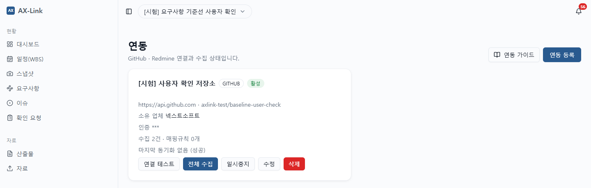
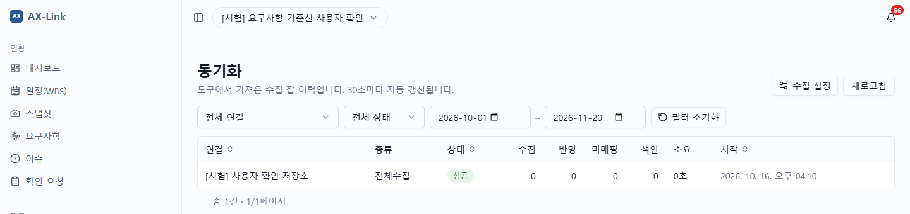
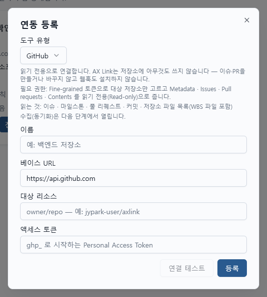

# 도구 연동

용역사가 쓰는 형상관리·이슈 도구(GitHub, Redmine)를 AX Link 사업에 붙이는 기능이다.
도구 쪽에서 준비할 것, 화면에 넣을 값, 붙인 뒤 무엇이 어디에 보이는지, 막혔을 때 확인할 곳을 순서대로 적는다.

| | |
|---|---|
| 화면 | 사업 선택 → **사업 설정 › 도구 연동** → **연동 등록** |
| 하는 사람 | 용역사(자기 업체 연결), 발주기관, 관리자. [권한](#permissions) |
| 먼저 할 것 | 도구 쪽 읽기 전용 토큰·계정 |
| 근거 | SWFR.CON.001~006 · ARC-003(REST 직접 호출) · ARC-007(추적관계 생성 규칙) · ARC-029(연결 소유) |
| 기준 | 2026-10-22 코드(main 9c1d216). Redmine 은 6.1.4 시험 환경에서 확인했다 |

## 1. 공통 원칙 {#principles}

- **읽기만 한다.** AX Link 는 도구의 REST API 에 조회 요청만 보낸다. 이슈를 만들거나 바꾸지 않고 웹훅·플러그인도 설치하지 않는다. 토큰·계정에는 읽기 권한만 준다.
- **주소는 https 로 넣는다.** 베이스 URL 은 `https://` 로 시작해야 한다. 예외는 호스트가 정확히 `localhost`·`127.0.0.1` 인 http 주소뿐이다. 주소에 `계정@` 을 넣을 수 없다. http 로만 열린 Redmine 은 앞에 TLS 를 두어야 한다.
- **사업마다 따로 붙인다.** 연결은 사업 하나에 속한다. 한 사업에는 도구별 연결을 하나씩 두기를 권한다.
- **토큰은 암호화해 둔다.** 등록한 토큰·API 키는 암호화돼 저장되고 화면에는 끝 몇 글자만 보인다.
- **요구사항은 도구에서 만들지 않는다.** 요구사항 목록은 명세서로 등록한다. 이슈는 요구사항 코드를 참조해 추적 링크가 된다. [요구사항 등록](요구사항-등록.md)

## 2. 연결 순서 {#flow}

도구가 달라도 순서는 같다.

1. **등록**: 도구 유형·이름·베이스 URL·대상 리소스·액세스 토큰을 넣는다.
2. **연결 테스트**: 항목마다 실제로 읽어 본다. 읽을 수 있는 항목과 권한이 없는 항목을 따로 알려 준다.
3. **활성화**: 테스트를 통과한 연결만 활성화된다.
4. **전체 수집**: 첫 수집은 처음부터 끝까지 읽는다. **전체 수집** 버튼으로 바로 돌릴 수 있다.
5. **자동 증분**: 그 뒤로는 바뀐 것만 읽는다. 기본 30분마다 돈다.



- 자동 수집 주기는 사업별로 정한다. **동기화 이력** 화면의 설정에서 수동만·15분·30분·1시간·3시간·6시간·12시간·하루 중에 고른다.
- 주소·대상·토큰을 고치면 검증이 무효가 되어 다시 테스트·활성화해야 한다.
- 한 회차가 실패해도 앞서 받은 데이터는 지우지 않는다. 실패한 회차는 동기화 이력에서 다시 시도할 수 있다.



## 3. 권한 {#permissions}

연결은 만든 업체가 소유한다. 한 사업에 용역 업체가 여럿이어도(공동 수급) 다른 업체의 연결 설정은 바꾸지 못한다.

| 할 일 | 발주기관 | 관리자 | 용역 업체 |
|---|---|---|---|
| 연결 목록·수집 결과 보기 | ○ | ○ | ○ (참여한 사업) |
| 연결 만들기 | ○ (소유: 발주기관) | ○ | 참여 업체만 (소유: 자기 업체) |
| 설정 변경·삭제·연결 테스트·상태 변경 | ○ | ○ | 소유 업체만 |
| 연결 소유 업체 바꾸기 | ○ (참여 업체로만) | ○ | × |
| 수집 실행·재시도 | ○ | ○ | ○ |
| 토큰 끝 몇 글자 보기 | ○ | ○ | 소유 업체만 |

- 소유 업체의 참여가 끝나면 연결은 지워지지 않고 "불명확"으로 보인다. 발주기관이 다른 참여 업체로 넘긴다. 넘긴 뒤에는 새 소유 업체가 토큰을 다시 등록하기를 권한다.
- 화면은 권한 없는 단추를 숨길 뿐이다. 검사는 서버가 한다.

## 4. GitHub 연동 {#github}

GitHub.com 과 사내 GitHub Enterprise Server 를 모두 받는다. 저장소 하나가 연결 하나다.

### 4.1 도구 쪽 준비 {#github-prepare}

**읽기 전용 토큰을 만든다.** GitHub → Settings → Developer settings → Personal access tokens. Fine-grained token 을 권한다. 대상 저장소만 고르고 아래 권한을 Read-only 로 준다.

| 권한 | 읽는 것 |
|---|---|
| Metadata | 저장소 정보 (필수, 자동 포함) |
| Issues | 이슈 · 마일스톤 |
| Pull requests | 풀 리퀘스트 |
| Contents | 커밋 · 저장소 파일 목록 · WBS 파일 |

Classic 토큰은 비공개 저장소에 `repo` 범위가 필요한데 쓰기까지 포함하므로 가능하면 Fine-grained 를 쓴다.

### 4.2 저장소 규약 {#conventions}

AX Link 는 이슈·커밋에 적힌 글자에서만 분류와 추적관계를 만든다. 나중에 소급할 수 없다.

- **커밋·PR**: 제목이나 본문에 요구사항 코드를 적는다. 예: `feat(integration): 증분 수집  [SWFR.CON.005]`
- **이슈**: 요구사항 작업 이슈는 제목을 `[SWFR.CON.001] 제목` 꼴로 쓰거나 본문에 코드를 적는다.
- 코드는 [요구사항 등록](요구사항-등록.md#spec-format)한 명세서의 코드와 글자 하나까지 같아야 한다. 점으로 이은 꼴(`SWFR.CON.001`)을 쓴다.
- 다른 이슈를 가리킬 때는 `GH-23`, `RM-204` 처럼 도구 접두를 붙인다. 맨 `#23` 은 어느 도구인지 모른다.
- WBS 항목에 이슈를 걸려면 라벨 `WBS: 3.2` 를 단다. 번호는 WBS 파일의 말단 번호와 같아야 한다.

### 4.3 화면에 넣을 값 {#github-fields}

| 입력칸 | 넣을 값 | 비고 |
|---|---|---|
| 도구 유형 | GitHub | |
| 이름 | 예: 백엔드 저장소 | 화면에 보일 이름 |
| 베이스 URL | `https://api.github.com` | 사내 서버는 `https://<호스트>/api/v3` |
| 대상 리소스 | `owner/repo` | 예: `jypark-user/axlink` |
| 액세스 토큰 | `github_pat_…` 또는 `ghp_…` | 위에서 만든 토큰 |



### 4.4 수집하는 것 {#github-collect}

| 항목 | 증분 기준 | AX Link 에서 |
|---|---|---|
| 이슈 | 갱신 시각 | 일반 이슈 · 담당 · 상태 · WBS 라벨 · 요구사항 코드로 추적관계 |
| 풀 리퀘스트 | 갱신 순, 이전 수집 시각에서 멈춤 | 코드 변경 · 추적관계 재료 |
| 커밋 | 갱신 시각 | 코드 변경 · 요구사항 코드로 추적관계 |
| 마일스톤 | 매번 전체(열림·닫힘) | 원본 보존 · 일반 이슈의 원천 마일스톤 |
| 저장소 파일 목록 | 매번 | 산출물 파일이 저장소에 있는지 판정 |
| WBS 파일 | 내용이 바뀌었을 때 | 기본 경로 `docs/00-management/WBS.xlsx` · 진척률·계획선 |

## 5. Redmine 연동 {#redmine}

Redmine 프로젝트 하나가 연결 하나다.

### 5.1 도구 쪽 준비 (Redmine 관리자) {#redmine-prepare}

1. **REST API 를 켠다.** 관리 → 설정 → API → REST 웹 서비스 사용. 기본값이 꺼짐이라 켜지 않으면 연결 테스트가 실패한다.
2. **수집 전용 역할과 계정을 만든다.** 관리 → 역할 및 권한에서 새 역할(예: 수집 읽기)을 만들고 **일감 보기**만 준다. 일감 가시성은 "모든 일감"으로 둔다. 이 역할로 수집 전용 계정을 대상 프로젝트의 구성원에 넣는다. 사람이 쓰는 계정이나 관리자 계정의 키는 쓰지 않는다.
3. **트래커와 커스텀 필드를 맞춘다.**
   - 리스크를 따로 관리한다면 이름이 `리스크` 인 트래커를 둔다. 이 트래커의 일감은 AX Link 의 리스크로 간다.
   - 요구사항 추적을 하려면 일감 커스텀 필드 `REQ ID`(문자열)를 만들어 모든 트래커에 붙인다. 값에는 요구사항정의서의 코드를 적는다. 예: `SWFR.CON.004`
   - 버전은 마일스톤으로 쓴다(M1~M6 등).
   - 이름이 다르면 그대로 두고 [판별 이름](#mapping-rules)을 바꿔도 된다.
4. **수집 계정의 API 키를 확인한다.** 수집 계정으로 로그인 → 내 계정 → 오른쪽 API 액세스 키 → 보기. 키를 다시 만들면 AX Link 연결이 끊기니 연결 수정에서 새 키를 넣는다.

### 5.2 화면에 넣을 값 {#redmine-fields}

| 입력칸 | 넣을 값 | 비고 |
|---|---|---|
| 도구 유형 | Redmine | |
| 이름 | 예: 사업 관리 Redmine | |
| 베이스 URL | `https://redmine.example.com` | http 는 같은 기계 안 주소만 |
| 대상 리소스 | 프로젝트 식별자 | 프로젝트 설정의 "식별자". 예: `b-project` (이름이 아니다) |
| 액세스 토큰 | 수집 계정 API 키 | 40자리 문자열 |

### 5.3 수집하는 것 {#redmine-collect}

| 항목 | 증분 기준 | AX Link 에서 |
|---|---|---|
| 일감(관계 포함) | 갱신 시각 `updated_on` | 일반 이슈 또는 리스크 · 상태 · 담당 · 우선순위 · REQ ID 추적 · 일감 관계 |
| 버전 | 매번 전체 | 원본 보존만 |
| 트래커 | 매번 전체 | 원본 보존만 |

닫힌 일감도 이력이라 상태와 관계없이 모두 읽는다. 관계를 추가하면 Redmine 이 양쪽 일감의 갱신 시각을 바꾸므로 다음 증분에 잡힌다.

### 5.4 용역사 내부망의 Redmine 에 붙이기 {#redmine-network}

AX Link 서버가 Redmine 에 닿는 길이 있어야 한다. 지금 코드 그대로 쓸 수 있는 방법은 셋이다.

| 방법 | 구성 | 비고 |
|---|---|---|
| 허용 IP 로만 연 https | Redmine 앞에 TLS 리버스 프록시, AX Link 서버 IP 만 허용 | 가장 단순하다 |
| VPN · 전용선 | 발주기관 서버와 용역사 망을 VPN 으로 연결 | 망 연동 승인 필요 |
| 프록시 경유 | AX Link 서버가 정해진 프록시를 거쳐 나감 | 서버 환경변수 `HTTPS_PROXY` |

- 사설 인증서를 쓰면 서버 환경변수 `SSL_CERT_FILE` 에 CA 파일을 준다. 이 값은 기본 인증서 묶음을 대체하므로 GitHub.com 도 함께 읽는다면 공용 CA 와 합친 파일을 준다.
- Redmine 앞에 SSO·기본 인증 같은 별도 인증이 있으면 지금 커넥터는 통과하지 못한다(API 키 헤더 하나만 보낸다).
- 연결 주소에 `localhost` 를 넣으면 AX Link 서버 자신을 가리킨다. 다른 서버·컨테이너의 Redmine 은 그 서버의 https 주소로 넣는다.

## 6. 무엇이 어디로 가나 {#mapping}

도구가 달라도 같은 표준 모델로 옮긴다. 화면과 AI 답변의 숫자는 모두 이 표준 모델에서 센다.

| 원천 | 조건 | AX Link |
|---|---|---|
| GitHub 이슈 | — | 일반 이슈. 제목·본문의 요구사항 코드로 그 요구사항에 추적 링크 |
| GitHub 커밋 · PR | — | 코드 변경. 본문의 요구사항 코드로 추적관계 |
| Redmine 일감 | 트래커 `리스크` | 리스크 |
| Redmine 일감 | 그 밖(작업·결함·지원 …) | 일반 이슈. REQ ID 값으로 추적관계 |

**요구사항은 이슈에서 만들지 않는다.** 요구사항 기준선 기능이 들어간 판(DB V53)부터 새로 만든 연결은 이슈로 요구사항을 만들지 않는다. 그 전에 만든 GitHub 연결은 라벨 `유형: 요구사항` 이나 제목 `[코드] …` 인 이슈로 요구사항을 만들어 왔고, 그 사업이 [요구사항 기준선](요구사항-등록.md#rules)을 확정하면 꺼진다. 이미 만들어진 요구사항은 지우지 않는다.

### Redmine 필드별 지원 범위 {#redmine-fields-support}

| 필드 | 원본 수집 | 표준 모델 | 화면 | 옮기는 방법 |
|---|---|---|---|---|
| 상태 | 됨 | 됨 | 일반 이슈 | 종료 상태면 닫힘. 그 밖에는 이름이 `진행` 이면 진행 중, `해결` 이면 해결, 나머지는 열림 |
| 담당자 | 됨 | 됨 | 일반 이슈 | 이름 그대로. 지우면 다음 증분에서 비워진다 |
| 우선순위 | 됨 | 됨 | 일반 이슈 | 원문 그대로 보존. 일반 이슈의 심각도는 비워 둔다 |
| 리스크 심각도 | 됨 | 대응표 | 지표만 | 낮음·보통·높음·긴급·즉시 → LOW·MEDIUM·HIGH·CRITICAL·CRITICAL |
| REQ ID | 됨 | 추적관계 | 요구사항 | 사업에 있는 요구사항 코드만 잇는다. 값을 지우면 링크가 끊김으로 바뀐다 |
| 일감 관계 | 됨 | 추적관계 | 일부 | 관계를 만든 쪽에서만 링크 하나 |
| 생성·갱신·종료일, 원문 링크 | 됨 | 됨 | 일반 이슈 | 링크는 `베이스 URL/issues/번호` |
| 시작일 · 기한 · 일감의 버전 | 됨 | 안 됨 | 없음 | 원본에만 남는다 |
| 트래커 종류 | 됨 | 리스크 여부만 | 없음 | |
| 댓글 · 첨부파일 | 안 됨 | 안 됨 | 없음 | 목록 API 가 싣지 않는다 |

리스크는 따로 목록 화면이 없다. 사업 목록의 "리스크" 건수와 대시보드 지표로 보인다.

## 7. 판별 이름 바꾸기 {#mapping-rules}

업체마다 라벨·트래커·필드 이름이 다르다. 도구 쪽 이름을 바꾸지 않고 연결별로 AX Link 가 찾을 이름을 바꿀 수 있다.

| 키 | 기본값 | 뜻 |
|---|---|---|
| `requirementLabel` | `유형: 요구사항` | GitHub 에서 이 라벨이 붙은 이슈를 요구사항 이슈로 본다(이슈로 요구사항을 만드는 옛 연결에서만 쓰인다) |
| `riskTracker` | `리스크` | Redmine 에서 이 트래커를 리스크로 본다 |
| `reqIdField` | `REQ ID` | Redmine 에서 요구사항 코드를 담은 커스텀 필드 이름 |

아직 화면이 없어 운영 담당이 API 로 바꾼다. 모르는 키나 빈 값은 거절한다. 바꾼 뒤 다음 수집부터 반영된다. 소유 업체·발주기관·관리자만 바꿀 수 있다.

```
PATCH /api/connections/{연결 ID}/mapping
{ "mappingRules": { "riskTracker": "위험", "reqIdField": "요구사항ID" } }
```

## 8. 오류와 해결 {#errors}

| 화면 문구 | 확인할 것 |
|---|---|
| baseUrl 은 https 로 시작해야 합니다 | http 주소는 같은 기계 주소(localhost·127.0.0.1)만 받는다. 호스트가 정확히 그 이름이어야 한다. Redmine 앞에 TLS 를 두고 https 주소로 등록한다 |
| baseUrl 에 사용자 정보(@)를 넣을 수 없습니다 | 주소에 `계정@` 이나 `계정:비밀번호@` 를 넣었다. 토큰은 액세스 토큰 칸에 넣는다 |
| API 키가 유효하지 않습니다 · 프로젝트를 찾을 수 없거나 API 키에 접근 권한이 없습니다 | Redmine: REST API 켜짐, 키가 현재 키인지, 수집 계정이 그 프로젝트 구성원인지, 대상 리소스가 프로젝트 식별자인지. GitHub: 토큰 만료일과 대상 저장소 |
| 권한 없음: … 이 항목은 수집되지 않습니다 | 저장소·프로젝트는 보이지만 일부 항목을 못 읽는다. GitHub 은 토큰 권한, Redmine 은 수집 역할의 "일감 보기" |
| 인증이 거부되었거나 읽기 권한이 없어 수집하지 못했습니다 | 이슈(일감)를 못 읽었거나 모든 항목이 막혔다. 수집은 실패로 끝나고 앞서 받은 데이터는 그대로 남는다. 키와 프로젝트 권한을 확인하고 연결 테스트를 다시 누른다 |
| 수집은 성공인데 "권한 없어 건너뛴 항목"이 붙어 있다 | 이슈는 받았고 버전·트래커 같은 부가 항목만 못 읽었다. Redmine 은 수집 역할의 "버전 보기" 등을 확인한다 |
| GitHub 레이트리밋에 걸렸습니다 | 토큰당 시간당 요청 수를 넘었다. 한 시간 안에 풀린다. 자동 수집 주기를 늘린다 |
| 숫자가 도구와 다르다 | 마지막 수집 시각을 본다. 한 회차는 항목마다 최대 1,000건(50건 × 20쪽)까지 읽고 넘는 부분은 다음 회차에 읽는다. 바로 맞추려면 **전체 수집**을 누른다 |
| 설정 단추가 보이지 않는다 | 다른 업체가 소유한 연결이다. [권한](#permissions) |
| 커밋에 코드를 적었는데 요구사항에 안 이어진다 | 코드가 확정된 요구사항에 있는지 본다. 기준선 화면 아래 "요구사항 목록에 없는 ID"에 나오면 오타이거나 명세서에 없는 코드다. [요구사항 등록 › 확정한 뒤](요구사항-등록.md#after) |

## 9. 제한 {#limits}

- 한 사업에 Redmine 서버 두 곳을 붙일 때 두 서버의 프로젝트 식별자가 같으면 둘째 연결을 등록할 수 없다. 식별자가 다르면 된다.
- Redmine 시작일·기한·일감 버전은 원본에만 남고 화면에 나오지 않는다. 댓글·첨부는 수집하지 않는다.
- 리스크의 발생확률·영향은 Redmine 에 해당 필드가 없어 "중간"으로 채운다. 원천 값이 아니다.
- GitHub 에서는 리스크를 받지 않는다. 리스크는 Redmine 리스크 트래커로만 들어온다.
- 판별 이름은 API 로만 바꿀 수 있다.
- GitLab · Jira 는 이번 범위에 없다. 새 도구는 어댑터를 하나 더해 붙이는 구조다.
- 2026-10-14 전에 수집한 Redmine 연결은 그때 있던 수집 결함(일감이 버전·트래커에 덮어써짐 등)이 남았을 수 있다. **전체 수집**을 한 번 돌려 다시 받는다.

## 10. 관련 문서 {#related}

- [요구사항 등록](요구사항-등록.md): 요구사항 목록을 명세서로 만드는 방법, 커밋·이슈의 코드가 이어지는 조건
- [사용 설명서 목차](사용-설명서.md)
