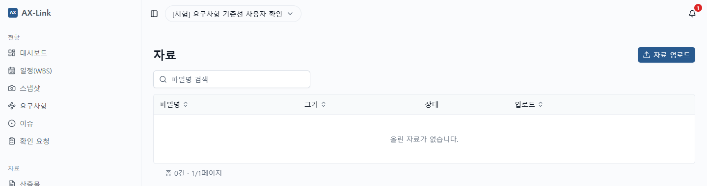
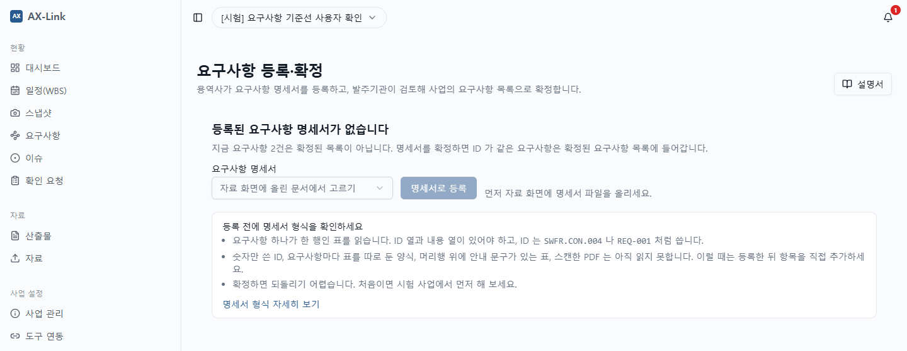
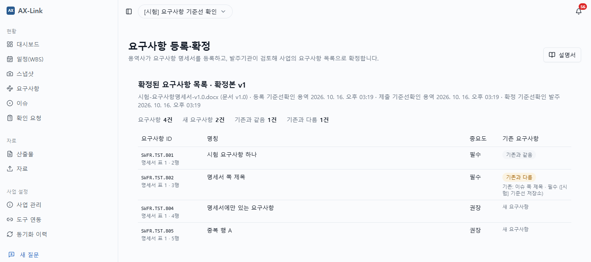
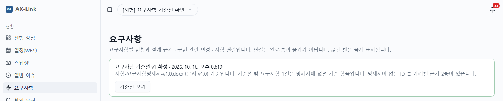
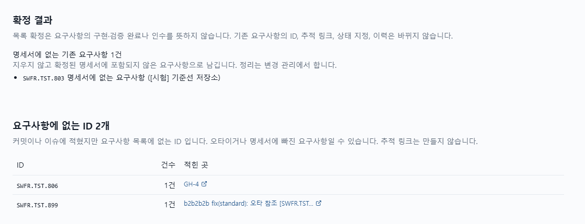

# 요구사항 등록

용역사가 요구사항 명세서를 등록하고, 발주기관이 검토해 사업의 요구사항 목록으로 확정한다.
확정된 요구사항 목록이 요구사항 화면·이행률·추적표·AI 답변의 기준이 된다.

목록을 확정한다는 것은 "이 사업의 요구사항은 이것이다"를 정하는 것이다. 요구사항의 구현 완료·검증 완료·인수를 뜻하지 않는다. 구현과 검증 상태는 확정한 뒤 요구사항마다 따로 쌓인다.

| | |
|---|---|
| 화면 | 사업 선택 → **요구사항** → 위쪽 띠의 **요구사항 등록·확정** |
| 하는 사람 | 등록·정리·제출: 용역사 · 확정·돌려보내기: 발주기관 · 플랫폼 관리자는 보기만 한다 |
| 먼저 할 것 | 명세서 파일을 **자료** 화면에 올린다 |
| 근거 | SWFR.PIP.002 · SWFR.PIP.003 · ARC-028 · ARC-030 · ARC-032 |
| 기준 | 2026-11-16 |

## 1. 흐름 {#flow}

| 단계 | 누가 | 화면에서 | 상태 |
|---|---|---|---|
| 1. 명세서 올리기 | 용역사 | **자료** 화면에 파일을 올리고 처리가 끝나기를 기다린다 | |
| 2. 명세서로 등록 | 용역사 | 요구사항 등록·확정 화면에서 문서를 고르고 **명세서로 등록** | 용역사 정리 중 |
| 3. 항목 정리 | 용역사 | 명세서에서 뽑은 확정 전 요구사항 목록을 보고 고치기·항목 추가·지우기. 잘못 고른 파일이면 **등록 취소** | 용역사 정리 중 |
| 4. 제출 | 용역사 | **제출** | 발주기관 확정 대기 |
| 5. 확정 또는 돌려보내기 | 발주기관 | **확정**, 또는 사유를 적어 **돌려보내기** | 확정 / 용역사 정리 중 |

- 돌려보내면 용역사 화면 위에 사유가 보인다. 고쳐서 다시 제출한다.
- 발주기관은 용역사가 정리 중인 목록을 보지 못한다. 제출된 것부터 본다.
- 확정 전 요구사항 목록은 요구사항 화면과 지표에 나오지 않는다. 요구사항 화면에는 확정된 요구사항 목록(확정 전이면 그 전부터 있던 요구사항)이 보인다.

## 2. 동작 규칙 {#rules}

**R1. 확정 전에는 요구사항이 생기지 않는다.** 등록·정리·제출은 확정 전 요구사항 목록 안에서만 일어난다. 요구사항 목록·이행률·추적표는 확정된 것만 센다.

**R2. 기존 요구사항은 ID 로 이어 붙인다.** 확정할 때 명세서의 ID 가 이미 사업에 있으면 그 요구사항을 확정된 목록에 넣고 추적 링크·상태 지정·이력을 그대로 둔다. 없는 ID 만 새 요구사항이 된다.

**R3. 내용이 다르면 기존 내용을 둔다.** ID 는 같은데 명칭·중요도가 다르면 "기존과 다름"으로 보인다. 발주기관이 확정 창에서 고른 것만 명세서 내용으로 바뀌고 이력이 남는다.

**R4. 명세서에 없는 기존 요구사항은 지우지 않는다.** "확정된 명세서에 포함되지 않은 요구사항"으로 남기고 확정 결과에 목록을 보인다. 정리는 변경 관리에서 한다.

**R5. 확정은 한꺼번에 된다.** 중간에 하나라도 실패하면 아무것도 바뀌지 않는다.

**R6. 지금은 첫 확정본(v1)만 만든다.** 확정한 뒤에는 새 명세서를 등록할 수 없다. 확정 뒤의 변경 절차는 아직 없다.

## 3. 명세서 형식 {#spec-format}

명세서는 정해진 규칙으로 읽는다. 문서에 적힌 글자만 옮기고, 규칙에 맞지 않는 형식은 읽지 못한다.

### 3.1 읽는 형식 {#spec-format-supported}

**표.** 한 행에 요구사항 하나가 있는 표를 읽는다.

| 열 | 머리행에 이런 말이 있으면 | 없으면 |
|---|---|---|
| 요구사항 ID | ID · 코드 · 번호 · 식별 | 첫 열 값이 ID 형식이면 그 열 |
| 명칭 | 요구사항 · 명칭 · ~명 · 제목 · 이름 · 내용 · 기능 | 표로 보지 않는다 |
| 설명 | 설명 · 내용 · 상세 (명칭 열과 따로 있을 때) | 명칭을 설명으로 쓴다 |
| 중요도 | 중요도 · 우선순위 · 필수 | 권장 |

- 머리행 없이 첫 열이 ID, 둘째 열이 글인 표도 읽는다.
- 문서에 요구사항 표가 하나라도 있으면 표만 읽는다. 표를 설명하는 문장은 요구사항으로 읽지 않는다.

**줄.** 표가 없으면 `FR-01 로그인` 처럼 ID 로 시작하는 줄을 요구사항으로 읽는다. 다음 줄부터 빈 줄이나 다음 ID 전까지가 설명이다.

**ID 형식.** 영문 대문자 묶음과 숫자를 점이나 하이픈으로 이은 것이다.

| 읽는다 | 읽지 않는다 |
|---|---|
| `SWFR.CON.004` · `REQ-001` · `FR-01` · `SFR-001` | `REQ-FUN-CON-001`(세 토막 이상) · `req-001`(소문자) · `기능-001`(한글) · `12`(숫자만) |

- 커밋·이슈와 이으려면 점으로 이은 형식(`SWFR.CON.004`)을 쓴다. 하이픈 형식은 등록은 되지만 "추적에 쓸 수 없는 ID 형식" 경고가 붙는다. [도구 연동 › 저장소 규약](도구-연동-가이드.md#conventions)

**중요도 표기.**

| 명세서 표기 | AX Link |
|---|---|
| 필수 · 상 · 높음 · high · must | 필수 |
| 권장 · 중 · 보통 · 중요 · medium · should | 권장 |
| 선택 · 하 · 낮음 · low · could | 선택 |
| 제외 · 미채택 · 보류 · won't | 제외 |
| 그 밖, 빈칸 | 권장 |

**길이.** 명칭은 100자에서 자르고 끝에 …을 붙인다. 원문 전체는 설명에 남는다. 설명은 2,000자까지 받는다.

**파일.** 자료 화면이 받는 HWP · HWPX · DOCX · XLSX · PPTX · PDF · MD · TXT, 50MB까지.

### 3.2 상위 요구사항 {#parents}

명세서가 절 제목에 상위 요구사항 ID 를 두고 그 아래 표에 하위 요구사항을 적으면(IM-001 의 `SFR.CON.001` 아래 `SWFR.CON.001`), 표 밖의 그 줄을 상위 요구사항으로 따로 읽는다.

- 상위 요구사항은 요구사항 목록에 넣지 않는다. 넣으면 이행률 분모가 바뀐다.
- 하위 항목은 설명이나 명칭에 상위 ID 가 적혀 있을 때만 그 상위에 묶는다.
- 커밋·이슈에 상위 ID 를 적으면 요구사항 등록·확정 화면의 "상위 요구사항 ID" 목록에 따로 나온다. 문제는 아니고, 추적 링크는 만들지 않는다.
- 상위 ID 도 점으로 이은 형식(`SFR.CON.001`)만 읽는다. 문서번호(`IM-001`)를 상위로 잘못 읽지 않게 하기 위해서다. `SFR-001` 처럼 하이픈으로 쓴 상위는 아직 읽지 못한다.

### 3.3 아직 읽지 못하는 형식 {#spec-format-unsupported}

아래 형식은 0건이 나오거나 일부만 나온다. 요구사항 등록·확정 화면에서 **항목 추가**로 직접 넣는다.

| 형식 | 예 | 상태 |
|---|---|---|
| 발주기관 예시 양식(정부과제 품질관리 IM-001 sample) | 머리행 위 안내 행, 머리 칸 안 줄바꿈, 시스템·SW 요구사항 ID 열 두 개 | 개선 예정 |
| 카드형(요구사항 하나에 세로 표 하나) | 고유번호 · 명칭 · 정의 · 세부내용 칸 | 개선 예정 |
| 숫자만 쓴 ID | `1`, `2`, `3.1.2` | 개선 예정. 사업 접두어로 코드를 만들고 원래 번호를 남기는 방식 |
| 영문 머리행 | `No` · `Title` · `Description` | 개선 예정 |
| 스캔한 PDF | 글자가 그림인 문서 | 지원하지 않음(OCR 없음) |
| 괘선 없는 PDF 표 | | 표로 인식하지 못함 |
| 서술형 문서 | 문단 속 "~해야 한다" 문장 | 지원하지 않음 |

## 4. 정리할 때 보이는 표시 {#problems}

| 표시 | 뜻 | 제출 |
|---|---|---|
| 코드 중복 | 같은 ID 가 두 번 이상 나왔다 | 막힘 |
| 코드 형식 아님 | ID 칸이 비었거나 ID 형식이 아니다 | 막힘 |
| 명칭 없음 | 명칭이 비었다 | 막힘 |
| 추적에 쓸 수 없는 ID 형식 | 등록은 되지만 추적 링크가 생기지 않는다 | 됨(경고) |
| 기존과 같음 · 기존과 다름 · 새 요구사항 | 사업에 이미 있는 요구사항과의 대조 | — |
| 고침 · 직접 추가 | 사람이 고친 항목, 손으로 더한 항목. 명세서에서 읽은 원래 값은 따로 보관된다 | — |

## 5. 확정한 뒤 {#after}

- 요구사항 화면 위에 "확정된 요구사항 목록 · 확정본 v1" 띠가 보이고, 요구사항 목록이 확정본을 따른다.
- 커밋·이슈에 요구사항 ID 를 적으면 추적 링크로 이어진다. 확정할 때 한 번 다시 잇는다.
- 요구사항 등록·확정 화면 아래에 두 목록이 있다.
  - **요구사항에 없는 ID**: 커밋이나 이슈에 적혔지만 요구사항 목록에 없는 ID. 오타이거나 명세서에 빠진 요구사항일 수 있다.
  - **상위 요구사항 ID**: 커밋이나 이슈에 상위 요구사항 ID 를 적은 경우. 문제는 아니며 접어 둔다.

## 6. 주의 {#cautions}

- **확정은 되돌리기 어렵다.** 확정하면 요구사항이 만들어지고, 그 뒤에는 변경 관리로만 바꾼다. 확정은 목록을 정하는 것이며 구현·검증 완료나 인수가 아니다. 제출 전에 명세서의 요구사항이 빠짐없이 나왔는지, 중요도가 맞는지 본다.
- **실제 사업에 바로 하지 않는다.** 처음이면 시험 사업에서 등록부터 확정까지 한 번 해 본다.
- **명세서 형식을 먼저 본다.** [3.3](#spec-format-unsupported)에 해당하면 추출이 비거나 모자란다. 그때는 항목을 직접 넣거나 표 형식으로 고친 파일을 올린다.
- **ID 를 커밋 규약과 맞춘다.** 명세서의 ID 와 커밋·이슈에 적는 ID 가 글자 하나까지 같아야 이어진다.

## 7. 오류와 해결 {#errors}

| 화면 문구 | 원인 | 할 일 |
|---|---|---|
| 먼저 자료 화면에 명세서 파일을 올리세요 | 고를 수 있는 문서가 없다(처리 중이거나 실패) | 자료 화면에서 처리 상태를 본다 |
| 문서에서 글을 아직 읽지 못했습니다 | 글 추출이 끝나지 않았다 | 처리가 끝난 뒤 다시 등록한다 |
| 명세서에서 요구사항을 찾지 못했습니다 | 읽는 형식이 아니다 | [명세서 형식](#spec-format)을 보고 항목을 직접 넣거나 다른 파일을 올린다 |
| 고쳐야 할 항목이 n건 있습니다 · 고쳐야 제출할 수 있는 항목이 n건 있습니다 | ID 중복·형식, 명칭 없음 | 빨간 표시가 있는 항목을 고치거나 지운다 |
| 정리 중이거나 확정을 기다리는 요구사항 명세서가 있습니다 | 이미 진행 중인 명세서 등록이 있다 | 그 등록을 마저 하거나 등록 취소한다 |
| 요구사항 목록이 이미 확정됐습니다 | 첫 확정본만 만들 수 있다(R6) | 변경 관리로 처리한다 |
| 요구사항 명세서 등록은 용역사가 합니다 | 발주기관 계정으로 등록하려 했다 | 용역사 계정으로 한다 |
| 용역사가 제출하면 볼 수 있습니다 | 발주기관이 정리 중인 목록을 열었다 | 제출을 기다린다 |
| 내용이 다른 기존 요구사항만 명세서 내용으로 바꿀 수 있습니다 | 같거나 새 요구사항을 바꾸겠다고 골랐다 | 확정 창에서 "기존과 다름" 항목만 고른다 |

## 8. 관련 문서 {#related}

- [도구 연동](도구-연동-가이드.md): 커밋·이슈에 요구사항 ID 를 적는 규약
- [사용자 매뉴얼 목차](사용-설명서.md)
