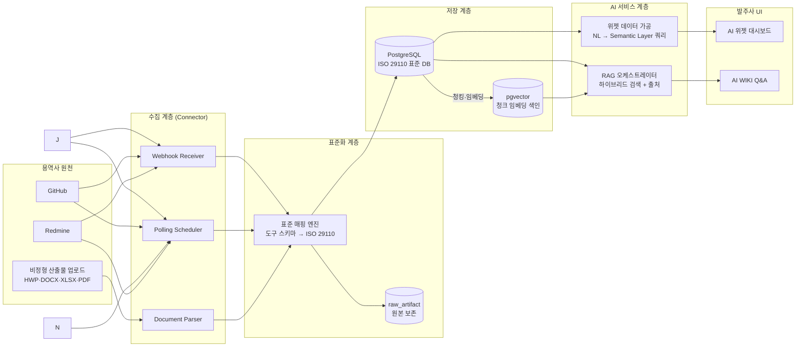
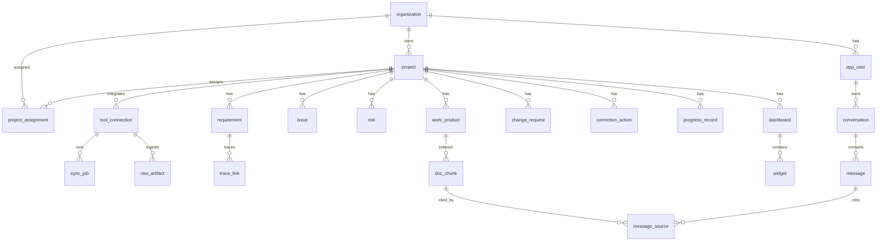

# AX-Link 시스템 기획서 · 개발 명세서 (PRD)

| 항목 | 내용 |
| --- | --- |
| 문서 버전 | v1.0 (2026-08-20) |
| 제품명 | AX-Link — 발주사 중심 AI 기반 WIKI & PMS |
| 표준 준거 | ISO/IEC 29110-5-1-2 Basic Profile (VSE 사업관리 PM · 소프트웨어 구현 SI) |
| 참조 프로젝트 | `ax-pms` — **표준 모델·화면기획·코드 컨벤션·라이브러리 선택만 준용. 코드 포크 금지** |
| UI 컴포넌트 | **shadcn/ui 필수** — 모든 컴포넌트는 shadcn/ui 또는 그 프리미티브 조합으로만 구현 |

---

## 1. 프로젝트 개요 (Executive Summary)

### 1.1 추진 배경

발주사(시행사)는 다수의 용역사가 각기 다른 형상관리·프로젝트 관리 도구(GitHub, Redmine)와
비정형 산출물(HWP·DOCX·XLSX·PDF)로 프로젝트를 수행하는 환경에서 다음 문제를 겪는다.

- **가시성 부재**: 진척·이슈·리스크가 용역사별 도구에 흩어져 있어 발주사가 실시간 현황을 볼 수 없다.
- **수작업 취합**: 주간보고·검수 시점마다 용역사가 수기로 취합한 보고서에 의존한다. 데이터 신선도와 정합성이 보장되지 않는다.
- **표준 부재**: 도구마다 이슈·요구사항·산출물의 스키마가 달라 프로젝트 간 비교와 품질 판정 기준이 없다.
- **검증 공수**: 요구사항 이행 여부, 산출물 완결성 확인이 문서 대조 수작업이다.

### 1.2 목적

용역사의 도구·문서 데이터를 **자동 수집**하고 **ISO/IEC 29110-5-1-2 Basic Profile 표준 데이터
모델로 통합·색인**하여, 발주사가 다음 두 인터페이스로 소비하게 한다.

1. **동적 AI 인포그래픽 대시보드** — 위젯 템플릿 + 자연어 프롬프트로 발주사가 직접 위젯을 생성하는 드래그&드롭 대시보드
2. **RAG 기반 AI WIKI Q&A** — 통합 데이터 전체를 근거로 자연어 질의응답(출처 링킹 포함)하는 Gemini 스타일 대화 UI

### 1.3 기대 효과

| 관점 | 효과 | 측정 지표(예) |
| --- | --- | --- |
| 발주사 관리 공수 | 주간보고 취합·현황 파악 수작업 제거 | 보고 취합 시간 70% 절감 |
| 투명성 | 도구 원천 데이터 기반 실시간 현황 → 보고 왜곡 차단 | 데이터 신선도 ≤ 5분 (Webhook 기준) |
| 품질 | ISO 29110 산출물 22종 완결성 자동 점검 | 필수 산출물 누락 0건으로 검수 진입 |
| 요구사항 관리 | 요구사항↔산출물↔시험 추적성 자동화 | 이행률·추적률 상시 조회 |
| 리스크 | 지연·미결 조치의 조기 감지 | 리스크 감지 리드타임 단축 |

### 1.4 범위

- **In**: 프로젝트/계정/권한 관리, 2종 도구 연동(형상관리 GitHub · 프로젝트 관리 Redmine), 비정형 문서 파싱, ISO 29110 표준 통합 DB, 벡터 색인, AI 위젯 대시보드, RAG Q&A
- **Out (1차 릴리스 제외)**: 도구 방향으로의 역동기화(쓰기), 결재/전자서명, 모바일 전용 앱, **Jira·GitLab·Notion 을 포함한 2종 외 도구**(커넥터 인터페이스만 확장 가능하게 설계)

### 1.5 용어

| 용어 | 정의 |
| --- | --- |
| 발주사 (Client) | 프로젝트를 발주·검수하는 시행사. ISO 29110의 **Customer** 역할 |
| 용역사 (Contractor) | 프로젝트를 수행하는 개발사. ISO 29110의 **Work Team / Technical Leader** 역할 |
| 표준 데이터 모델 | ISO/IEC 29110-5-1-2 Basic Profile의 PM(4활동)·SI(6활동)·산출물 22종 기반 통합 스키마 |
| 커넥터 (Connector) | 외부 도구의 API/Webhook을 표준 모델로 변환·적재하는 수집 모듈 |
| 위젯 (Widget) | 대시보드에 배치되는 단위 시각화. 템플릿(모양) + 데이터 스펙(내용)의 조합 |

---

## 2. 시스템 아키텍처 및 데이터 흐름

### 2.1 기술 스택 (ax-pms 준용)

| 계층 | 선택 | 근거 |
| --- | --- | --- |
| Frontend | React 19 + Vite + TypeScript, Tailwind CSS v4, **shadcn/ui**(radix), react-router | ax-pms와 같은 라이브러리 조합이되 **신규 스캐폴딩**(코드 포크 금지). 코드 스타일은 ax-pms CLAUDE.md 준용. 모든 컴포넌트는 shadcn/ui 필수 |
| 대시보드 그리드 | **react-grid-layout v2** | ax-pms에 이미 도입. 하드코딩 금지 요건 충족 |
| 차트 | **recharts** | ax-pms 도입. shadcn/ui Charts가 recharts 기반 |
| Backend | Spring Boot (Java, Gradle), 패키지 `kr.co.axlink.<도메인>`, DTO는 record | ax-pms 백엔드 컨벤션 준용 |
| DB | **PostgreSQL 16 + pgvector** | 표준 RDB와 벡터 색인을 단일 DB로 운영. 별도 Vector DB 도입은 규모가 요구할 때로 유보 |
| 검색 | PostgreSQL FTS + pgvector 하이브리드 | 별도 검색엔진(Elasticsearch) 없이 시작 |
| 큐/스케줄러 | Spring @Scheduled + DB 잡 테이블 | 1차는 단일 인스턴스. 처리량 증가 시 Redis 큐로 승격 |
| LLM | **Ollama** 단일 게이트웨이(`http://localhost:11434`), 용도별 2개 모델 — 비정형 문서 정형화: **`deepseek-v4-pro:cloud`** / 답변 합성·질의 라우팅·위젯 스펙 생성: **`glm-5.2:cloud`** | 로컬·클라우드 모델을 한 API로 다룬다. Java 측은 SDK 없이 JDK 내장 `java.net.http.HttpClient` + Jackson으로 호출(의존성 추가 없음). **구조화 출력은 `format` 파라미터가 아니라 tool calling으로 얻는다** — §2.5 검증 결과 참조 |
| Embedding | **`bge-m3` (Ollama 로컬 실행, 1024차원)** | 한국어·다국어 강함. 차원이 `vector(1024)`와 정확히 일치. 완전 로컬이라 색인 비용·레이트리밋·유출 위험 없음 |
| 문서 파싱 | PDF/DOCX/XLSX: Apache Tika 계열, HWP/HWPX: hwplib | 국내 산출물 필수 포맷 |

### 2.2 아키텍처 다이어그램



### 2.3 데이터 파이프라인 5단계

| 단계 | 처리 | 상세 |
| --- | --- | --- |
| ① 수집 | Webhook(실시간) + Polling(백필) + 파일 업로드 | 도구별 이벤트를 `sync_job`으로 적재. Webhook 유실 대비 주기 Polling이 증분 동기화(updated_since)로 보정 |
| ② 정규화 | 표준 매핑 엔진 | 도구 스키마 → ISO 29110 엔티티 변환(§4.2 매핑 테이블). 원본 JSON은 `raw_artifact`에 무손실 보존 |
| ③ 저장 | 표준 DB 적재 | upsert 기준: `(tool_connection_id, external_id)`. 상태 전이 이력은 `entity_history`에 append |
| ④ 색인 | 청킹 → 임베딩 → pgvector | 문서: 표제 계층 기반 500~1,000 토큰 청크(오버랩 15%). 이슈·요구사항: 제목+본문+메타를 1청크. 청크마다 `project_id`, 출처 URI, ISO 활동 태그 부착 |
| ⑤ 소비 | 위젯 가공 / RAG 응답 | 위젯: 표준 DB에 대한 집계 쿼리. Q&A: 하이브리드 검색 → LLM 합성 → 출처 반환 |

### 2.4 도구별 동기화 정책

| 도구 | 실시간 | 백필 주기 | 인증 |
| --- | --- | --- | --- |
| GitHub | Webhook (issues, pull_request, push, release) | 1시간 (`since=` / `updated` 정렬) | Personal Access Token (fine-grained) |
| Redmine | Webhook 플러그인 有 시 사용, 기본 Polling | 1시간 (`updated_on >=`) | API Key |
| 파일 업로드 | 업로드 즉시 파싱 | — | 세션 인증 |

인증정보(토큰)는 AES-256-GCM 애플리케이션 레벨 암호화로 저장하고, 조회 API는 마스킹된 값만 반환한다.

### 2.5 AI 런타임 검증 결과 (2026-08-20 실측)

설계 이전에 실제 환경에서 확인한 사실이며, 아래 결론은 구현이 반드시 따라야 하는 제약이다.

| 확인 항목 | 결과 | 설계 반영 |
| --- | --- | --- |
| pgvector | 0.8.0 설치·동작 확인 (`vector(3)` 생성, `<=>` 코사인 연산자) | `doc_chunk.embedding`을 `vector(1024)` + HNSW(`vector_cosine_ops`)로 확정 |
| `bge-m3` 임베딩 | Ollama 로컬 실행, **1024차원** 반환 확인 | 스키마 차원과 일치. 별도 차원 변환 불필요 |
| `glm-5.2:cloud` 응답 | 정상 (인증 완료 상태, 추가 키 불필요) | 합성·라우팅·위젯 스펙에 사용 |
| `deepseek-v4-pro:cloud` 응답 | 정상 (`:cloud` 태그로만 접근 가능. `:0813` 등 날짜 태그는 pull 실패) | 문서 정형화에 사용. 모델 ID는 `deepseek-v4-pro:cloud`로 고정 |
| `format` = JSON Schema | **무시됨** — 마크다운 펜스로 감싼 임의 필드명 JSON 반환 | 구조화 출력에 `format`을 쓰지 않는다 |
| `format` = `"json"` | **무시됨** — 동일 증상 | 위와 같음 |
| tool calling (glm-5.2) | **정상** — enum 제약값을 정확히 준수한 `tool_calls` 반환 | **위젯 스펙 생성은 tool calling으로 구현한다** |
| tool calling (deepseek-v4-pro) | **정상** — 국문 요구사항정의서 샘플에서 산출물 유형(`REQUIREMENTS_SPEC`), 제목·버전 분리, 요구사항 3건 추출 및 우선순위 매핑(필수→MUST, 선택→COULD) 전부 정확 | **문서 정형화는 tool calling으로 구현한다** |

모델 응답은 신뢰 경계 밖이다. tool calling이 정상 동작하더라도 서버는 measure·dimension·filter를
카탈로그 화이트리스트로 반드시 재검증한 뒤에만 쿼리를 조립하고(§4.3.3), 정형화 결과의 산출물 유형도
22종 enum 밖이면 거부한다(§4.2 INT-006).

---

## 3. 권한 및 역할 정의서 (RBAC)

### 3.1 역할 체계

| 역할 | 소속 | ISO 29110 대응 | 요약 |
| --- | --- | --- | --- |
| **SUPER_ADMIN** | 플랫폼 운영 | — | 조직(발주사·용역사)·계정·Role 부여. 데이터 열람은 감사 목적 한정 |
| **CLIENT** (발주사) | 발주사 조직 | Customer | 프로젝트 생성·용역사 할당, 대시보드·Q&A 소비, PM 프로세스(점검·검수) 주체 |
| **CONTRACTOR** (용역사) | 용역사 조직 | Work Team | 할당된 프로젝트의 사업 정보 조회 + 형상관리도구 연동 등록·연결 상태 확인. **AI Q&A 등 LLM 기능은 사용하지 않는다** |

권한 판정은 `역할 × 프로젝트 할당` 2단계다. CONTRACTOR는 `project_assignment`에 등록된
프로젝트만 접근할 수 있고, CLIENT는 자사 조직이 소유한 프로젝트만 접근한다.

### 3.2 권한 매트릭스

| 기능 | SUPER_ADMIN | CLIENT | CONTRACTOR |
| --- | :-: | :-: | :-: |
| 조직(발주사·용역사) 등록·관리 | ✅ | — | — |
| 계정 생성 및 Role 부여 | ✅ | — | — |
| 프로젝트 생성·수정·종료 | — | ✅ | — |
| 프로젝트별 용역사 계정 할당·해제 | — | ✅ | — |
| 프로젝트별 용역사 권한 제어(연동/업로드 허용 범위) | — | ✅ | — |
| 사업 정보(프로젝트 개요) 조회 | ✅ | ✅ | ✅ (할당 프로젝트) |
| 도구 연동 등록·수정·삭제 (GitHub·Redmine) | — | 조회만 | ✅ (할당 프로젝트) |
| 비정형 산출물 업로드 | — | ✅ | — |
| 동기화 상태·로그 조회 | ✅ | ✅ | ✅ (자사 연동분) |
| 통합 대시보드 조회 | — | ✅ | — |
| 위젯 생성·편집·삭제, 레이아웃 편집 | — | ✅ | — |
| AI Q&A 사용 | — | ✅ | — (LLM 미사용) |
| 산출물 22종 점검표·요구사항 추적 조회 | — | ✅ | — |
| 검수확인(Acceptance Record) 처리 | — | ✅ | — |
| 감사 로그 조회 | ✅ | 자사 프로젝트 한정 | — |

AI Q&A와 대시보드 쿼리는 **항상 요청자의 프로젝트 접근 범위로 필터**되어 실행된다
(검색·집계 시 `project_id IN (허용 목록)` 강제 주입 — LLM 프롬프트가 아니라 쿼리 레이어에서 강제).

CONTRACTOR에게 닫힌 경로는 `SecurityConfig.EXCEPT_CONTRACTOR` 한 곳에 모아 두었고,
화면 쪽 대응물은 `routes.tsx` · `app-sidebar.tsx` 의 같은 이름 상수다. 정책을 바꿀 때 이 세 곳을 함께 고친다.

---

## 4. 상세 기능 명세

기능 ID 체계: `ADM`(관리) · `PRJ`(프로젝트) · `INT`(연동) · `DSH`(대시보드) · `QNA`(Q&A) · `SCH`(일정) · `STD`(상시 모니터링).

### 4.0 정보 구조 — 좌측 메뉴

**AX-Link의 사용자는 프로젝트·개발 전문 지식이 없는 발주사 직원이다.** 이들이 하는 일은
진행 상황(일정·이슈·위험) 모니터링 한 가지이고, 용역사가 산출물을 제출하는 기능은 이 제품에 없다.

ISO/IEC 29110은 **데이터 모델의 근거**이지 **메뉴 구성의 근거가 아니다.** 메뉴는 표준 목차(PM 4활동 /
SI 6활동)가 아니라 발주사 직원이 던지는 질문 순서로 배열한다. `사업 관리 PM` · `구현 현황 SI` 같은
표준 용어 그룹 라벨은 쓰지 않는다.

```
현황
  진행 상황      "지금 괜찮은가"        기본 진입
  일정           "언제 끝나나"          간트 · 칸반 · 캘린더 · 표
  이슈 · 위험     "뭐가 막혀 있나"       issue + risk + correction_action
  요구사항       "요청한 게 반영됐나"    requirement + trace_link + change_request
자료
  산출물         "받기로 한 문서가 왔나"  22종 × 실물 파일 접근
  자료           "근거 원본은"           문서 업로드 · 파싱
질문
  새 질문 / 질문 목록
─────────────────────────────
⚙ 사업 설정      사업 정보 · 용역사 할당 · 도구 연동 · 동기화 이력 · 검수 · 종료
```

**설계 규칙**

1. **상시 메뉴는 모니터링 화면만 둔다.** 연 1~2회 하는 행정 작업(용역사 할당·검수·종료)과
   운영 진단 화면(도구 연동·동기화 이력)은 `사업 설정` 하위로 내린다.
2. **데이터 없는 메뉴는 만들지 않는다.** 화면을 추가하기 전에 그것을 채울 테이블과 수집 경로가
   먼저 있어야 한다. `시험` 메뉴는 `test_case`/`test_result` 테이블이 없어 폐기하고,
   요구사항 status `verified`로 대체한다.
3. **한 개념은 한 메뉴.** Change Request와 Correction Register를 별도 메뉴로 쪼개지 않는다.
   CR은 "요청의 변경"이므로 `요구사항`으로, CA는 "미결 조치"이므로 `이슈 · 위험`으로 흡수한다.
4. **라벨은 발주사 어휘로 쓴다.** `요구사항 추적`(개발 용어) → `요구사항`,
   `자료 수집 현황`/`동기화 이력` → 설정 하위 `도구 연동`.

**용역사 메뉴** — 용역사가 이 제품에서 하는 일은 도구 연동 등록 1회뿐이다. 프로젝트 메뉴를 두지 않고
`연동 설정` 단일 화면만 노출한다.

`SecurityConfig.EXCEPT_CONTRACTOR` · `routes.tsx` · `app-sidebar.tsx` 세 곳을 함께 고친다(§3.2).


### 4.1 프로젝트 관리

| ID | 기능 | 명세 |
| --- | --- | --- |
| ADM-001 | 조직 관리 | SUPER_ADMIN이 발주사·용역사 조직 등록. 필드: 조직명, 유형(CLIENT/CONTRACTOR), 사업자번호(선택) |
| ADM-002 | 계정·Role 부여 | SUPER_ADMIN이 조직에 계정 생성, 역할 부여. **초대 링크를 화면에서 복사해 전달**하고 수신자가 최초 비밀번호를 설정한다. **메일 자동 발송은 범위 밖**(2026-08-21 확정) |
| PRJ-001 | 프로젝트 생성 | CLIENT 전용. **필수 필드: 프로젝트명, 착수일, 마감일, 프로젝트 설명.** 착수일 ≤ 마감일 검증. 기간은 항상 시작·종료 한 쌍(열린 기간 표기 금지 — ax-pms 규칙 준용) |
| PRJ-002 | 프로젝트 목록·상세 | 카드형 목록(ax-pms `ProjectCard` 패턴): 현재 SI 단계, 필수 산출물 승인 n/m건, 열린 조치 건수 표시 |
| PRJ-003 | 용역사 할당 | CLIENT가 프로젝트에 용역사 조직·계정을 할당/해제. 할당 시 CONTRACTOR에게 해당 프로젝트가 노출됨 |
| PRJ-004 | 용역사 권한 제어 | 할당 단위로 허용 범위 토글: 도구 연동 설정, 문서 업로드, 대시보드 읽기 |
| PRJ-005 | 프로젝트 종료 | PM.4 검수확인서(Acceptance Record) 등록 완료 시에만 종료 가능 |

**API 초안**

```
POST   /api/projects                        {name, startDate, endDate, description}
GET    /api/projects?scope=mine
POST   /api/projects/{id}/assignments        {contractorOrgId, userIds[], permissions{}}
DELETE /api/projects/{id}/assignments/{assignmentId}
POST   /api/projects/{id}/close              (검수확인서 존재 검증)
```

### 4.2 도구 연동 관리

| ID | 기능 | 명세 |
| --- | --- | --- |
| INT-001 | 연동 등록 | CONTRACTOR가 할당 프로젝트에 도구별 연결 생성. 공통 필드: 도구 유형, 베이스 URL, 인증정보, 대상 리소스(GitHub `owner/repo` / Redmine 프로젝트 식별자) |
| INT-002 | 연결 테스트 | 저장 전 인증·대상 리소스 접근 검증. 실패 시 도구 API의 오류 원인을 그대로 표시 |
| INT-003 | Webhook 발급 | GitHub·Redmine용 수신 URL + 서명 시크릿 자동 생성. 설정 방법은 도구별 설정 화면 경로로 표기 |
| INT-004 | 동기화 상태 | 연결별 최근 동기화 시각, 적재 건수, 실패 잡 목록(재시도 버튼). ax-pms `collection` 화면 패턴 준용 |
| INT-005 | 초기 백필 | 연결 생성 직후 전체 이력 1회 수집(페이지네이션·rate limit 준수, 지수 백오프) |
| INT-006 | 문서 업로드·정형화 | HWP·HWPX·DOCX·XLSX·PDF 업로드 → 텍스트 파싱 → **`deepseek-v4-pro:cloud`가 tool calling으로 ISO 29110 표준 구조로 정형화**(산출물 유형 22종 분류, 제목·버전·작성일 추출, 요구사항 항목 추출과 우선순위 매핑) → 사용자 확정 → 표준 DB 적재 및 색인. 모델이 22종 enum 밖 유형을 반환하면 서버가 거부하고 수동 지정으로 넘긴다 |

**도구 → ISO 29110 표준 매핑 (기본 규칙)**

| 원천 | 원천 개체 | 표준 엔티티 | 매핑 상세 |
| --- | --- | --- | --- |
| GitHub | Commit / Pull Request | `software_component` 형상 이력 | PR 제목의 이슈 키(`#123`, `PROJ-123`)로 요구사항·이슈에 추적 링크 자동 생성 |
| GitHub | Actions Run / Release | `software`(통합 소프트웨어), `test_report` 원천 | 워크플로 결과 → 시험 상태 |
| GitHub | Issue | `issue` | `open`→열림, `closed`→종료 |
| GitHub | Milestone | `milestone` | 마감일·완료율 → 일정 |
| Redmine | Issue (Tracker별) | `requirement` / `issue` / `risk` | Tracker 매핑 규칙(기본: Feature→요구사항, Bug→이슈, Risk 커스텀→리스크) |
| Redmine | Version | `milestone` | 버전 마감일 → 마일스톤 |
| 업로드 문서 | 파일 | `work_product` + `doc_chunk` | §2.3 ④ 색인 파이프라인 |

매핑 규칙(개체 종류·Tracker → 표준 엔티티)은 연결별로 편집 가능한 룰 테이블로 두어 하드코딩하지 않는다.

### 4.3 AI 위젯 대시보드

#### 4.3.1 레이아웃·편집 모드

- 그리드: `react-grid-layout` 12컬럼, rowHeight 80px, 브레이크포인트 lg/md/sm 반응형 레이아웃 저장.
- **조회 모드(기본)**: 드래그 비활성, 위젯 데이터 자동 갱신(수동 새로고침 + 대시보드 열람 시 갱신).
- **편집 모드**: CLIENT만 진입. 드래그 이동·리사이즈·삭제·추가. 저장 시 `dashboard.layout_json`에 직렬화, 취소 시 원복.
- 대시보드는 프로젝트별 1개 기본 제공 + CLIENT가 추가 생성 가능(전체 프로젝트 통합 대시보드 포함).

#### 4.3.2 AI 위젯 생성 흐름 (3단계)

```
[① 템플릿 선택] → [② 내용 정의 (프롬프트 or 선택)] → [③ 생성 → 미리보기 → 배치]
```

1. **템플릿 선택**: shadcn/ui create 컴포넌트 라이브러리 기준 카탈로그(§4.3.4)에서 UI 모양 선택.
2. **내용 정의**: 자연어 프롬프트 입력(예: "용역사별 이번 달 이슈 처리율을 비교해줘") 또는 사전 정의 지표 선택(요구사항 이행률, 산출물 승인률, 열린 리스크 수 등). 대상 프로젝트 범위 선택.
3. **생성**: AI가 데이터 스펙을 산출 → 서버가 쿼리 실행 → 선택한 템플릿에 바인딩 → 미리보기 확인 후 대시보드에 추가.

#### 4.3.3 AI 데이터 가공 로직 (Semantic Layer 방식)

LLM이 SQL을 직접 생성하지 않는다. 표준 스키마 위에 **시맨틱 레이어**(사전 정의된 measure /
dimension / filter 카탈로그)를 두고, LLM(`glm-5.2:cloud`)은 **tool calling**으로 그 조합만 산출한다.
도구 파라미터 스키마의 measure·dimension·filter는 카탈로그에서 생성한 `enum`으로 제약한다.
서버는 반환된 인자를 카탈로그 화이트리스트로 **재검증한 뒤에만** 파라미터라이즈드 쿼리로 변환·실행한다.
→ SQL 인젝션 원천 차단, 권한 필터 강제 주입. `format`(JSON Schema) 파라미터는 실측상 무시되므로 쓰지 않는다(§2.5).

**위젯 정의 스키마 (`widget.spec_json`)**

```json
{
  "template": "bar-chart",
  "title": "용역사별 이슈 처리율",
  "query": {
    "measure": "issue_resolution_rate",
    "dimensions": ["contractor_org"],
    "filters": [{"field": "period", "op": "in_month", "value": "current"}],
    "projectScope": ["prj_01"]
  },
  "options": {"unit": "%", "sort": "desc", "threshold": {"warn": 70, "critical": 50}}
}
```

measure 카탈로그(1차): 요구사항 이행률, 요구사항→시험 추적률, 산출물 승인률(22종 기준),
이슈 처리율/평균 처리일, 열린 리스크 수(심각도별), 시정조치 지연 건수, 변경요청 처리 현황,
커밋/MR 활동량, 일정 진척(계획 대비), 시험 통과율. 카탈로그는 DB 테이블로 관리해 코드 수정 없이 확장한다.

프롬프트가 카탈로그로 표현 불가하면 위젯 생성 대신 "Q&A로 질문하기" 액션을 제안한다.

#### 4.3.4 위젯 템플릿 카탈로그 (shadcn/ui create 기준)

| 템플릿 ID | 모양 | 구성 컴포넌트 | 적합 데이터 |
| --- | --- | --- | --- |
| `stat-card` | 숫자 KPI 카드 (증감 배지) | Card + Badge | 단일 지표 + 전기 대비 |
| `bar-chart` | 막대 차트 | Card + Chart(recharts Bar) | 차원 1개 비교 |
| `line-chart` | 추이 라인/영역 | Card + Chart(recharts Line/Area) | 기간 추이 |
| `pie-chart` | 도넛 비중 | Card + Chart(recharts Pie) | 구성비 |
| `progress-list` | 항목별 진행률 목록 | Card + Progress | 이행률·승인률 목록 |
| `data-table` | 정렬·페이징 테이블 | Card + Table | 상세 목록(리스크·이슈 등) |
| `checklist` | 22종 산출물 점검표 | Card + Table + Badge | 산출물 완결성 |
| `gantt-summary` | 일정 요약 | Card + 커스텀(ax-pms gantt 패턴) | 계획 대비 실적 |

#### 4.3.5 인포 템플릿 (위젯 묶음 사전 구성)

위젯을 하나씩 만들지 않고 **여러 위젯을 한 번에 배치**하는 사전 구성. 대시보드가 비어 있을 때의
기본 진입점이며, 이미 위젯이 있으면 아래에 이어 붙인다.

| 템플릿 ID | 이름 | 구성 |
| --- | --- | --- |
| `overview` | 전체 진행 현황 | 일정 진척·요구사항 이행률·산출물 승인률·열린 이슈 수(숫자 카드) + 월별 일정 진척 추이 + 유형별 산출물 승인률 + 심각도별 열린 리스크 |
| `issue` | 이슈 · 위험 중심 | 이슈 처리율·평균 처리일·시정조치 지연(숫자 카드) + 심각도별 열린 이슈 + 월별 이슈 처리율 + 용역사별 이슈 처리율 |
| `deliverable` | 산출물 · 요구사항 중심 | 산출물 승인률·미제출 수·요구사항 이행률·추적률(숫자 카드) + 유형별 승인률 + 우선순위별 이행률 + 유형별 미제출 산출물 |

인포 템플릿은 §4.3.4 템플릿과 §4.3.3 measure 조합을 **데이터로 나열한 목록**일 뿐이고,
배치는 기존 위젯 생성 API(`POST /dashboards/{id}/widgets`)를 위젯 수만큼 순차 호출한다.
따라서 검증(measure·dimension 화이트리스트, 프로젝트 권한 필터)은 AI 생성 경로와 동일하게 서버가 한다.
시계열 dimension(`period_month`·`period_week`)을 쓰는 위젯은 값이 아니라 시간 순으로 정렬한다.

### 4.4 RAG 기반 AI WIKI Q&A

#### 4.4.1 레이아웃 (Gemini 스타일 + ax-pms `ax-query` 준용)

- **좌측 사이드바**: 새 대화 버튼, 대화 목록(프로젝트 태그 표시), 고정(pin).
- **중앙**: 대화 스레드. 초기 화면은 입력창 + 프로젝트 범위 선택 + 추천 질문 칩 4개(데이터 기반 생성: 예 "이번 주 지연된 산출물은?").
- **응답 스트리밍**: SSE 토큰 스트리밍, 생성 중 중지 버튼.
- **출처 카드(Source Linking)**: 답변 하단에 근거 청크의 출처 목록 — 산출물명/이슈 키, 도구 아이콘, 원문 딥링크(GitHub 이슈·PR URL, Redmine 이슈 URL, 업로드 문서는 내부 뷰어 + 페이지 번호). 본문 인라인 각주 `[1]` ↔ 출처 카드 하이라이트 연동.
- ax-pms CLAUDE.md 규칙 준용: Gemini·ChatGPT의 검증된 대화 패턴만 사용, 새 패턴 발명 금지, 안내·배려 문구 미표기.

#### 4.4.2 RAG 파이프라인

```
질의 → [전처리: 프로젝트 범위 확정 + 질의 재작성 (glm-5.2:cloud)]
     → [임베딩: bge-m3 (로컬, 1024차원)]
     → [하이브리드 검색: pgvector `<=>` 코사인 top-40 ∪ FTS/pg_trgm top-40 → RRF 융합 → top-8]
     → [컨텍스트 조립: 청크 + 구조화 데이터(집계형 질의 시 시맨틱 레이어 결과 주입)]
     → [glm-5.2:cloud 합성: 출처 인용 강제(system prompt), 없는 근거 인용 금지]
     → [SSE 스트리밍 응답 + message_source 저장]
```

- **구조화 질의 감지**: "요구사항 이행률이 몇 %야?" 같은 집계형 질문은 문서 검색만으로 부정확하므로, 라우터(`glm-5.2:cloud`, tool calling으로 분류)가 집계형으로 분류하면 시맨틱 레이어 쿼리 결과를 컨텍스트에 함께 주입한다.
- **권한**: 검색 단계에서 `project_id` 허용 목록을 WHERE로 강제(§3.2).
- **인용 규격**: 응답 내 `[n]` 각주는 `message_source`(chunk_id, 출처 URI) 레코드와 1:1.
- **대화 맥락**: 직전 N턴 요약 + 원문 유지의 슬라이딩 윈도우. 시스템 프롬프트(고정)를 앞에, 가변 컨텍스트를 뒤에 배치해 프롬프트 캐시 적중률을 확보한다.

| ID | 기능 |
| --- | --- |
| QNA-001 | 대화 생성·목록·삭제·핀 |
| QNA-002 | 프로젝트 범위 선택(단일/복수/전체 — 권한 내) |
| QNA-003 | 질의 응답(SSE 스트리밍, 중지) |
| QNA-004 | 출처 카드 및 원문 딥링크 |
| QNA-005 | 추천 질문 칩(프로젝트 상태 기반 동적 생성) |
| QNA-006 | 응답 평가(👍/👎) — 검색 품질 개선 데이터 축적 |

### 4.5 상시 모니터링 화면

§4.0 정보 구조의 `현황` · `자료` 그룹에 대응한다.

| ID | 화면 | 내용 |
| --- | --- | --- |
| STD-001 | 산출물 | 22종 목록 × 적용 대상 여부 × 상태 × **수정일**. 목록에 없는 산출물은 받지 않고, 빠진 것은 "없음" 표시. **상태 전이(초안 등록·제출·재제출 등)는 플랫폼에서 관리하지 않는다** — 상태는 연결된 도구에서 수집한 값이고, 최신 버전은 수정일(`work_product.updated_at`)이 가장 최근인 행이다. 각 행에서 실물 파일에 도달해야 한다(STD-005) |
| STD-002 | 요구사항 | 요구사항 ↔ 설계 ↔ 구현(MR) ↔ 검증 추적표. 추적 끊김 하이라이트. **Change Request 목록을 같은 화면의 탭으로 흡수** — 발주사 관점에서 "무엇을 만들기로 했나 + 어떻게 바뀌었나 + 얼마나 반영됐나"는 한 질문이다 |
| STD-003 | 이슈 · 위험 | `issue`(지연·미결 작업) + `risk`(발생 확률 × 영향) + `correction_action`(시정조치)을 **미결 항목 하나의 개념으로 통합**. 심각도·기한 초과 기준 정렬, 담당·기한·경과일 표시 |
| STD-004 | 검수 · 종료 | PM.4 산출물 인도 확인 → 검수확인서 등록 (CLIENT 전용). **상시 메뉴가 아니라 `사업 설정` 하위** |
| STD-005 | 산출물 파일 접근 | 22종 각 행에서 실물에 도달하는 경로. 테이블 변경 없이 기존 컬럼을 UI로 노출한다 |

**STD-005 파일 경로**

| 경로 | 컬럼 | 등록 주체 |
| --- | --- | --- |
| 직접 업로드 | `work_product.document_upload_id` | 발주사 (`axlink-storage`) |
| 도구 원본 링크 | `work_product.external_url` | 자동 수집 |

용역사가 제출하는 것이 아니라 **발주사가 받은 문서를 걸어두는 구조**다(§3.2 업로드 권한 = CLIENT 전용).

> TODO(후순위): 외부 CDN 보관(`work_product.file_uri`). 도입 시 공개 URL 직결은 프로젝트 권한 체계를
> 무력화하므로 **만료 포함 서명 URL 또는 백엔드 프록시 다운로드**를 전제로 한다.

---

### 4.6 일정 화면

발주사 직원이 가장 먼저 묻는 "언제 끝나나 / 마일스톤을 지켰나"에 답하는 화면. UI 구성은 ax-pms
`components/schedule/` 를 준용한다(`gantt-task-react` + `@fullcalendar/react`).

| ID | 기능 | 명세 |
| --- | --- | --- |
| SCH-001 | 4개 뷰 | **간트**(기간·의존·진척 바) · **칸반**(상태 4단계 그룹) · **캘린더**(월 단위 마감일) · **표**(WBS 계층). 뷰 전환만 있고 데이터는 동일 |
| SCH-002 | 상태 판정 | ax-pms `scheduleStatusOf` 준용 — `progress >= 100` → `완료`, `progress < planned` → **`계획보다 늦음`**, `progress > 0` → `진행 중`, 그 외 `시작 전` |
| SCH-003 | 계획 진척률 산출 | `planned`(계획 진척률)는 외부 도구에 존재하지 않는다. **경과일 / 총기간** 선형 가정으로 산출한다. baseline 비교가 필요해지면 그때 `milestone.baseline_due_date`를 추가한다 |
| SCH-004 | 마일스톤 수집 | GitHub Milestone · Redmine Version → `milestone` 표준 매핑 |

**칸반은 읽기 전용이다.** 도구 방향 역동기화(쓰기)는 1차 릴리스 범위 밖이므로(§1.4 Out)
발주사는 카드를 옮길 수 없다. 상태 4단계 그룹핑 뷰로만 기능하며, 드래그 조작을 노출하지 않는다.

**태스크는 별도 테이블을 만들지 않는다.** GitHub Issue · Redmine Issue가 곧 WBS
태스크이고 이미 `issue`로 적재된다. `schedule_task` 테이블을 신설하면 같은 원천을 이중 동기화하게
되므로, `issue`에 일정 컬럼을 더해 **일정 화면(시간축)과 이슈·위험 화면(미결 항목)이 같은 테이블을
다른 렌즈로 본다.**

---

## 5. 데이터 모델링 (Standard Data Schema)

### 5.1 ERD (핵심 엔티티)



### 5.2 테이블 정의

공통 컬럼(전 테이블): `id (uuid pk)`, `created_at`, `updated_at`. 원천 연동 엔티티 공통:
`tool_connection_id fk`, `external_id`, `external_url` — upsert 유니크 키 `(tool_connection_id, external_id)`.

**기반**

| 테이블 | 주요 컬럼 |
| --- | --- |
| `organization` | name, type(CLIENT/CONTRACTOR), business_no |
| `app_user` | organization_id, email, name, role(SUPER_ADMIN/CLIENT/CONTRACTOR), status |
| `project` | client_org_id, **name, start_date, end_date, description**(필수 4), status(planning/active/closing/closed), current_si_phase |
| `project_assignment` | project_id, contractor_org_id, user_id, permissions_json(연동설정/업로드/대시보드읽기) |
| `tool_connection` | project_id, tool(GITHUB/REDMINE), base_url, auth_encrypted, target_resource, mapping_rules_json, webhook_secret, status |
| `sync_job` | tool_connection_id, kind(WEBHOOK/POLL/BACKFILL), status, started_at, finished_at, stats_json, error |
| `raw_artifact` | tool_connection_id, external_id, payload_jsonb, fetched_at |

**ISO 29110 표준 엔티티**

| 테이블 | ISO 29110 대응 | 주요 컬럼 |
| --- | --- | --- |
| `requirement` | Requirements Specification 항목 (SI.2) | project_id, code, title, body, priority, status(defined/designed/implemented/verified/accepted), source(도구/문서), 원천 공통 컬럼 |
| `work_product` | **산출물 22종** | project_id, type(§5.3 enum), title, version, status(none/draft/submitted/approved), pm_activity(PM1~4), si_activity(SI1~6), file_uri 또는 external_url, approved_by, approved_at |
| `trace_link` | Traceability Record (SI.2~SI.6) | from_type/from_id, to_type/to_id, link_kind(designs/implements/tests/delivers), origin(auto/manual) |
| `issue` | 진행 중 결함·작업 + **WBS 태스크** | project_id, key, title, status, severity, assignee, resolved_at, **milestone_id fk, parent_issue_id fk, start_date, due_date, progress_pct**, 원천 공통 컬럼 — 일정 화면(§4.6)과 이슈·위험 화면(STD-003)이 공유 |
| `milestone` | 상위 일정 단위 (PM.2) | project_id, code, name, start_date, due_date, status, 원천 공통 컬럼 — GitHub Milestone · Redmine Version 매핑 |
| `risk` | 리스크 (PM.2·PM.3) | project_id, title, probability, impact, severity(계산), mitigation, status(open/mitigating/closed) |
| `change_request` | Change Request (PM.2) | project_id, title, reason, impact_summary, status(requested/reviewing/approved/rejected/applied) |
| `correction_action` | Correction Register (PM.3) | project_id, finding, action, owner, due_date, status(open/done/overdue) |
| `progress_record` | Progress Status Record (PM.2·PM.3) | project_id, period, planned_pct, actual_pct, summary, source |
| `meeting_record` | Meeting Record (PM.2) | project_id, held_at, attendees, minutes_uri |
| `acceptance_record` | Acceptance Record (PM.4) | project_id, accepted_by, accepted_at, conditions, document_uri |
| `entity_history` | 상태 전이 감사 | entity_type, entity_id, field, from_value, to_value, changed_at, actor |

**AI·색인·UI**

| 테이블 | 주요 컬럼 |
| --- | --- |
| `doc_chunk` | project_id, source_type(work_product/requirement/issue/...), source_id, chunk_index, content, embedding **vector(1024)**, meta_json(활동 태그·페이지·헤딩 경로) — HNSW 인덱스 |
| `semantic_measure` | key, label, sql_template, allowed_dimensions[], description(LLM 노출용) |
| `dashboard` | project_id(null=통합), owner_user_id, name, layout_json(react-grid-layout 직렬화) |
| `widget` | dashboard_id, template, spec_json(§4.3.3), 배치 좌표는 layout_json이 관리 |
| `conversation` | user_id, title, project_scope[], pinned |
| `message` | conversation_id, role(user/assistant), content, feedback |
| `message_source` | message_id, footnote_no, doc_chunk_id, snippet, external_url |

### 5.3 산출물 22종 enum (`work_product.type`)

ax-pms 화면기획-ISO29110의 확정 목록을 그대로 사용한다.

| enum | 화면 이름 | 주 활동 | | enum | 화면 이름 | 주 활동 |
| --- | --- | --- | --- | --- | --- | --- |
| `STATEMENT_OF_WORK` | 과업지시서 | PM.1 입력 | | `SOFTWARE_DESIGN` | 설계서 | SI.3 |
| `PROJECT_PLAN` | 사업수행계획서 | PM.1 | | `TEST_CASES_PROCEDURES` | 시험계획서 | SI.3·SI.4 |
| `PROGRESS_STATUS_RECORD` | 진척 보고 | PM.2·PM.3 | | `SOFTWARE_COMPONENT` | 프로그램 구성요소 | SI.4 |
| `MEETING_RECORD` | 회의록 | PM.2 | | `SOFTWARE` | 통합 소프트웨어 | SI.5 |
| `CHANGE_REQUEST` | 변경 요청서 | PM.2 | | `TEST_REPORT` | 시험결과서 | SI.5 |
| `CORRECTION_REGISTER` | 시정조치 대장 | PM.3 | | `PRODUCT_OPERATION_GUIDE` | 운영지침서 | SI.5 |
| `ACCEPTANCE_RECORD` | 검수확인서 | PM.4 | | `SOFTWARE_USER_DOC` | 사용자취급설명서 | SI.5 |
| `PROJECT_REPOSITORY` | 사업 저장소 | PM.1~4 | | `SOFTWARE_CONFIGURATION` | 소프트웨어 형상 | SI.6 |
| `REPOSITORY_BACKUP` | 저장소 백업 | PM.2 | | `MAINTENANCE_DOC` | 유지보수문서 | SI.6 |
| `REQUIREMENTS_SPEC` | 요구사항정의서 | SI.2 | | `VERIFICATION_RESULTS` | 검토 결과 | 각 활동 |
| `TRACEABILITY_RECORD` | 요구사항추적표 | SI.2~SI.6 | | `VALIDATION_RESULTS` | 확인 결과 | 각 활동 |

이 목록에 없는 산출물 유형은 받지 않는다. 목록에 있으나 수집되지 않은 항목은 상태 `none`("없음")으로 표시한다.

---

## 6. UI/UX 컴포넌트 설계 가이드

### 6.1 디자인 원칙

1. **모든 UI 컴포넌트는 shadcn/ui 필수.** 카탈로그에 없는 UI가 필요하면 radix 프리미티브 + shadcn 스타일 규격으로 조합해 `components/ui/`에 추가한다. 외부 컴포넌트 라이브러리 추가 금지 (react-grid-layout·recharts처럼 shadcn이 커버하지 않는 기능 라이브러리는 예외이되, 표시 계층은 shadcn 컴포넌트로 감싼다).
2. 프로토타입이 아니라 실제 운영 서비스로 읽히는 화면. 데모·목업 흔적 금지.
3. 대화형 UI는 Gemini·ChatGPT 패턴을 그대로 따르고 새 패턴을 발명하지 않는다.
4. 묻지 않은 안내·배려 문구를 화면에 넣지 않는다.
5. 대시보드 위젯 스타일은 https://ui.shadcn.com/create 컴포넌트 디자인 시스템 기준.
6. 기간 표기는 항상 시작일·종료일 한 쌍.
7. UI 제작·수정 작업 시 `design-for-ai` 플러그인 워크플로(research → plan → mock → build)를 따른다.

### 6.1.1 ax-pms 실패 교훈 — 구조 금지 규칙

ax-pms는 "프롬프트로 UI를 고쳐도 화면이 변하지 않는" 문제로 중단되었다. 원인 분석에 따라 다음을 금지한다.

| 금지 | ax-pms에서의 증상 | AX-Link 규칙 |
| --- | --- | --- |
| 클라이언트(localStorage) 레이아웃 저장 | 저장된 레이아웃이 코드 수정을 덮어써 변경이 화면에 반영 안 됨 | 대시보드 레이아웃·위젯 상태의 단일 원천은 **서버 DB**(`dashboard.layout_json`)뿐 |
| 닫힌 위젯/섹션 유니온 타입 | 섹션 18종 하드코딩 → 위젯 하나에 4개 파일 동시 수정 필요 | 위젯은 코드가 아니라 **데이터**(`widget.spec_json`). 템플릿 카탈로그는 §4.3.4 8종 렌더러만 코드로 두고 내용은 전부 데이터 |
| 다층 조립 간접화 | template → catalog → compose(610줄) → 컴포넌트 경로에 묻혀 수정 지점을 못 찾음 | 렌더 경로는 `spec_json → 템플릿 렌더러` 1단계 |
| 목업 데이터 내장 | 내용 변경이 컴포넌트가 아닌 mocks 수정을 요구 | 화면 데이터는 전부 API에서 온다. 프론트에 목업 데이터 파일 금지 |

### 6.2 shadcn/ui 컴포넌트 매핑 테이블

| 화면/기능 | shadcn/ui 컴포넌트 | 비고 |
| --- | --- | --- |
| 앱 셸 (전 화면) | Sidebar, Breadcrumb, DropdownMenu(계정), Sonner(toast) | ax-pms `components/layout` 패턴 |
| 로그인 / 초대 수락 | Card, Input, Button, Form(react-hook-form + zod) | |
| 프로젝트 목록 | Card, Badge(단계·상태), Progress(산출물 승인률), Skeleton | `ProjectCard` 패턴 |
| 프로젝트 생성/수정 | Dialog, Form, Input, Textarea, **Calendar + Popover**(착수일·마감일) | 날짜는 range 검증 |
| 용역사 할당 | Sheet, Command(계정 검색), Checkbox, Switch(권한 토글), Table | |
| 도구 연동 등록 | Tabs(도구별), Form, Input(마스킹), Select, Button(연결 테스트), Alert(검증 결과) | |
| 동기화 상태 | Table, Badge(성공/실패), Tooltip(오류 상세), Button(재시도) | |
| 문서 업로드 | 드래그&드롭 존(커스텀) + Progress, Select(산출물 유형 확정) | AI 추천 유형은 Badge로 제시 |
| 대시보드 캔버스 | react-grid-layout + Card(위젯 컨테이너), ContextMenu(위젯 편집/삭제) | 편집 모드 토글은 Switch |
| 위젯 생성 마법사 | Dialog(3-step), RadioGroup(템플릿 카탈로그 카드), Textarea(프롬프트), Chart(미리보기) | |
| 차트 위젯 | **Chart**(recharts 래퍼: Bar/Line/Area/Pie), ChartTooltip, ChartLegend | shadcn/ui Charts 규격 |
| KPI 위젯 | Card, Badge(증감), Separator | tabular-nums 적용 |
| 테이블 위젯 | Table, Pagination, Input(필터) | |
| AI Q&A | Sidebar(대화 목록), ScrollArea, Textarea(자동 높이), Button(전송/중지), Skeleton(로딩), Collapsible(출처 카드), HoverCard(각주 미리보기), DropdownMenu(대화 관리) | Gemini 레이아웃 |
| 산출물 점검표 | Table, Badge(none/draft/submitted/approved) | 상태는 데이터로만 변경 |
| 요구사항 추적 | Table(고정 헤더), Badge(추적 끊김 경고), Tooltip | |
| 검수·종료 | Card, AlertDialog(종료 확정), Form | 파괴적 액션은 AlertDialog 필수 |
| 공통 상태 | Empty state는 데이터 기준 문구만, Error는 Alert + 원인 | 원칙 3 준용 |

### 6.2.1 모달 정의

모달은 **직접 만들지 않는다.** 아래 셋 중 하나를 골라 쓰고, `fixed inset-0` 으로 덮개를
직접 그리지 않는다 — 그 마크업은 shadcn 원시 요소 안에만 있어야 한다.

| 종류 | 쓰는 자리 | 규칙 |
| --- | --- | --- |
| `Dialog` | 입력이 있는 일 — 등록·수정·선택·설정 | 제목은 명사구(`발주사 등록`), 확인 버튼은 그 일을 말한다(`등록`). 바깥 클릭·Esc 로 닫힌다 |
| `AlertDialog` | 되돌릴 수 없는 확인 — 종료·해제 | **입력칸을 두지 않는다.** 바깥 클릭으로 닫히지 않는다. 실행 버튼은 `variant="destructive"` |
| `Sheet` | 화면 옆에서 미는 보조 영역 — 모바일 사이드바 | 데스크톱 본문의 보조 자료는 모달이 아니라 오른쪽 자료 칸(`ResourceSheet`)을 쓴다 |

갈림길은 **입력 유무**다. 파괴적이라도 확인 문구·비밀번호를 받아야 하면 `Dialog` 다
(사업 삭제는 삭제 비밀번호를 받으므로 `Dialog`). 묻고 예/아니오만 받으면 `AlertDialog` 다.

- 모달 안에 모달을 겹치지 않는다. 두 단계가 필요하면 한 모달 안에서 단계를 넘긴다(위젯 생성 마법사).
- 열림 상태(`open` / `onOpenChange`)는 부모가 쥔다. 모달은 결과만 알리고 스스로 닫는다.
- 읽기만 하는 내용은 모달로 띄우지 않는다 — 화면이나 오른쪽 자료 칸에 둔다.

### 6.3 프론트 구조 (ax-pms 컨벤션)

```
frontend/src/
  components/ui/          shadcn/ui 생성 컴포넌트
  components/layout/      앱 셸(사이드바·헤더)
  features/
    projects/  assignments/  connections/  collection/
    dashboard/  widgets/  ax-query/  deliverables/
    schedule/  issues/  traceability/  changes/  closure/
  lib/  api/  types/  standard/   ← 22종 enum·PM/SI 활동 상수는 standard/에 단일 정의
```

named export만 사용, `@/` 경로 별칭, 도메인 코드는 `features/<도메인>/` — ax-pms CLAUDE.md 코드 스타일 전 항목 준용.

---

## 부록 A. 구현 우선순위 (권장)

| 단계 | 범위 | 완료 기준 |
| --- | --- | --- |
| M1 | 조직·계정·RBAC, 프로젝트 CRUD·할당 | CLIENT가 프로젝트 생성→용역사 할당까지 E2E |
| M2 | GitHub·Redmine 커넥터 + 표준 매핑(**`milestone` 신설·수집 포함**) + 동기화 상태 화면 | 실도구 데이터가 표준 DB에 적재·갱신 |
| M3 | 문서 업로드·파싱·색인(pgvector) | 22종 점검표가 실데이터로 동작 |
| M4 | RAG Q&A (검색→합성→출처) | 출처 딥링크 포함 응답 E2E |
| M5 | AI 위젯 대시보드 (시맨틱 레이어 + 그리드 편집) | 프롬프트→위젯 생성→배치 E2E |
| M6 | **좌측 메뉴 재편(§4.0)** + 상시 모니터링 화면(일정 4뷰 · 이슈·위험 · 요구사항 · 산출물), 검수·종료, 감사 로그 | 발주사 직원이 로그인 → 진행 상황·일정·이슈 확인까지 E2E |
