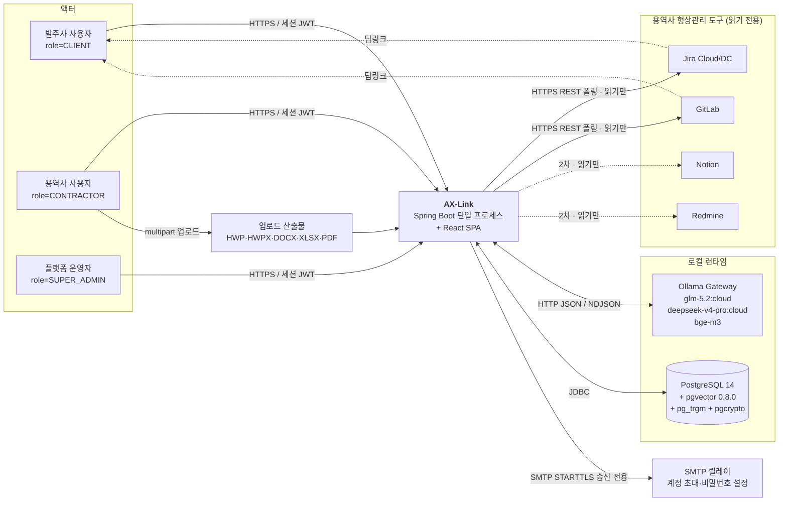
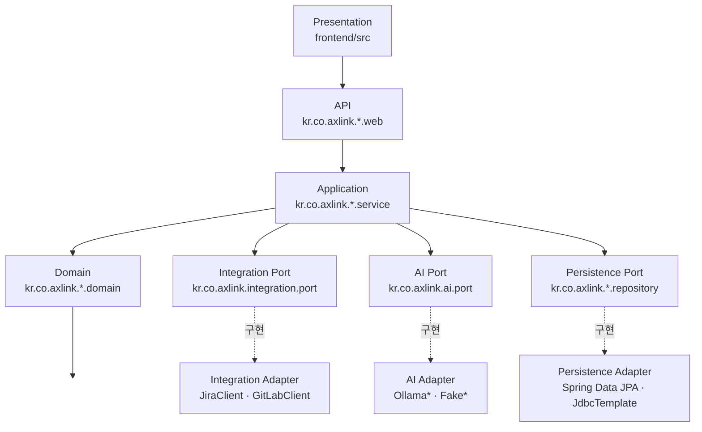

# AX-Link 개념 설계 — 시스템 컨텍스트 및 아키텍처 개념

> **2026-08-21 범위 확정**: 연동 도구는 형상관리 **GitHub** · 프로젝트 관리 **Redmine** 2종으로 확정했다.
> 이 문서의 Jira · GitLab · Notion 관련 서술은 그 시점 이전 기록이며 더 이상 유효하지 않다.
> 현재 범위는 `docs/AX-Link-PRD.md` §1.4 와 `docs/design/02-logical-datamodel.md` §3.5 를 따른다.


| 항목 | 내용 |
| --- | --- |
| 문서 ID | `design/01-conceptual-architecture` |
| 버전 | v1.0 (2026-08-20) |
| 상위 문서 | `docs/AX-Link-PRD.md` |
| 후속 문서 | `02-data-model`, `03-api-spec`, `04-integration`, `05-ai-pipeline`, `06-frontend` |

## 0. 확정 전제 (이 문서가 고정하는 것)

| 전제 | 값 | 근거 |
| --- | --- | --- |
| AI 런타임 | Ollama 단일 게이트웨이 `http://localhost:11434` | PRD §2.1 · §2.5. **Anthropic·OpenAI 등 타 공급자 어댑터는 만들지 않는다.** 작업 지시서에 남아 있던 "Anthropic Claude API / 별도 임베딩 제공자" 표기는 Ollama 로 대체된 것으로 확정한다 |
| 합성·라우팅·위젯스펙 LLM | `glm-5.2:cloud` (요청 시 `"think": false`) | PRD §2.5 |
| 문서 정형화 LLM | `deepseek-v4-pro:cloud` | PRD §2.5. 날짜 태그 금지 |
| 임베딩 | `bge-m3`, 1024차원 | PRD §2.5 |
| 구조화 출력 | **tool calling 전용.** `format` 파라미터 사용 금지 | PRD §2.5 실측 |
| 벡터 저장 | PostgreSQL 14 + pgvector 0.8.0, `vector(1024)` + HNSW | 실측 확인 |
| 실시간 수집 | **1차 릴리스는 Polling 전용.** Webhook 수신기는 범위 밖 | 공통 컨텍스트 범위 3 (Jira·GitLab 폴링 기반 증분 동기화) |
| 배포 | Docker 없음. Spring Boot 단일 프로세스 + PostgreSQL 로컬 프로세스 + Ollama 로컬 프로세스 | 환경 제약 |
| Java 호출 스택 | JDK `java.net.http.HttpClient` + Jackson. AI SDK 의존성 추가 금지 | 환경 제약 |

---

## 1. 시스템 컨텍스트

### 1.1 컨텍스트 다이어그램



점선(`-.->`)은 1차 릴리스 범위 밖이거나 브라우저에서 직접 열리는 경로다. Notion·Redmine 커넥터는 인터페이스만 열어 두고 구현은 M3 로 미룬다.

### 1.2 외부 인터페이스 규격

| # | 외부 시스템 | 프로토콜·엔드포인트 | 인증 방식 | 데이터 방향 | 쓰기 여부 |
| --- | --- | --- | --- | --- | --- |
| EXT-1 | Jira | HTTPS REST v3 `POST /rest/api/3/search` (JQL `project = {key} AND updated >= "{cursor}"`), `GET /rest/api/3/issue/{key}` | Basic — `base64(email:apiToken)` | Jira → AX-Link | **없음(읽기 전용)**. 쓰기 메서드 호출 코드를 두지 않는다 |
| EXT-2 | GitLab | HTTPS REST v4 `GET /api/v4/projects/{id}/issues?updated_after=`, `/merge_requests`, `/repository/commits?since=`, `/pipelines?updated_after=` | 헤더 `PRIVATE-TOKEN: {project access token}` | GitLab → AX-Link | **없음(읽기 전용)** |
| EXT-3 | Notion (M3) | HTTPS REST `POST /v1/databases/{id}/query` (`last_edited_time` 필터), 헤더 `Notion-Version` | 헤더 `Authorization: Bearer {internal integration token}` | Notion → AX-Link | **없음(읽기 전용)** |
| EXT-4 | Redmine (M3) | HTTPS REST `GET /issues.json?updated_on=%3E%3D{cursor}` | 헤더 `X-Redmine-API-Key` | Redmine → AX-Link | **없음(읽기 전용)** |
| EXT-5 | Ollama | HTTP/1.1 JSON — `POST /api/chat`(합성·분류·tool calling), `POST /api/embed`(임베딩). 스트리밍은 `"stream": true` 의 **NDJSON**(SSE 아님) | 없음(localhost 바인딩) | 요청·응답 양방향 | 해당 없음 |
| EXT-6 | PostgreSQL | JDBC (`org.postgresql`) localhost:5432 | 사용자/비밀번호, 애플리케이션 전용 롤 | 양방향 | 있음 |
| EXT-7 | SMTP 릴레이 | SMTP + STARTTLS (`spring-boot-starter-mail`) | SMTP AUTH | AX-Link → 메일서버 **단방향 송신** | 해당 없음 |
| EXT-8 | 업로드 파일 | HTTPS multipart → 로컬 파일시스템 `axlink.storage.root` | 세션 JWT | 사용자 → AX-Link | 있음(저장) |

**단방향 읽기 전용 원칙**: EXT-1~4 는 조회 메서드만 사용한다. 커넥터 인터페이스에 `create`/`update`/`delete` 시그니처를 정의하지 않음으로써 컴파일 단계에서 역동기화를 차단한다(PRD §1.4 Out).

### 1.3 신뢰 경계

| 경계 | 안쪽 | 바깥쪽 | 통과 시 강제 조치 |
| --- | --- | --- | --- |
| TB-1 | AX-Link API | 브라우저 요청 | JWT 검증 → `AuthPrincipal` → `ProjectAccessResolver` 로 허용 `project_id` 집합 산출 |
| TB-2 | 표준 DB | 외부 도구 응답 JSON | `raw_artifact` 무손실 보존 후 매핑 엔진이 화이트리스트 필드만 표준 엔티티로 변환 |
| TB-3 | 쿼리 실행기 | LLM `tool_calls` 인자 | `semantic_measure` / `semantic_dimension` / `semantic_filter` 카탈로그 화이트리스트 재검증. 실패 시 1회 재시도 후 실패 응답 |
| TB-4 | 표준 DB | 문서 정형화 결과 | `work_product.type` 22종 enum 검증 + 사용자 확정 단계 |
| TB-5 | 파일 저장소 | 업로드 파일 | 확장자·MIME·크기 검증, 저장명은 UUID, 원본명은 컬럼 값으로만 보관 |

---

## 2. 논리 계층 아키텍처

### 2.1 계층 의존 방향



의존은 **항상 안쪽(Domain)으로만** 향한다. 어댑터는 포트를 구현할 뿐 포트가 어댑터를 알지 않는다. Domain 은 Spring·JPA·Jackson 어느 것도 import 하지 않는다.

### 2.2 계층별 책임

| 계층 | 패키지/경로 | 들어가는 것 | **들어가면 안 되는 것** |
| --- | --- | --- | --- |
| Presentation | `frontend/src/features/*`, `components/*` | shadcn/ui 컴포넌트, react-router 라우트, TanStack Query 훅, `spec_json → 위젯 렌더러` 1단계 매핑 | 목업 데이터 파일, localStorage 레이아웃 저장, 비즈니스 규칙(권한 판정·상태 전이), 닫힌 위젯 유니온 타입 |
| API | `kr.co.axlink.<도메인>.web` | `@RestController`, 요청/응답 `record` DTO, Bean Validation, `@PreAuthorize`, SSE 중계 `SseEmitter` | 트랜잭션 선언, Repository 직접 호출, 엔티티 직접 반환, SQL |
| Application | `kr.co.axlink.<도메인>.service` | 유스케이스 서비스, `@Transactional` 경계, 포트 오케스트레이션, 권한 필터 주입(`ProjectAccessResolver`), `entity_history` 기록 호출 | HTTP·JSON 직렬화 세부, 외부 도구 API URL·헤더, LLM 프롬프트 문자열(→ `ai.prompt` 로 분리) |
| Domain | `kr.co.axlink.<도메인>.domain` | 엔티티, 값 객체, enum(`WorkProductType` 22종·`ProjectStatus`·`SyncJobKind`), 불변식(`startDate <= endDate`, 종료 전 `acceptance_record` 존재), 상태 전이 규칙 | 프레임워크 애노테이션 이외의 인프라 코드, 외부 API 모델, DTO |
| Integration | `kr.co.axlink.integration.port` / `.adapter` | `ToolConnector` 포트, `JiraConnector`·`GitLabConnector` 어댑터, `MappingRuleEngine`, 커서 기반 증분 페치, 지수 백오프 | 표준 엔티티 저장(Application 이 담당), 권한 판정, LLM 호출 |
| Persistence | `kr.co.axlink.<도메인>.repository` | Spring Data JPA 리포지토리, 벡터·FTS 하이브리드 검색용 `JdbcTemplate` 쿼리, `SemanticQueryBuilder`(파라미터라이즈드 SQL 조립) | 문자열 연결로 만든 SQL, 권한 필터 없는 조회 메서드 |
| AI Port | `kr.co.axlink.ai.port` / `.adapter` | `LlmPort`·`EmbeddingPort` 인터페이스, `OllamaLlmAdapter`·`OllamaEmbeddingAdapter`·`FakeLlmAdapter`·`FakeEmbeddingAdapter` | Ollama 이외 공급자 어댑터, 권한 판정, 도메인 규칙 |

### 2.3 도메인 패키지 목록 (이름 확정)

| 패키지 | 담당 범위 |
| --- | --- |
| `kr.co.axlink.auth` | 로그인, JWT 발급·검증, 초대 수락 |
| `kr.co.axlink.org` | `organization`, `app_user` |
| `kr.co.axlink.project` | `project`, `project_assignment`, 종료 플로우 |
| `kr.co.axlink.integration` | `tool_connection`, `sync_job`, `raw_artifact`, 커넥터, 매핑 규칙 |
| `kr.co.axlink.standard` | ISO 29110 엔티티 10종 + `entity_history` |
| `kr.co.axlink.document` | 업로드·파싱·정형화·청킹 |
| `kr.co.axlink.semantic` | 카탈로그, 위젯 스펙 검증, 쿼리 실행 |
| `kr.co.axlink.dashboard` | `dashboard`, `widget` |
| `kr.co.axlink.rag` | 하이브리드 검색, 합성, `conversation`/`message`/`message_source` |
| `kr.co.axlink.ai` | AI 포트·어댑터·프롬프트 |
| `kr.co.axlink.common` | 예외, 에러 응답, 암호화, 백오프, 감사 |

---

## 3. AI 포트 설계 개념

### 3.1 포트 2종

포트는 **딱 두 개**다. 용도별로 인터페이스를 쪼개지 않는다(합성·분류·구조화출력은 모두 `/api/chat` 한 엔드포인트로 처리되므로 분리하면 어댑터만 늘어난다).

| 포트 | 인터페이스 | 메서드 개념 | 사용처 |
| --- | --- | --- | --- |
| `LlmPort` | `kr.co.axlink.ai.port.LlmPort` | `complete(LlmRequest) -> LlmResponse`<br/>`stream(LlmRequest) -> Flow.Publisher<LlmDelta>`<br/>`callTool(ToolRequest) -> ToolInvocation` | 합성(스트리밍), 질의 라우팅/분류, 위젯 스펙 생성, 문서 정형화 |
| `EmbeddingPort` | `kr.co.axlink.ai.port.EmbeddingPort` | `embed(List<String>) -> List<float[]>`<br/>`dimension() -> int` | 청크 색인, 질의 임베딩 |

주요 타입(모두 `record`):

| 타입 | 필드 |
| --- | --- |
| `LlmRequest` | `model`, `List<LlmMessage> messages`, `Double temperature`, `Integer maxTokens`, `boolean think` |
| `LlmMessage` | `LlmRole role`(SYSTEM/USER/ASSISTANT/TOOL), `String content` |
| `LlmDelta` | `String text`, `boolean done` |
| `ToolRequest` | `LlmRequest base`, `ToolSchema tool` |
| `ToolSchema` | `String name`, `String description`, `Map<String,Object> parameters` (JSON Schema, enum 은 카탈로그에서 런타임 생성) |
| `ToolInvocation` | `String toolName`, `JsonNode arguments`, `String rawText` |
| `LlmModels` | 상수 — `SYNTHESIS = "glm-5.2:cloud"`, `STRUCTURING = "deepseek-v4-pro:cloud"`, `EMBEDDING = "bge-m3"` (모두 `application.yml` 오버라이드 가능) |

`callTool` 은 `format` 파라미터를 절대 사용하지 않고 Ollama `tools` 배열로만 요청하며, 응답의 `message.tool_calls[0].function.arguments` 를 `ToolInvocation.arguments` 로 반환한다. `tool_calls` 가 비어 있으면 `ToolCallMissingException` 을 던진다.

### 3.2 어댑터 2종과 선택 전략

| 어댑터 | 클래스 | 조건 | 동작 |
| --- | --- | --- | --- |
| 실제 | `OllamaLlmAdapter`, `OllamaEmbeddingAdapter` | `axlink.ai.provider=ollama` (기본값) | `HttpClient` 로 `http://localhost:11434` 호출. 스트리밍은 NDJSON 라인 파싱 |
| Fake | `FakeLlmAdapter`, `FakeEmbeddingAdapter` | `axlink.ai.provider=fake` | 결정적 응답. **단위 테스트 전용** |

선택 지점은 `AiPortConfiguration` 한 곳이다.

```java
@Configuration
class AiPortConfiguration {
  @Bean
  @ConditionalOnProperty(name = "axlink.ai.provider", havingValue = "ollama", matchIfMissing = true)
  LlmPort ollamaLlmPort(AiProperties props, ObjectMapper mapper) { ... }

  @Bean
  @ConditionalOnProperty(name = "axlink.ai.provider", havingValue = "fake")
  LlmPort fakeLlmPort() { ... }
}
```

Ollama 는 API 키를 요구하지 않으므로 "키 유무" 대신 **프로퍼티 명시값**으로 고른다. `src/test/resources/application.yml` 에 `axlink.ai.provider: fake` 를 고정해 Ollama 데몬 없이도 전 테스트가 통과한다.

Fake 어댑터의 결정성 규칙:

| 요청 | Fake 응답 |
| --- | --- |
| `embed(texts)` | 각 텍스트의 SHA-256 을 시드로 한 `java.util.Random` 으로 1024개 float 생성 후 L2 정규화. 같은 입력 → 항상 같은 벡터 |
| `complete` / `stream` | `"[fake] " + 마지막 user 메시지의 첫 200자`. 스트리밍은 어절 단위 분할 |
| `callTool` | `ToolSchema.parameters` 의 각 프로퍼티에 대해 enum 이면 첫 값, string 이면 `""`, number 면 `0`, array 면 `[]` 를 채운 인자 반환 |

### 3.3 실패·폴백 정책

| 실패 | 감지 | 폴백 |
| --- | --- | --- |
| Ollama 연결 불가 (`ConnectException`, 타임아웃) | `HttpClient` 예외 | 재시도 없음. `AI_UNAVAILABLE` 로 HTTP 503 + 화면에 원인 표시. **가짜 답변을 만들지 않는다** |
| 5xx / `model not found` | 상태코드 | 200ms → 400ms 2회 재시도 후 실패 |
| `tool_calls` 누락 또는 화이트리스트 검증 실패 | `ToolCallMissingException` / `CatalogValidationException` | 프롬프트에 위반 사유를 덧붙여 **1회만** 재시도. 재실패 시 위젯 생성은 "Q&A로 질문하기" 제안, 문서 정형화는 수동 유형 지정 화면으로 전환 |
| 임베딩 차원 불일치 | `dimension() != 1024` | 색인 잡 즉시 실패(`sync_job.error`). 부분 적재 금지 |
| 검색 결과 0건 | 하이브리드 결과 empty | LLM 호출 없이 "근거 문서 없음" 고정 응답. 출처 없는 답변 생성 금지 |
| 스트리밍 중단(사용자 중지) | SSE 연결 종료 | `HttpClient` 응답 스트림 close, 부분 메시지를 `message` 에 저장하지 않음 |

타임아웃: 연결 5초, 임베딩 응답 30초, 합성 응답 180초.

### 3.4 프롬프트 캐싱과 구조화 출력 적용 지점

Ollama 에는 Anthropic 식 `cache_control` 이 없다. 대신 **프리픽스 안정성**으로 KV 캐시 적중을 노린다.

| 지점 | 규칙 |
| --- | --- |
| 메시지 배치 순서 | `[고정 system 프롬프트] → [고정 카탈로그/enum 설명] → [가변 컨텍스트 청크] → [사용자 질의]`. 앞부분 바이트가 요청마다 동일해야 한다 |
| 금지 | system 프롬프트에 타임스탬프·요청 ID·사용자명 같은 가변값 삽입 금지 |
| 프롬프트 소유 | 프롬프트 문자열은 `kr.co.axlink.ai.prompt` 의 상수 클래스에만 둔다. 서비스 코드에 인라인 금지 |

| 구조화 출력(tool calling) 사용 지점 | 모델 | 도구 이름 | 검증 |
| --- | --- | --- | --- |
| 위젯 스펙 생성 | `glm-5.2:cloud` | `build_widget_spec` | `semantic_*` 카탈로그 화이트리스트 (TB-3) |
| 질의 라우팅(문서형/집계형/혼합) | `glm-5.2:cloud` | `classify_query` | enum 3값 검사 |
| 추천 질문 칩 생성 | `glm-5.2:cloud` | `suggest_questions` | 개수·길이 제한 |
| 문서 정형화 | `deepseek-v4-pro:cloud` | `structure_work_product` | 22종 enum + 필수 필드 (TB-4) |

합성(답변 생성)만 tool calling 을 쓰지 않는 자유 텍스트 스트리밍이며, 각주 `[n]` 규격은 system 프롬프트로 강제하고 서버가 후처리로 `message_source` 와 1:1 대응을 검증한다(대응되지 않는 각주는 제거).

---

## 4. 데이터 파이프라인 개념 흐름

PRD §2.3 의 5단계(수집 → 정규화 → 저장 → 색인 → 소비)를 컴포넌트 수준으로 전개한다.

### 4.1 (a) 도구 폴링 → 표준화 → 적재 → 색인

```mermaid
sequenceDiagram
  autonumber
  participant SCH as SyncScheduler<br/>@Scheduled(15분)
  participant SVC as SyncJobService
  participant CON as JiraConnector<br/>(ToolConnector)
  participant JIRA as Jira REST
  participant MAP as MappingRuleEngine
  participant STD as StandardEntityService
  participant DB as PostgreSQL
  participant IDX as IndexingService
  participant EMB as EmbeddingPort<br/>(bge-m3)

  SCH->>SVC: 활성 tool_connection 조회
  SVC->>DB: insert sync_job(kind=POLL, status=RUNNING)
  SVC->>CON: fetchSince(connection, cursor=last_synced_at)
  loop 페이지네이션 (startAt += maxResults)
    CON->>JIRA: POST /rest/api/3/search (JQL updated >= cursor)
    alt 429 또는 5xx
      JIRA-->>CON: 오류
      CON->>CON: 지수 백오프 1s→2s→4s→8s→16s (최대 5회)
    else 200
      JIRA-->>CON: issues[]
    end
  end
  CON->>DB: upsert raw_artifact (tool_connection_id, external_id) 무손실 보존
  CON-->>SVC: List<RawRecord>
  SVC->>MAP: apply(mapping_rules_json, rawRecords)
  MAP-->>SVC: List<StandardChange> (requirement / issue / risk / work_product / trace_link)
  SVC->>STD: upsertAll(changes)
  STD->>DB: upsert by (tool_connection_id, external_id)
  STD->>DB: insert entity_history (변경된 필드만 append)
  STD-->>SVC: 신규·변경된 엔티티 ID 목록
  SVC->>IDX: reindex(changedIds)
  IDX->>IDX: 청킹 (문서 500~1000토큰 · 오버랩 15% / 이슈·요구사항 1청크)
  IDX->>EMB: embed(chunkTexts)
  EMB-->>IDX: float[1024][]
  IDX->>DB: delete doc_chunk where source_id in (...) ; insert doc_chunk(embedding vector(1024))
  SVC->>DB: update sync_job(status=SUCCESS, stats_json, cursor=maxUpdatedAt)
```

핵심 규칙:

| 규칙 | 내용 |
| --- | --- |
| 커서 | `sync_job.stats_json.cursor` 가 아니라 `tool_connection.last_synced_at` 에 **성공 시에만** 갱신. 다음 폴링은 `cursor - 60초`(clock skew 여유)부터 재조회 |
| 재색인 단위 | 변경된 소스 단위로 `doc_chunk` 전량 삭제 후 재삽입. 부분 갱신하지 않는다 |
| 트랜잭션 | 페치는 트랜잭션 밖, `upsertAll` + `entity_history` 는 한 트랜잭션, 색인은 별도 트랜잭션 |
| 초기 백필 | `kind=BACKFILL` 로 동일 경로 재사용. 커서를 `1970-01-01` 로 시작 |

### 4.2 (b) 사용자 질의 → 하이브리드 검색 → 합성 → 출처 응답

```mermaid
sequenceDiagram
  autonumber
  participant UI as React AI Q&A
  participant API as QnaController
  participant ACL as ProjectAccessResolver
  participant RAG as RagOrchestrator
  participant LLM as LlmPort (glm-5.2:cloud)
  participant EMB as EmbeddingPort (bge-m3)
  participant DB as PostgreSQL
  participant SEM as SemanticQueryExecutor

  UI->>API: POST /api/qna/messages {conversationId, question, projectScope[]}
  API->>ACL: allowedProjectIds(principal, projectScope)
  ACL-->>API: [prj_01, prj_07]  (권한 밖 요청은 403)
  API->>RAG: ask(question, allowedProjectIds, history)
  RAG->>LLM: callTool(classify_query)
  LLM-->>RAG: {type: DOCUMENT | AGGREGATE | MIXED, rewrittenQuery}
  opt AGGREGATE 또는 MIXED
    RAG->>SEM: run(measure, dimensions, filters, allowedProjectIds)
    SEM->>DB: 파라미터라이즈드 집계 쿼리 (project_id = ANY(?) 강제)
    DB-->>SEM: rows
    SEM-->>RAG: 구조화 컨텍스트
  end
  RAG->>EMB: embed([rewrittenQuery])
  EMB-->>RAG: float[1024]
  par 벡터 검색
    RAG->>DB: SET LOCAL hnsw.ef_search = 100 ; hnsw.iterative_scan = relaxed_order<br/>SELECT ... ORDER BY embedding <=> ?::vector LIMIT 40 WHERE project_id = ANY(?)
    DB-->>RAG: top-40 (vector)
  and 키워드 검색
    RAG->>DB: FTS to_tsquery + pg_trgm similarity, WHERE project_id = ANY(?) LIMIT 40
    DB-->>RAG: top-40 (lexical)
  end
  RAG->>RAG: RRF 융합 score = Σ 1/(60 + rank) → top-8
  RAG->>LLM: stream(system 고정 프롬프트 + 컨텍스트 + 질의)
  loop NDJSON 라인
    LLM-->>RAG: LlmDelta
    RAG-->>API: 토큰
    API-->>UI: SSE data: {"delta": "..."}
  end
  RAG->>RAG: 각주 [n] ↔ 청크 매칭 검증, 미대응 각주 제거
  RAG->>DB: insert message, insert message_source (footnote_no, doc_chunk_id, snippet, external_url)
  API-->>UI: SSE data: {"sources": [...]} , event: done
```

핵심 규칙:

| 규칙 | 내용 |
| --- | --- |
| 권한 | `allowedProjectIds` 는 컨트롤러에서 산출해 검색·집계 쿼리 **양쪽 모두**에 바인딩 파라미터로 주입. LLM 프롬프트에는 프로젝트 ID 를 넣지 않는다 |
| RRF | `k=60` 고정. 두 리스트 모두 40건, 융합 후 상위 8건을 컨텍스트로 사용 |
| 출처 1:1 | `message_source.footnote_no` ↔ 답변 본문 `[n]`. 대응 없는 각주는 응답 저장 전에 제거 |
| 스트림 종료 | 사용자 중지 시 `message` 를 저장하지 않고 SSE 를 닫는다 |

---

## 5. 횡단 관심사

### 5.1 인증·인가 적용 지점

| 지점 | 컴포넌트 | 강제 내용 |
| --- | --- | --- |
| 요청 진입 | `JwtAuthenticationFilter` (Spring Security) | Bearer JWT 검증 → `AuthPrincipal(userId, orgId, orgType, role)` |
| 메서드 | `@PreAuthorize("hasRole('CLIENT')")` 등 | 역할 단위 1차 게이트 (PRD §3.2 매트릭스) |
| 프로젝트 범위 | `ProjectAccessResolver.allowedProjectIds(principal)` | CLIENT: `project.client_org_id = principal.orgId` / CONTRACTOR: `project_assignment` 존재 / SUPER_ADMIN: 감사 목적 읽기만 |
| 세부 권한 | `project_assignment.permissions_json` | `canConfigureIntegration`, `canUploadDocument`, `canReadDashboard` 3개 불리언 |
| 쿼리 | `SemanticQueryBuilder`, `HybridSearchRepository` | `project_id = ANY(?)` 를 **빌더가 무조건 부착**. 허용 목록 없는 조회 메서드를 만들지 않는다 |

토큰: Access JWT 30분, Refresh 14일(DB 저장·회전). 비밀번호는 `bcrypt`.

### 5.2 트랜잭션 경계

| 경계 | 범위 | 이유 |
| --- | --- | --- |
| Application 서비스 메서드 1개 = 트랜잭션 1개 | `@Transactional` 은 `*.service` 에만 선언 | 컨트롤러·리포지토리에 선언 금지 |
| 외부 I/O 제외 | 도구 API 호출, Ollama 호출, 파일 파싱은 트랜잭션 **밖** | 커넥션 점유 시간 최소화 |
| 표준 적재 | `upsert 엔티티 + entity_history append` = 1 트랜잭션 | 감사 누락 방지 |
| 색인 | 소스 1건당 `delete doc_chunk + insert doc_chunk` = 1 트랜잭션 | 부분 색인 상태 금지 |
| RAG 응답 | 스트리밍 전체를 트랜잭션으로 감싸지 않는다. 완료 후 `message + message_source` 저장이 1 트랜잭션 | 장시간 트랜잭션 회피 |
| 읽기 | 조회 서비스는 `@Transactional(readOnly = true)` | |

### 5.3 동기화 멱등성

| 전략 | 구현 |
| --- | --- |
| 자연 키 upsert | 모든 원천 엔티티에 유니크 제약 `(tool_connection_id, external_id)`. `INSERT ... ON CONFLICT ... DO UPDATE` |
| 커서 갱신 시점 | 잡이 `SUCCESS` 로 끝날 때만 `last_synced_at` 갱신. 실패 시 커서 유지 → 다음 회차가 같은 구간 재처리 |
| 중복 실행 방지 | `tool_connection` 단위 DB 어드바이저리 락 `pg_try_advisory_lock(hashtext(connection_id))`. 획득 실패 시 이번 회차 스킵 |
| 변경 없음 판정 | `raw_artifact.payload_jsonb` 의 SHA-256 을 `content_hash` 로 저장. 동일하면 매핑·색인 전 단계를 건너뛴다 |
| 이력 중복 방지 | `entity_history` 는 실제 값이 바뀐 필드만 append |
| 재시도 안전 | 실패 잡 재시도 버튼(INT-004)은 같은 커서로 동일 경로를 다시 태운다. 결과는 항상 동일 |

`pg_try_advisory_lock` 은 단일 인스턴스 전제에서 충분하다. 다중 인스턴스로 확장할 때만 잡 큐로 승격한다.

### 5.4 에러·재시도 정책

| 대상 | 재시도 | 백오프 | 상한 |
| --- | --- | --- | --- |
| 도구 API 429/5xx/타임아웃 | 예 | 1s → 2s → 4s → 8s → 16s (지터 ±20%) | 5회. `Retry-After` 헤더가 있으면 그 값 우선 |
| 도구 API 401/403/404 | 아니오 | — | 즉시 `sync_job.status=FAILED`, `error` 에 도구 원문 메시지 저장(INT-002 규칙) |
| Ollama 5xx | 예 | 200ms → 400ms | 2회 |
| Ollama 연결 불가 | 아니오 | — | 503 즉시 반환 |
| tool calling 검증 실패 | 예 | 즉시 | 1회 |
| DB 직렬화 충돌 | 예 | 50ms → 100ms | 3회 |

에러 응답 규격: `record ErrorResponse(String code, String message, Map<String,Object> details)`. `code` 는 `AI_UNAVAILABLE`, `TOOL_AUTH_FAILED`, `CATALOG_VALIDATION_FAILED`, `PROJECT_ACCESS_DENIED`, `WORK_PRODUCT_TYPE_REJECTED` 등 상수 enum.

### 5.5 감사 로그(`entity_history`) 기록 지점

| 기록 지점 | `entity_type` | `actor` |
| --- | --- | --- |
| 동기화로 인한 표준 엔티티 상태·담당자·우선순위 변경 | `requirement`/`issue`/`risk`/`work_product` | `system:sync:{tool_connection_id}` |
| 문서 정형화 확정 | `work_product` | 확정한 사용자 ID |
| 산출물 승인(`status → approved`) | `work_product` | CLIENT 사용자 ID |
| 검수확인서 등록·프로젝트 종료 | `acceptance_record`, `project` | CLIENT 사용자 ID |
| 용역사 할당·해제, 권한 토글 변경 | `project_assignment` | CLIENT 사용자 ID |
| 도구 연동 생성·수정·삭제 | `tool_connection` | CONTRACTOR 사용자 ID (인증정보 값은 기록하지 않음) |
| 변경요청·시정조치 상태 전이 | `change_request`, `correction_action` | 처리자 ID |

기록은 `EntityHistoryRecorder.record(entityType, entityId, field, from, to, actor)` 한 지점으로 통일한다. 서비스마다 직접 insert 하지 않는다.

### 5.6 비밀정보 암호화 지점

| 대상 | 방식 | 위치 |
| --- | --- | --- |
| `tool_connection.auth_encrypted` | AES-256-GCM (12바이트 random IV, IV+ciphertext+tag Base64), 애플리케이션 레벨 | `kr.co.axlink.common.crypto.SecretCipher` |
| 마스터 키 | 환경변수 `AXLINK_SECRET_KEY` (Base64 32바이트). 소스·DB·로그에 두지 않는다 | 기동 시 `AiProperties` 와 별도 `CryptoProperties` 로 주입 |
| `tool_connection.webhook_secret` | 동일 방식 (Webhook 미구현이어도 컬럼과 생성은 유지) | |
| 조회 API 응답 | 항상 마스킹(`****abcd` — 마지막 4자만) | `ToolConnectionResponse` DTO 에서 복호화 값을 담지 않는다 |
| 비밀번호 | bcrypt (단방향, 복호화 불가) | `app_user.password_hash` |
| 로그 | 인증정보·JWT·프롬프트 원문을 로그에 남기지 않는다 | `LoggingSanitizer` |

복호화는 커넥터가 도구를 호출하기 직전 한 지점(`ToolConnectionSecretProvider`)에서만 일어난다.

---

## 6. 품질 속성과 설계 대응

### 6.1 요구 → 설계 결정 → 근거

| 속성 | 요구 | 설계 결정 | 근거 |
| --- | --- | --- | --- |
| 성능 | 대시보드 위젯 응답 p95 < 1.5초 | 시맨틱 레이어의 `sql_template` 은 사전 정의된 집계 쿼리. `project_id`, `status`, `updated_at` 복합 인덱스. 위젯당 쿼리 1회 | Text-to-SQL 은 실행계획을 예측할 수 없어 p95 를 보장 못 한다 |
| 성능 | RAG 검색(합성 제외) p95 < 800ms | HNSW `ef_search=100` + FTS 병렬 실행 후 애플리케이션에서 RRF. 청크당 컨텍스트 1KB 상한 | 두 검색이 독립이라 병렬화 이득이 크고, 융합은 O(n) |
| 성능 | 색인 처리량 | 임베딩은 배치 32건 단위 `POST /api/embed`. 대량 백필 시 인덱스 생성 후행 | `bge-m3` 로컬 실행은 배치가 왕복 비용을 지배 |
| 일관성 | 표준 DB 가 도구 상태와 최대 15분 이내 일치 | 폴링 15분 + 성공 시에만 커서 전진 + 커서 60초 겹침 | 유실보다 중복이 안전. upsert 가 중복을 흡수 |
| 일관성 | 대시보드 레이아웃 단일 원천 | `dashboard.layout_json` 서버 저장. localStorage 금지 | ax-pms 실패 원인(PRD §6.1.1) |
| 보안 | SQL 인젝션 차단 | LLM 은 카탈로그 키만 산출, 서버가 화이트리스트 검증 후 파라미터라이즈드 쿼리 조립 | 문자열 SQL 생성 경로 자체가 없다 |
| 보안 | 크로스 프로젝트 데이터 유출 차단 | 권한 필터를 쿼리 빌더가 부착. 프롬프트 의존 금지 | 프롬프트는 우회 가능, WHERE 절은 불가 |
| 보안 | 인증정보 보호 | AES-256-GCM + 응답 마스킹 + 단일 복호화 지점 | PRD §2.4 |
| 테스트 용이성 | Ollama·PostgreSQL 없이 단위 테스트 통과 | AI 포트 Fake 어댑터 + Domain 계층 무프레임워크 | 결정적 Fake 임베딩이 1024차원을 그대로 생성하므로 차원 계약도 테스트로 고정 |
| 테스트 용이성 | 커넥터 테스트 | `ToolConnector` 포트 + 저장된 실제 응답 JSON 픽스처 재생 | 외부 도구 없이 매핑 규칙을 검증 |
| 확장성 | 5번째 도구 추가 | `ToolConnector` 구현 1개 + `mapping_rules_json` 기본값 추가. 표준 스키마 무변경 | 표준 모델이 도구에 독립 |
| 확장성 | 지표 추가 | `semantic_measure` 행 추가 (코드 무수정) | 카탈로그가 DB 테이블 |
| 확장성 | 위젯 추가 | 템플릿 8종 렌더러는 코드, 내용은 `spec_json` 데이터 | PRD §6.1.1 |
| 확장성 | 처리량 증가 | `@Scheduled` + 어드바이저리 락 → 필요 시 잡 큐로 교체. 인터페이스 불변 | 1차는 단일 인스턴스 확정 |

### 6.2 pgvector HNSW 파라미터

```sql
create index concurrently idx_doc_chunk_embedding_hnsw
  on doc_chunk using hnsw (embedding vector_cosine_ops)
  with (m = 16, ef_construction = 64);
```

| 파라미터 | 값 | 근거 |
| --- | --- | --- |
| `m` | 16 | pgvector 기본값. 예상 규모(프로젝트 20 × 문서 300 × 청크 30 ≈ 18만 행)에서 `m=16` 의 recall@10 이 0.95 이상. `m` 을 32로 올리면 인덱스 크기·빌드 시간이 약 2배가 되는데 이 규모에서 얻는 recall 이득이 없다 |
| `ef_construction` | 64 | 기본값. 18만 행 빌드가 로컬 단일 프로세스에서 수 분 내 완료. 128 이상은 빌드 시간만 늘고 recall 이득이 미미하다 |
| `ef_search` | **100** (세션 단위 `SET LOCAL hnsw.ef_search = 100`) | 벡터 후보를 top-40 뽑으므로 `ef_search >= k` 가 필수 조건이고, 여유 2.5배를 둬야 recall 이 안정된다. 기본값 40 은 k=40 과 같아 recall 이 급락한다 |
| `hnsw.iterative_scan` | **`relaxed_order`** (0.8.0 신기능) | 검색은 항상 `project_id = ANY(?)` 로 필터된다. 필터 없이 post-filter 하면 상위 40건이 전부 타 프로젝트라 결과가 0건이 될 수 있다. iterative scan 이 필터 통과 건수를 채울 때까지 그래프를 계속 훑는다 |
| `hnsw.max_scan_tuples` | 20000 (기본) | 프로젝트 필터가 좁을 때의 최악 지연을 상한한다 |

**색인 재구축 전략**

| 상황 | 조치 |
| --- | --- |
| 초기 백필 | 인덱스를 **먼저 만들지 않는다**. 전체 `doc_chunk` 적재 완료 후 `SET maintenance_work_mem = '2GB'; CREATE INDEX CONCURRENTLY ...`. 행 단위 삽입보다 수 배 빠르다 |
| 운영 중 증분 색인 | 인덱스 유지한 채 delete+insert. 재구축 불필요 |
| 대량 삭제 후 성능 저하 | 월 1회 `REINDEX INDEX CONCURRENTLY idx_doc_chunk_embedding_hnsw` |
| 잠금 | 모든 인덱스 작업에 `CONCURRENTLY`. 서비스 중단 없음 |

**임베딩 차원 변경 마이그레이션 경로** (예: 1024 → N)

| 단계 | 작업 |
| --- | --- |
| 1 | `doc_chunk` 에 `embedding_next vector(N)`, `embedding_model text` 컬럼 추가 (nullable) |
| 2 | 새 모델로 전체 청크 재임베딩하여 `embedding_next` 백필. 이 기간 검색은 기존 `embedding` 으로 계속 서비스 |
| 3 | `embedding_next` 에 HNSW 인덱스 `CREATE INDEX CONCURRENTLY` |
| 4 | `axlink.ai.embedding.model` 전환 → 검색 컬럼을 `embedding_next` 로 스위치(설정값 `axlink.rag.embedding-column`) |
| 5 | 검증 후 구 인덱스·구 컬럼 DROP, `embedding_next` → `embedding` 리네임 |

`EmbeddingPort.dimension()` 과 DB 컬럼 차원이 기동 시 불일치하면 애플리케이션이 기동에 실패하도록 `EmbeddingDimensionVerifier` 를 둔다. 조용한 오적재를 원천 차단한다.

---

## 7. 아키텍처 결정 기록 (ADR)

### ADR-001 단일 PostgreSQL 사용

- **결정**: 관계형 데이터·전문검색·벡터 색인·잡 큐를 PostgreSQL 14 한 인스턴스로 처리한다.
- **맥락**: Docker 없음, 로컬 프로세스만 허용, 1차 릴리스 단일 인스턴스.
- **대안**: PostgreSQL + Elasticsearch + Redis + 전용 Vector DB 조합.
- **근거**: 미들웨어 하나당 기동·백업·장애 지점이 늘어난다. 18만 행 규모에서 PostgreSQL 단독으로 성능 목표(§6.1)를 만족한다. 트랜잭션 하나로 표준 데이터와 색인의 정합성을 유지할 수 있다.
- **영향**: 잡 큐는 `sync_job` 테이블 + `@Scheduled`. 처리량이 요구할 때만 Redis 로 승격하며, 그 시점까지 인터페이스는 바뀌지 않는다.

### ADR-002 벡터 저장은 pgvector `vector(1024)` — `real[]` 대체안 기각

- **결정**: `doc_chunk.embedding` 을 `vector(1024)` 로 두고 `vector_cosine_ops` HNSW 인덱스를 건다.
- **맥락**: pgvector 0.8.0 설치·동작이 실측 확인되었고 `bge-m3` 가 정확히 1024차원을 반환한다.
- **대안**: `real[]` 컬럼 + 애플리케이션 측 코사인 계산(pgvector 미설치 대비 폴백).
- **근거**: `real[]` 은 인덱스가 없어 전체 스캔이고 18만 행에서 검색 지연이 초 단위가 된다. 확장이 이미 있는데 폴백 코드를 유지하는 것은 쓰이지 않을 분기의 유지비다.
- **영향**: 배포 환경에 `create extension vector` 가 전제 조건이 된다. Flyway 첫 마이그레이션에 확장 생성을 포함하고, 미설치 시 기동 실패로 즉시 드러낸다.

### ADR-003 LLM·임베딩을 포트로 추상화하고 어댑터는 2벌만 둔다

- **결정**: `LlmPort`·`EmbeddingPort` 2개 포트 × (Ollama 실제, 결정적 Fake) 2개 구현.
- **맥락**: Ollama 데몬 없이 단위 테스트가 통과해야 하고, AI 런타임은 Ollama 로 확정되었다.
- **대안**: (a) 추상화 없이 서비스에서 Ollama 직접 호출, (b) 공급자별 어댑터 다수 준비.
- **근거**: (a)는 테스트가 데몬에 묶여 CI 가 불가능하다. (b)는 구현이 하나도 요구되지 않는 확장성이라 YAGNI. Fake 는 "쓰이는 두 번째 구현"이므로 추상화가 실제 값을 낸다.
- **영향**: 다른 공급자를 붙일 일이 생기면 어댑터 1개 추가로 끝난다. 그때까지 공급자 분기 코드는 존재하지 않는다.

### ADR-004 시맨틱 레이어 채택, Text-to-SQL 배제

- **결정**: LLM 은 tool calling 으로 `measure`·`dimensions`·`filters` 조합만 산출하고, 서버가 카탈로그 화이트리스트 검증 후 파라미터라이즈드 쿼리를 조립한다.
- **맥락**: 발주사가 자연어로 위젯을 만들고, 그 쿼리는 프로젝트 권한 경계를 넘으면 안 된다.
- **대안**: LLM 이 SQL 을 직접 생성하고 서버가 파싱·검증.
- **근거**: 생성 SQL 의 안전성 검증은 사실상 SQL 파서를 다시 구현하는 일이고, 통과시켜도 실행계획을 예측할 수 없다. 카탈로그 조합은 유한집합이라 검증이 등가비교로 끝나고 권한 필터를 강제 주입할 수 있다.
- **영향**: 카탈로그로 표현 불가한 질문은 위젯을 만들지 않고 "Q&A로 질문하기"를 제안한다. 지표 확장은 `semantic_measure` 행 추가로 처리한다.

### ADR-005 구조화 출력은 tool calling 으로만 얻는다

- **결정**: Ollama 의 `format`(JSON Schema 및 `"json"`) 파라미터를 쓰지 않고 `tools` 파라미터만 사용한다.
- **맥락**: 실측에서 `format` 이 무시되고 마크다운 펜스로 감싼 임의 필드명 JSON 이 반환됐다.
- **대안**: `format` + 응답 텍스트에서 JSON 추출·정규화 파서 작성.
- **근거**: 필드명이 매 호출 달라지므로 파서는 휴리스틱 더미가 된다. tool calling 은 실측에서 enum 제약까지 정확히 지켰다.
- **영향**: 모든 구조화 지점(§3.4)은 `ToolSchema` 를 정의해야 한다. 그럼에도 응답은 신뢰 경계 밖이므로 서버 재검증은 유지한다.

### ADR-006 위젯은 코드가 아니라 데이터

- **결정**: 위젯 정의는 `widget.spec_json` 이고, 코드에는 템플릿 렌더러 8종만 둔다. 닫힌 위젯 유니온 타입을 만들지 않는다.
- **맥락**: ax-pms 는 섹션 18종을 하드코딩해 위젯 하나 바꾸는 데 파일 4개를 동시에 고쳐야 했고, 그래서 중단됐다.
- **대안**: 위젯별 컴포넌트 + discriminated union 타입.
- **근거**: 위젯 종류는 카탈로그 확장에 따라 계속 늘어나는데, 유니온 타입은 늘어날 때마다 타입·카탈로그·조립·컴포넌트 4곳을 동기화해야 한다. 렌더 경로가 `spec_json → 렌더러` 1단계면 수정 지점이 하나다.
- **영향**: 렌더러는 `template` 값으로 조회하는 `Record<string, WidgetRenderer>` 맵 하나. 알 수 없는 `template` 은 에러 카드를 그린다.

### ADR-007 대시보드 레이아웃은 서버 DB 에만 저장

- **결정**: `dashboard.layout_json` 이 레이아웃·위젯 배치의 유일한 원천이다. localStorage·sessionStorage 저장을 금지한다.
- **맥락**: ax-pms 에서 localStorage 에 저장된 레이아웃이 코드 수정을 덮어써 "프롬프트로 UI 를 고쳐도 화면이 안 바뀌는" 문제가 발생했다.
- **대안**: 오프라인 편의를 위한 클라이언트 캐시 병행.
- **근거**: 원천이 둘이면 어느 쪽이 이겼는지 화면만 봐선 알 수 없다. 발주사 대시보드는 여러 사용자가 공유하므로 서버 저장이 기능적으로도 옳다.
- **영향**: 편집 모드 저장은 `PUT /api/dashboards/{id}/layout` 1회 호출. 취소는 서버 상태 재조회로 원복한다.

### ADR-008 1차 릴리스는 폴링 우선, Webhook 은 유보

- **결정**: Jira·GitLab 증분 동기화를 15분 주기 폴링(`updated >= cursor`)으로 구현하고 Webhook 수신기는 만들지 않는다.
- **맥락**: 로컬 프로세스 구동 전제라 외부에서 도달 가능한 수신 URL 이 없다. Notion 은 Webhook 미지원이라 어차피 폴링이 필요하다.
- **대안**: Webhook 우선 + 폴링 보정(PRD §2.3 원안).
- **근거**: 폴링 경로는 Webhook 이 있어도 유실 보정을 위해 반드시 필요하다. 필수 경로를 먼저 만들면 Webhook 은 나중에 "같은 매핑 파이프라인에 이벤트를 밀어넣는" 어댑터 하나로 붙는다. 순서를 뒤집으면 두 경로를 동시에 디버깅해야 한다.
- **영향**: 데이터 신선도 목표가 5분에서 15분(Notion 5분)으로 완화된다. `tool_connection.webhook_secret` 컬럼과 `sync_job.kind=WEBHOOK` enum 값은 미리 두어 스키마 변경 없이 추가할 수 있게 한다.

### ADR-009 UI 는 shadcn/ui 전용

- **결정**: 모든 UI 컴포넌트는 shadcn/ui 또는 radix 프리미티브 + shadcn 스타일 조합으로만 만들고 `components/ui/` 에 둔다. 외부 컴포넌트 라이브러리를 추가하지 않는다.
- **맥락**: PRD §6.1 필수 요건. 위젯 디자인 기준이 shadcn/ui create 컴포넌트 시스템이다.
- **대안**: MUI·Ant Design 등 완성형 라이브러리 도입.
- **근거**: 완성형 라이브러리는 자체 토큰·테마 체계를 끌고 들어와 Tailwind v4 토큰과 이중화된다. shadcn 은 코드를 프로젝트에 복사하는 방식이라 수정 지점이 프로젝트 안에 있다.
- **영향**: `react-grid-layout`·`recharts` 는 shadcn 이 커버하지 않는 기능 라이브러리이므로 예외로 허용하되, 표시 계층은 shadcn `Card`/`Chart` 로 감싼다.

### ADR-010 Java AI 호출은 SDK 없이 JDK 내장 HttpClient

- **결정**: `java.net.http.HttpClient` + Jackson 으로 Ollama 를 호출한다. AI 관련 신규 의존성을 추가하지 않는다.
- **맥락**: 호출 대상은 `POST /api/chat`, `POST /api/embed` 두 엔드포인트뿐이다.
- **대안**: Spring AI 또는 LangChain4j 도입.
- **근거**: 두 엔드포인트를 위해 추상화 프레임워크를 들이면, 실측에서 확인된 Ollama 고유 제약(`format` 무시, NDJSON 스트리밍)을 프레임워크 추상화 뒤에서 다시 우회해야 한다. `HttpClient` 는 JDK 17 표준이고 NDJSON 은 `BodyHandlers.ofLines()` 로 그대로 읽힌다.
- **영향**: 어댑터 코드가 각 100줄 내외로 유지된다. 다른 공급자가 필요해지면 그때 판단한다.

### ADR-011 감사 이력은 `entity_history` 단일 테이블 append

- **결정**: 상태 전이 감사를 테이블별 이력 테이블이 아니라 `entity_history(entity_type, entity_id, field, from_value, to_value, changed_at, actor)` 하나에 append 한다.
- **맥락**: 감사 대상 엔티티가 10종 이상이고 조회 요건은 "이 엔티티가 언제 무엇으로 바뀌었나" 하나다.
- **대안**: 엔티티별 `*_history` 테이블, 또는 JPA Envers.
- **근거**: 테이블 10개는 스키마·마이그레이션·조회 쿼리가 10배가 되는데 조회 패턴은 하나다. Envers 는 전체 스냅샷을 남겨 저장량이 크고 "바뀐 필드" 조회가 불편하다.
- **영향**: `from_value`/`to_value` 는 `text`. 타입 안전성은 잃지만 감사 로그는 표시 용도이므로 수용한다. 인덱스는 `(entity_type, entity_id, changed_at desc)`.

---

## 8. 다음 문서로 넘기는 확정 사항

| 항목 | 후속 문서 |
| --- | --- |
| 테이블 DDL, 인덱스, Flyway 마이그레이션 순서, enum 값 | `02-data-model` |
| 엔드포인트 전체 목록, 요청/응답 record, 에러 코드 | `03-api-spec` |
| `ToolConnector` 시그니처, 매핑 규칙 JSON 스키마, 커넥터별 페이징 규격 | `04-integration` |
| 청킹 규칙 상세, 프롬프트 전문, `ToolSchema` 4종 JSON Schema, RRF 구현 | `05-ai-pipeline` |
| 라우트 트리, 위젯 렌더러 8종 props, shadcn 컴포넌트 설치 목록 | `06-frontend` |
