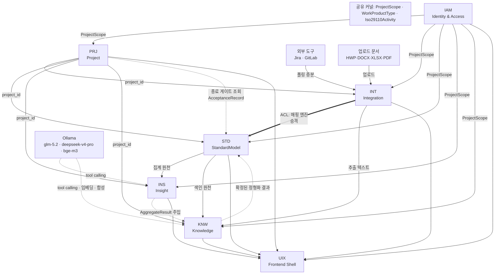
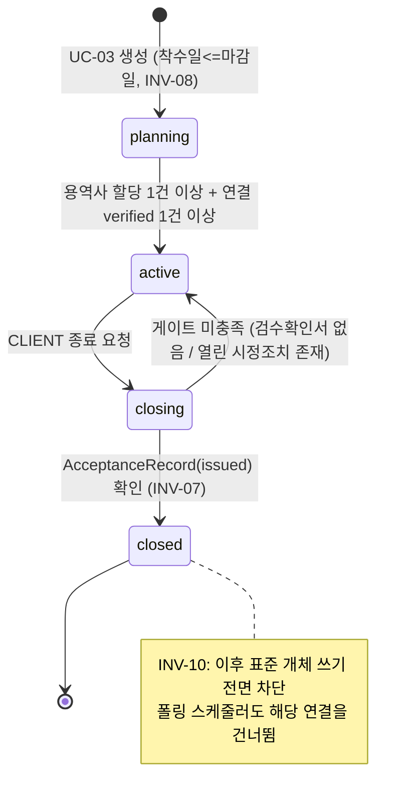
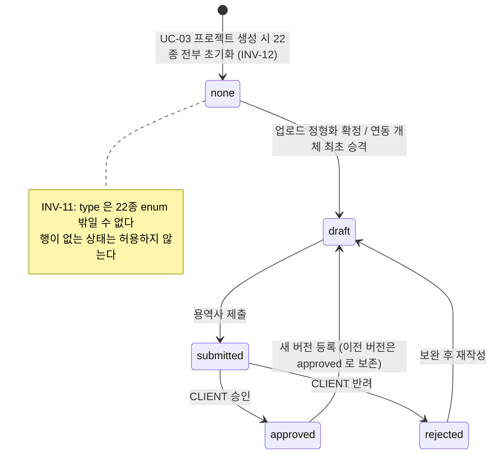
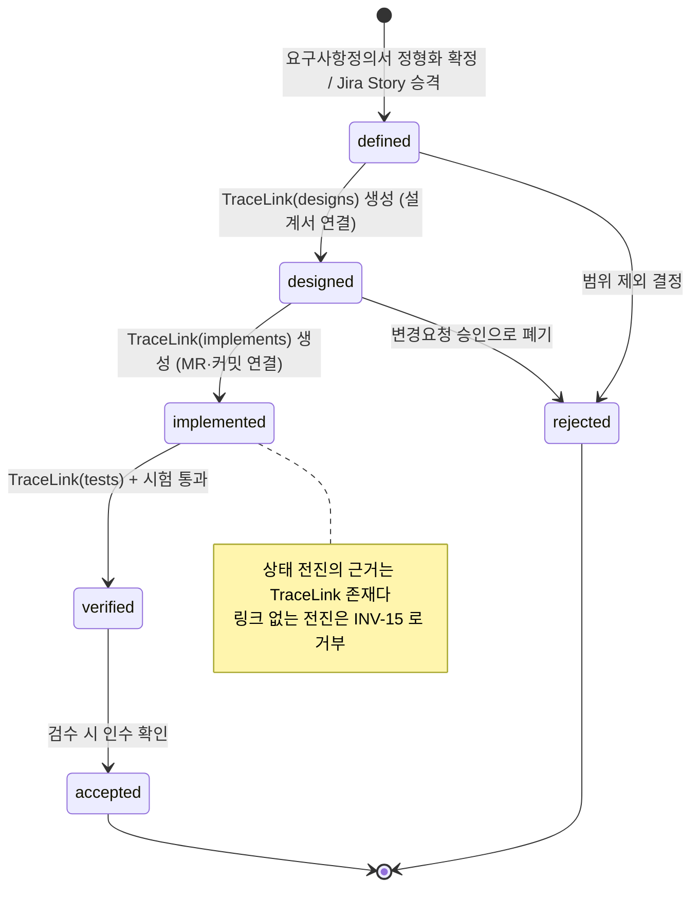
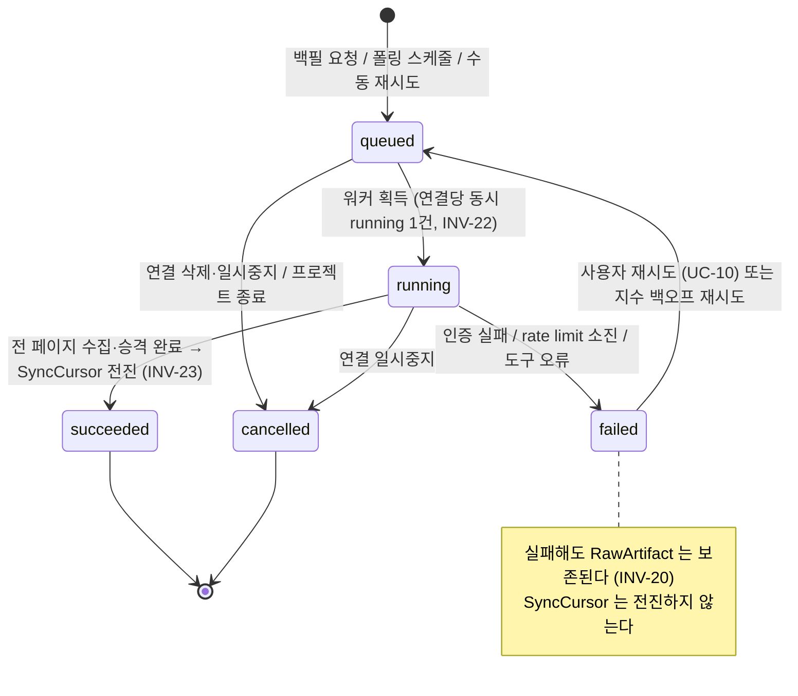

# AX-Link 개념 설계 — 도메인 개념 모델

> **2026-08-21 범위 확정**: 연동 도구는 형상관리 **GitHub** · 프로젝트 관리 **Redmine** 2종으로 확정했다.
> 이 문서의 Jira · GitLab · Notion 관련 서술은 그 시점 이전 기록이며 더 이상 유효하지 않다.
> 현재 범위는 `docs/AX-Link-PRD.md` §1.4 와 `docs/design/02-logical-datamodel.md` §3.5 를 따른다.

| 항목 | 내용 |
| --- | --- |
| 문서 ID | `01-conceptual-domain` |
| 버전 | v1.0 (2026-08-20) |
| 상위 원천 | `docs/AX-Link-PRD.md` |
| 범위 | 인증/RBAC · 프로젝트 · 도구 연동(Jira·GitLab 폴링) · ISO 29110 표준 적재 · 시맨틱/위젯 · RAG Q&A · 프론트 화면 |
| 후속 문서 참조 대상 | 컨텍스트 코드(§1), 개념명(§2), 불변식 ID `INV-xx`(§5), 상태값(§6) |

이 문서는 **개념**을 확정한다. 물리 스키마(컬럼 타입·인덱스), API 시그니처, 패키지 트리는 후속 문서가 다룬다.
단, 이름은 여기서 확정하며 후속 문서는 여기 이름을 그대로 쓴다.

---

## 1. 바운디드 컨텍스트

### 1.1 컨텍스트 목록

| 코드 | 컨텍스트 | 책임 | 소유 개념(대표) | PRD 범위 |
| --- | --- | --- | --- | --- |
| `IAM` | Identity & Access | 조직·계정·역할·프로젝트 할당·세부 권한. **ProjectScope(허용 project_id 집합) 산출의 유일한 권위** | Organization, AppUser, Role, ProjectAssignment, AssignmentPermission, ProjectScope | 1 |
| `PRJ` | Project | 프로젝트 생명주기(생성·진행·종료), 착수/마감 기간, 현재 SI 단계, 종료 게이트 | Project, ProjectClosure | 2 |
| `INT` | Integration | 외부 도구 연결·연결 테스트·매핑 규칙·폴링 증분 동기화·원본 보존. 표준 개념으로의 **승격 요청자** | ToolConnection, MappingRule, SyncJob, RawArtifact, DocumentUpload | 3 |
| `STD` | StandardModel | ISO/IEC 29110-5-1-2 표준 개념의 **유일한 소유자**. 승격된 데이터의 정합성·상태 전이·이력 | Requirement, Issue, WorkProduct, Risk, TraceLink, ChangeRequest, CorrectionAction, ProgressRecord, MeetingRecord, AcceptanceRecord, EntityHistory | 4 |
| `INS` | Insight (Semantic + Widget) | 시맨틱 카탈로그(measure·dimension·filter), WidgetSpec 검증, 파라미터라이즈드 집계 실행, 대시보드 레이아웃 | SemanticMeasure, SemanticDimension, SemanticFilter, WidgetSpec, Widget, Dashboard, AggregateResult | 5 |
| `KNW` | Knowledge (RAG) | 청킹·임베딩·하이브리드 검색·합성·출처. 비정형 문서의 표준 구조 정형화 초안 | DocChunk, StructuringDraft, Conversation, Message, MessageSource, RetrievalSet | 6, 6-1 |
| `UIX` | Frontend Shell | 화면·라우팅·상태. 자체 도메인 없음. 모든 데이터는 위 6개 컨텍스트의 API에서만 온다 | — | 7 |

`UIX`는 도메인 개념을 소유하지 않는다. 프론트에 목업 데이터 파일을 두지 않는 규칙(§PRD 6.1.1)의 개념적 근거가 이것이다.

### 1.2 공유 커널 (Shared Kernel)

세 값 개념만 전 컨텍스트가 공유한다. 그 외 개념의 교차 참조는 ID 참조로만 한다.

| 공유 개념 | 정의 | 소유 | 소비 |
| --- | --- | --- | --- |
| `ProjectScope` | 요청자가 접근 가능한 `project_id` 집합. 역할 × 할당으로 계산 | IAM | PRJ, INT, STD, INS, KNW |
| `WorkProductType` | 산출물 22종 폐쇄 enum | STD | INT, INS, KNW, UIX |
| `Iso29110Activity` | `PM.1~PM.4`, `SI.1~SI.6` 폐쇄 enum | STD | INT, INS, KNW, UIX |

프론트는 `WorkProductType`·`Iso29110Activity`를 `frontend/src/standard/`에 **단일 정의**하고, 서버 enum과 값이 1:1 일치해야 한다(INV-18).

### 1.3 컨텍스트 간 관계

| 상류(Upstream) | 하류(Downstream) | 관계 유형 | 전달 개념 | 방향 근거 |
| --- | --- | --- | --- | --- |
| IAM | PRJ, INT, STD, INS, KNW | Conformist (하류가 IAM 계약을 그대로 수용) | ProjectScope | 권한 판정은 단일 지점 |
| PRJ | INT, STD, INS, KNW | Customer/Supplier | Project 식별자·상태·기간 | 모든 표준 데이터는 프로젝트에 귀속 |
| INT | STD | ACL (Anti-Corruption Layer = 매핑 엔진) | 승격 후보(정규화된 표준 개념 초안) | 도구 스키마가 표준 모델을 오염시키지 않게 차단 |
| INT | KNW | Customer/Supplier | DocumentUpload 텍스트 | 정형화·색인 입력 |
| STD | INS | Open Host (시맨틱 카탈로그가 공개 계약) | 집계 가능한 표준 개념 | 위젯은 표준 개념만 집계 |
| STD | KNW | Customer/Supplier | 색인 대상 본문 + 출처 URI | 청킹 원천 |
| KNW | STD | Customer/Supplier (역방향, 확정 시에만) | 확정된 StructuringDraft → WorkProduct/Requirement | 사용자 확정 전에는 STD에 쓰지 않음 |
| INS | KNW | Customer/Supplier | AggregateResult(집계형 질의 컨텍스트 주입) | 집계 질문의 정확도 확보 |
| 전 컨텍스트 | UIX | Open Host (REST) | 화면 데이터 | 프론트는 소비만 |

**PRJ → STD 는 있으나 STD → PRJ 는 없다.** 예외 한 건: 프로젝트 종료 게이트가 `AcceptanceRecord` 존재를 조회한다. 이 조회는 PRJ가 STD에 질의하는 단방향 읽기이며, STD는 PRJ를 알지 못한다(INV-07).

### 1.4 컨텍스트 맵

---

## 2. 핵심 도메인 개념 사전

식별자는 전부 `uuid`를 기본 키로 갖는다. 아래 "식별자" 열은 **개념적 동일성 판정 기준**(자연키)을 적는다.

### 2.1 IAM

| 개념(한글) | 개념(영문) | 정의 | 식별자 | 생명주기 상태 |
| --- | --- | --- | --- | --- |
| 조직 | `Organization` | 발주사 또는 용역사. 계정과 프로젝트 소유의 최상위 경계 | `name` | 없음(활성만) |
| 계정 | `AppUser` | 로그인 주체. 정확히 하나의 조직에 소속 | `email` (전역 유일) | `invited` → `active` → `disabled` |
| 역할 | `Role` | `SUPER_ADMIN` / `CLIENT` / `CONTRACTOR`. 계정당 1개 | enum 값 | 없음(값 개념) |
| 프로젝트 할당 | `ProjectAssignment` | 용역사 조직·계정에 특정 프로젝트 접근을 부여하는 연결 | `(project_id, contractor_org_id, user_id)` | `active` → `revoked` |
| 할당 권한 | `AssignmentPermission` | 할당 단위 세부 토글 3종: 연동설정·문서업로드·대시보드읽기 | ProjectAssignment에 종속된 값 개념 | 없음 |
| 접근 범위 | `ProjectScope` | 요청자에게 허용된 project_id 집합. **모든 조회·집계·검색에 강제 주입되는 값 개념** | 요청 단위 파생값 | 없음 |
| 감사 기록 | `AuditEntry` | 권한·설정 변경 행위 기록(누가·무엇을·언제) | `(actor_id, occurred_at, action)` | 불변(append-only) |

### 2.2 PRJ

| 개념(한글) | 개념(영문) | 정의 | 식별자 | 생명주기 상태 |
| --- | --- | --- | --- | --- |
| 프로젝트 | `Project` | 발주사가 발주한 사업 단위. 모든 표준 데이터의 귀속 루트 | `(client_org_id, name)` | `planning` → `active` → `closing` → `closed` |
| 사업 기간 | `ProjectPeriod` | 착수일·마감일 한 쌍. 열린 기간 없음 | Project에 종속된 값 개념 | 없음 |
| 현재 SI 단계 | `CurrentSiPhase` | 프로젝트가 현재 수행 중인 SI 활동(`SI.1`~`SI.6`) | Project에 종속된 값 개념 | 없음 |
| 종료 판정 | `ProjectClosure` | 종료 요청에 대한 게이트 판정 결과(검수확인서 존재 + 미결 조치 확인) | `project_id` | 판정 단위 일시 개념 |

### 2.3 INT

| 개념(한글) | 개념(영문) | 정의 | 식별자 | 생명주기 상태 |
| --- | --- | --- | --- | --- |
| 도구 연결 | `ToolConnection` | 한 프로젝트와 한 외부 도구 인스턴스/리소스의 연결. 인증정보와 대상 리소스를 보유 | `(project_id, tool, target_resource)` | `draft` → `verified` → `active` → `paused` / `failed` |
| 도구 유형 | `ToolKind` | `JIRA` / `GITLAB` (본 범위). enum | 값 개념 | 없음 |
| 매핑 규칙 | `MappingRule` | 도구 개체 유형(Jira issuetype, GitLab 개체종류) → 표준 개념 + 상태 매핑. **연결별 데이터이며 코드가 아니다** | `(tool_connection_id, source_kind, source_value)` | `active` / `disabled` |
| 동기화 잡 | `SyncJob` | 한 번의 수집 실행 단위. 종류: `BACKFILL` / `POLL` | `(tool_connection_id, kind, started_at)` | `queued` → `running` → `succeeded` / `failed` / `cancelled` |
| 동기화 커서 | `SyncCursor` | 증분 폴링 기준점(`updated_since` 시각 + 페이지 토큰) | `tool_connection_id` | 갱신되는 값 개념 |
| 원본 산출물 | `RawArtifact` | 도구 응답 원본 JSON 무손실 보존체 | `(tool_connection_id, external_id, fetched_at)` | 불변 |
| 승격 후보 | `PromotionCandidate` | 매핑 엔진이 RawArtifact에서 만든 표준 개념 초안. STD에 upsert되기 직전의 일시 개념 | `(tool_connection_id, external_id)` | 일시(영속 안 함) |
| 문서 업로드 | `DocumentUpload` | 업로드된 비정형 파일과 추출 텍스트 | `(project_id, file_hash)` | `uploaded` → `extracted` → `structured` → `confirmed` / `rejected` |

### 2.4 STD — ISO 29110 표준 개념

| 개념(한글) | 개념(영문) | 정의 | 식별자 | 생명주기 상태 |
| --- | --- | --- | --- | --- |
| 요구사항 | `Requirement` | 발주사가 요구하고 용역사가 이행해야 할 단위 항목 | `(project_id, code)` 또는 `(tool_connection_id, external_id)` | `defined` → `designed` → `implemented` → `verified` → `accepted` (+ `rejected`) |
| 이슈 | `Issue` | 진행 중 작업·결함 | `(tool_connection_id, external_id)` | `open` → `in_progress` → `resolved` → `closed` |
| 산출물 | `WorkProduct` | ISO 29110 22종 중 하나에 해당하는 문서·성과물. 22종 밖은 존재할 수 없다 | `(project_id, type, version)` | `none` → `draft` → `submitted` → `approved` (+ `rejected` → `draft`) |
| 리스크 | `Risk` | 발생 확률과 영향으로 평가되는 잠재 위협 | `(project_id, title)` | `open` → `mitigating` → `closed` |
| 추적 링크 | `TraceLink` | 두 표준 개념 사이의 방향성 있는 추적 관계(`designs`/`implements`/`tests`/`delivers`) | `(from_type, from_id, to_type, to_id, link_kind)` | `active` / `broken` |
| 변경요청 | `ChangeRequest` | 승인된 기준선에 대한 변경 요구 | `(project_id, code)` | `requested` → `reviewing` → `approved` / `rejected` → `applied` |
| 시정조치 | `CorrectionAction` | 점검·검토에서 발견된 부적합에 대한 조치 항목 | `(project_id, code)` | `open` → `done`, 기한 경과 시 `overdue` |
| 진척 기록 | `ProgressRecord` | 기간 단위 계획 대비 실적 | `(project_id, period)` | 불변(기간별 upsert) |
| 회의록 | `MeetingRecord` | PM.2 회의 기록 | `(project_id, held_at)` | 불변 |
| 검수확인서 | `AcceptanceRecord` | 발주사가 인도물 인수를 확인한 기록. **프로젝트 종료의 유일한 전제** | `project_id` (프로젝트당 최대 1건 유효) | `issued` (취소 시 `voided`) |
| 개체 이력 | `EntityHistory` | 표준 개체 필드 전이의 append-only 감사 기록 | `(entity_type, entity_id, changed_at, field)` | 불변 |

### 2.5 INS

| 개념(한글) | 개념(영문) | 정의 | 식별자 | 생명주기 상태 |
| --- | --- | --- | --- | --- |
| 측정치 | `SemanticMeasure` | 집계 가능한 지표 정의(키·라벨·허용 차원·설명). LLM에 enum으로 노출 | `key` | `active` / `deprecated` |
| 차원 | `SemanticDimension` | 그룹핑 축 정의(용역사, 산출물유형, 상태, 심각도, 기간 등) | `key` | `active` / `deprecated` |
| 필터 | `SemanticFilter` | 허용 필터 필드·연산자 정의 | `(field, op)` | `active` / `deprecated` |
| 위젯 스펙 | `WidgetSpec` | `{template, title, query{measure, dimensions, filters, projectScope}, options}` JSON. **위젯의 본질은 이 데이터이며 코드가 아니다** | Widget에 종속된 값 개념 | 없음(검증 통과/실패만 존재) |
| 위젯 | `Widget` | 대시보드에 배치된 하나의 시각화 인스턴스 | `(dashboard_id, id)` | `active` / `deleted` |
| 대시보드 | `Dashboard` | 위젯 배치판. 레이아웃의 단일 원천은 서버 | `(owner_user_id, name, project_id?)` | `active` / `deleted` |
| 집계 결과 | `AggregateResult` | 검증된 WidgetSpec을 파라미터라이즈드 쿼리로 실행한 행 집합 | 실행 단위 일시 개념 | 없음 |

### 2.6 KNW

| 개념(한글) | 개념(영문) | 정의 | 식별자 | 생명주기 상태 |
| --- | --- | --- | --- | --- |
| 문서 청크 | `DocChunk` | 검색 단위 텍스트 조각 + 1024차원 임베딩 + 출처 메타 | `(source_type, source_id, chunk_index)` | `indexed` → `stale` → `reindexed` / `deleted` |
| 정형화 초안 | `StructuringDraft` | 업로드 문서를 `deepseek-v4-pro:cloud` tool calling으로 ISO 29110 구조로 변환한 **미확정** 결과(산출물 유형 추정, 제목·버전·작성일, 추출 요구사항 목록) | `document_upload_id` | `proposed` → `confirmed` / `rejected` / `manual_override` |
| 검색 결과 집합 | `RetrievalSet` | 벡터 top-k ∪ FTS top-k → RRF 융합 → top-8 청크 목록 | 질의 단위 일시 개념 | 없음 |
| 대화 | `Conversation` | 사용자별 Q&A 스레드. 프로젝트 범위를 보유 | `(user_id, id)` | `active` → `pinned` ↔ `active` → `deleted` |
| 메시지 | `Message` | 대화 내 한 턴(`user` / `assistant`) | `(conversation_id, seq)` | `streaming` → `complete` / `aborted` |
| 출처 | `MessageSource` | 답변 각주 `[n]`과 근거 청크의 1:1 대응 | `(message_id, footnote_no)` | 불변 |

---

## 3. ISO/IEC 29110-5-1-2 매핑

### 3.1 활동 → 도메인 개념

| 활동 | 활동명 | 주 도메인 개념 | 컨텍스트 | 시스템에서의 관측 방식 |
| --- | --- | --- | --- | --- |
| PM.1 | Project Planning | `Project`, `ProjectPeriod`, `WorkProduct(PROJECT_PLAN, STATEMENT_OF_WORK, PROJECT_REPOSITORY)` | PRJ, STD | 프로젝트 생성 + 계획 문서 업로드 |
| PM.2 | Project Plan Execution | `ProgressRecord`, `MeetingRecord`, `ChangeRequest`, `WorkProduct(REPOSITORY_BACKUP)` | STD | Jira 스프린트/버전 집계, 회의록·변경요청서 업로드 |
| PM.3 | Project Assessment and Control | `ProgressRecord`, `Risk`, `CorrectionAction` | STD | 계획 대비 실적 비교, 리스크·시정조치 등록 |
| PM.4 | Project Closure | `AcceptanceRecord`, `ProjectClosure` | STD, PRJ | 검수확인서 등록 → 종료 |
| SI.1 | SI Initiation | `ToolConnection`, `ProjectAssignment`, `WorkProduct(PROJECT_REPOSITORY)` | INT, IAM | 도구 연결 등록·검증, 용역사 할당 |
| SI.2 | Requirements Analysis | `Requirement`, `TraceLink`, `WorkProduct(REQUIREMENTS_SPEC, TRACEABILITY_RECORD, VERIFICATION_RESULTS)` | STD | Jira Story 승격 + 요구사항정의서 정형화 |
| SI.3 | Architectural & Detailed Design | `WorkProduct(SOFTWARE_DESIGN, TEST_CASES_PROCEDURES)`, `TraceLink(designs)` | STD | 설계서·시험계획서 업로드 |
| SI.4 | Software Construction | `WorkProduct(SOFTWARE_COMPONENT)`, `Issue`, `TraceLink(implements)` | STD | GitLab Commit/MR |
| SI.5 | Integration & Tests | `WorkProduct(SOFTWARE, TEST_REPORT, PRODUCT_OPERATION_GUIDE, SOFTWARE_USER_DOC)`, `TraceLink(tests)` | STD | GitLab Pipeline/Release |
| SI.6 | Product Delivery | `WorkProduct(SOFTWARE_CONFIGURATION, MAINTENANCE_DOC)`, `TraceLink(delivers)` | STD | 릴리스 태그 + 인도 문서 |

### 3.2 산출물 22종 → 개념 대응

`WorkProduct.type` enum 22개 전부. "연동 자동 채움"은 도구 데이터로 상태·존재가 자동 갱신되는지를 뜻한다.

| # | enum | 화면 이름 | 주 활동 | 대응 개념(문서 외) | 연동 자동 채움 |
| --- | --- | --- | --- | --- | --- |
| 1 | `STATEMENT_OF_WORK` | 과업지시서 | PM.1 | `Requirement`(추출 시) | 업로드 정형화 |
| 2 | `PROJECT_PLAN` | 사업수행계획서 | PM.1 | `ProjectPeriod` | 업로드 정형화 |
| 3 | `PROGRESS_STATUS_RECORD` | 진척 보고 | PM.2·PM.3 | `ProgressRecord` | Jira 스프린트/버전 |
| 4 | `MEETING_RECORD` | 회의록 | PM.2 | `MeetingRecord` | 업로드 |
| 5 | `CHANGE_REQUEST` | 변경 요청서 | PM.2 | `ChangeRequest` | 업로드 / Jira 이슈타입 매핑 |
| 6 | `CORRECTION_REGISTER` | 시정조치 대장 | PM.3 | `CorrectionAction` | 업로드 / Jira 이슈타입 매핑 |
| 7 | `ACCEPTANCE_RECORD` | 검수확인서 | PM.4 | `AcceptanceRecord` | 발주사 직접 등록만 |
| 8 | `PROJECT_REPOSITORY` | 사업 저장소 | PM.1~4 | `ToolConnection` | GitLab 연결 존재로 충족 |
| 9 | `REPOSITORY_BACKUP` | 저장소 백업 | PM.2 | — | 업로드 |
| 10 | `REQUIREMENTS_SPEC` | 요구사항정의서 | SI.2 | `Requirement` 집합 | 업로드 정형화 |
| 11 | `TRACEABILITY_RECORD` | 요구사항추적표 | SI.2~SI.6 | `TraceLink` 집합 | 시스템 자동 생성 |
| 12 | `SOFTWARE_DESIGN` | 설계서 | SI.3 | `TraceLink(designs)` | 업로드 |
| 13 | `TEST_CASES_PROCEDURES` | 시험계획서 | SI.3·SI.4 | `TraceLink(tests)` | 업로드 |
| 14 | `SOFTWARE_COMPONENT` | 프로그램 구성요소 | SI.4 | GitLab Commit/MR 형상 이력 | GitLab |
| 15 | `SOFTWARE` | 통합 소프트웨어 | SI.5 | GitLab Release | GitLab |
| 16 | `TEST_REPORT` | 시험결과서 | SI.5 | GitLab Pipeline 결과 | GitLab |
| 17 | `PRODUCT_OPERATION_GUIDE` | 운영지침서 | SI.5 | — | 업로드 |
| 18 | `SOFTWARE_USER_DOC` | 사용자취급설명서 | SI.5 | — | 업로드 |
| 19 | `SOFTWARE_CONFIGURATION` | 소프트웨어 형상 | SI.6 | GitLab Tag/Branch | GitLab |
| 20 | `MAINTENANCE_DOC` | 유지보수문서 | SI.6 | — | 업로드 |
| 21 | `VERIFICATION_RESULTS` | 검토 결과 | 각 활동 | `CorrectionAction` 발생원 | 업로드 |
| 22 | `VALIDATION_RESULTS` | 확인 결과 | 각 활동 | `AcceptanceRecord` 근거 | 업로드 |

### 3.3 도구 데이터의 표준 개념 승격 규칙 (개념 수준)

**승격 4원칙**

| 원칙 | 내용 |
| --- | --- |
| P1 무손실 보존 | 도구 응답 원본은 항상 `RawArtifact`로 먼저 보존한다. 승격 실패해도 원본은 남는다 |
| P2 규칙의 데이터화 | 도구 개체 → 표준 개념 결정은 `MappingRule`(연결별 데이터)로만 한다. 코드에 도구별 분기를 넣지 않는다 |
| P3 멱등 승격 | 승격은 `(tool_connection_id, external_id)` 기준 upsert다. 같은 개체를 몇 번 수집해도 표준 개체는 1개다 |
| P4 상태 이력화 | 승격으로 표준 개체의 상태가 바뀌면 `EntityHistory`에 append한다. 덮어쓰기만 하고 지나가지 않는다 |

**기본 매핑 규칙 (연결 생성 시 시드되며, 이후 사용자가 편집 가능)**

| 도구 | 원천 개체 | 판별 기준 | 승격 대상 개념 | 상태 정규화 |
| --- | --- | --- | --- | --- |
| Jira | Issue | issuetype = `Story` | `Requirement` | statusCategory `To Do`→`defined`, `In Progress`→`designed`, `Done`→`implemented` |
| Jira | Issue | issuetype = `Bug`, `Task`, `Sub-task` | `Issue` | `To Do`→`open`, `In Progress`→`in_progress`, `Done`→`resolved` |
| Jira | Issue | issuetype = `Risk`(커스텀) | `Risk` | `To Do`→`open`, `In Progress`→`mitigating`, `Done`→`closed` |
| Jira | Sprint / Version | — | `ProgressRecord` | 완료 스토리포인트 / 전체 → `actual_pct` |
| GitLab | Merge Request | — | `WorkProduct(SOFTWARE_COMPONENT)` 형상 이력 + `TraceLink(implements)` | MR 상태 `merged`→링크 `active` |
| GitLab | Commit | 메시지에 이슈 키 포함 | `TraceLink(implements)` | 항상 `active` |
| GitLab | Issue | — | `Issue` | `opened`→`open`, `closed`→`closed` |
| GitLab | Pipeline | — | `WorkProduct(TEST_REPORT)` 상태 원천 | `success`→`submitted`, `failed`→`draft` |
| GitLab | Release / Tag | — | `WorkProduct(SOFTWARE)`, `WorkProduct(SOFTWARE_CONFIGURATION)` | 릴리스 생성 → `submitted` |
| 업로드 문서 | 파일 | `StructuringDraft` 확정 | `WorkProduct` + (있으면) `Requirement` 집합 + `DocChunk` | 확정 시 `draft` 또는 사용자 지정 상태 |

**추적 링크 자동 생성 규칙**: MR 제목/커밋 메시지에서 이슈 키 패턴(`PROJ-123`)을 발견하면, 같은 프로젝트 내에서 그 키를 `external_id`로 갖는 `Requirement` 또는 `Issue`를 찾아 `TraceLink(link_kind=implements, origin=auto)`를 생성한다. 대상을 찾지 못하면 링크를 만들지 않는다(고아 링크 금지, INV-13).

**승격 거부 규칙**: `MappingRule`이 없는 도구 개체는 승격하지 않고 `RawArtifact`로만 남긴 뒤 `SyncJob.stats`에 `unmapped` 건수로 집계한다. 잡은 실패가 아니다.

---

## 4. 핵심 유스케이스

모든 유스케이스의 암묵 사전조건: 요청자가 인증되어 있고, 대상 프로젝트가 요청자의 `ProjectScope`에 포함된다(UC-01, UC-02 제외).

| UC-ID | 유스케이스 | 액터 | 사전조건 | 주요 흐름 | 사후조건 |
| --- | --- | --- | --- | --- | --- |
| UC-01 | 조직·계정 등록 | SUPER_ADMIN | 로그인 | ① 조직 등록(명·유형) ② 계정 생성(이메일·역할) ③ 초대 발송 ④ 피초대자 비밀번호 설정 | `AppUser.status = active`, `AuditEntry` 기록 |
| UC-02 | 로그인·세션 | 전 역할 | 계정 `active` | ① 이메일·비밀번호 제출 ② 자격 검증 ③ 역할·조직·ProjectScope 산출 ④ 세션 발급 | 세션 유효, 이후 요청에 ProjectScope 결정 |
| UC-03 | 프로젝트 생성 | CLIENT | 발주사 조직 소속 | ① 프로젝트명·착수일·마감일·설명 입력 ② 착수일 ≤ 마감일 검증 ③ 생성 ④ 기본 대시보드 1개 자동 생성 ⑤ 22종 산출물 점검표를 전부 `none`으로 초기화 | `Project.status = planning`, `Dashboard` 1건, `WorkProduct` 22건 `none` |
| UC-04 | 용역사 할당·권한 토글 | CLIENT | 프로젝트 소유 | ① 용역사 조직 선택 ② 계정 선택 ③ 권한 토글 3종 설정 ④ 저장 | `ProjectAssignment.active`, 해당 CONTRACTOR의 ProjectScope 확장 |
| UC-05 | 프로젝트 목록·상세 조회 | CLIENT, CONTRACTOR | — | ① 목록 요청 ② ProjectScope로 필터 ③ 카드별 현재 SI 단계·필수 산출물 승인 n/m·열린 조치 수 계산 ④ 상세 진입 | 조회만, 상태 변화 없음 |
| UC-06 | 도구 연결 등록·테스트 | CONTRACTOR | 할당 권한 `연동설정 = true` | ① 도구 유형·베이스 URL·인증정보·대상 리소스 입력 ② 연결 테스트 실행 ③ 성공 시 저장(인증정보 암호화) ④ 기본 MappingRule 시드 | `ToolConnection.status = verified`, 기본 규칙 N건 |
| UC-07 | 초기 백필 | 시스템(스케줄러) | 연결 `verified` | ① `SyncJob(BACKFILL)` 생성 ② 페이지네이션으로 전체 이력 수집 ③ RawArtifact 보존 ④ 매핑 엔진으로 승격 upsert ⑤ SyncCursor 초기화 | `ToolConnection.status = active`, 표준 개체 적재, `SyncJob.succeeded` |
| UC-08 | 증분 폴링 동기화 | 시스템(스케줄러) | 연결 `active`, SyncCursor 존재 | ① 15분 주기 기동 ② `updated_since = SyncCursor` 로 증분 조회 ③ 승격 upsert + EntityHistory append ④ SyncCursor 전진 | 표준 개체 최신화, `SyncJob` 1건 종결 |
| UC-09 | 매핑 규칙 편집 | CONTRACTOR | 연결 소유 | ① 규칙 목록 조회 ② 도구 개체값 → 표준 개념·상태 매핑 수정 ③ 저장 ④ 재적용 여부 선택(다음 폴링부터 / 즉시 백필) | `MappingRule` 갱신, 선택 시 `SyncJob(BACKFILL)` 생성 |
| UC-10 | 동기화 현황 조회·재시도 | CLIENT, CONTRACTOR | — | ① 연결별 최근 동기화 시각·적재 건수 조회 ② 실패 잡 목록·오류 원문 확인 ③ 재시도 실행 | 새 `SyncJob` 생성, 실패 잡은 이력으로 보존 |
| UC-11 | 문서 업로드·정형화·확정 적재 | CONTRACTOR, CLIENT | 할당 권한 `문서업로드 = true` | ① 파일 업로드 ② 텍스트 추출 ③ `deepseek-v4-pro:cloud` tool calling으로 정형화 ④ 22종 enum 화이트리스트 검증(밖이면 수동 지정으로 강등) ⑤ 사용자가 유형·제목·버전·추출 요구사항 확정 ⑥ WorkProduct/Requirement 적재 + 청킹·임베딩 색인 | `WorkProduct.status = draft` 이상, `DocChunk` N건 `indexed`, `StructuringDraft.confirmed` |
| UC-12 | 산출물 22종 점검표 조회 | CLIENT, CONTRACTOR | — | ① 프로젝트 선택 ② 22종 × 적용대상 여부 × 상태 조회 ③ 미제출은 `none`으로 표시 ④ 상세로 이동 | 조회만 |
| UC-13 | 요구사항 추적 조회 | CLIENT, CONTRACTOR | — | ① 요구사항 목록 조회 ② 각 요구사항의 설계·구현(MR)·시험 링크 전개 ③ 링크 없는 구간 하이라이트 | 조회만, 추적 끊김 식별 |
| UC-14 | AI 위젯 생성 | CLIENT | 대시보드 소유 | ① 템플릿 8종 중 선택 ② 자연어 프롬프트 또는 사전정의 지표 선택 + 프로젝트 범위 지정 ③ `glm-5.2:cloud` tool calling으로 measure·dimensions·filters 산출 ④ 서버가 카탈로그 화이트리스트로 재검증(실패 시 1회 재시도 후 "Q&A로 질문하기" 제안) ⑤ ProjectScope 강제 주입 후 파라미터라이즈드 쿼리 실행 ⑥ 미리보기 확인 후 배치 | `Widget` 1건 + `WidgetSpec` 저장, `Dashboard.layout` 갱신 |
| UC-15 | 대시보드 레이아웃 편집 | CLIENT | 대시보드 소유 | ① 편집 모드 진입 ② 위젯 이동·리사이즈·삭제 ③ 저장 또는 취소 ④ 저장 시 서버 DB에 레이아웃 직렬화 | 서버 레이아웃 갱신. 클라이언트 저장소에는 아무것도 남기지 않음 |
| UC-16 | AI Q&A 질의 | CLIENT, CONTRACTOR | — | ① 프로젝트 범위 선택(권한 내) ② 질의 입력 ③ 라우터가 집계형/문서형 분류 ④ 집계형이면 시맨틱 결과를 컨텍스트에 주입 ⑤ 하이브리드 검색(벡터 ∪ FTS → RRF → top-8, ProjectScope WHERE 강제) ⑥ `glm-5.2:cloud` 합성 스트리밍 ⑦ 각주 ↔ MessageSource 1:1 저장 | `Message.complete`, `MessageSource` N건, 출처 딥링크 제공 |
| UC-17 | 대화 관리·응답 평가 | CLIENT, CONTRACTOR | 대화 소유 | ① 대화 목록 조회 ② 생성·핀·삭제 ③ 답변에 👍/👎 기록 | `Conversation` 상태 갱신, `Message.feedback` 저장 |
| UC-18 | 검수확인서 등록·프로젝트 종료 | CLIENT | 프로젝트 `active` 또는 `closing` | ① PM.4 인도 산출물 확인 ② 검수확인서 등록(인수자·인수일·조건·문서) ③ 종료 요청 ④ 게이트 판정: 검수확인서 존재 + 필수 산출물 승인 + 열린 시정조치 0 ⑤ AlertDialog 확정 | `AcceptanceRecord.issued`, `Project.status = closed`, 이후 쓰기 차단 |

---

## 5. 도메인 불변식 (Invariant)

후속 설계·구현·테스트는 이 ID를 참조한다. 각 불변식은 **강제 지점**(어디서 지키는가)을 함께 확정한다.

### 5.1 권한·접근

| ID | 불변식 | 강제 지점 |
| --- | --- | --- |
| INV-01 | 모든 계정은 정확히 하나의 조직에 속하고 정확히 하나의 역할을 갖는다 | DB 제약 + 등록 서비스 |
| INV-02 | CONTRACTOR는 `ProjectAssignment.active`가 존재하는 프로젝트에만 접근한다 | ProjectScope 산출 로직 |
| INV-03 | CLIENT는 자사 조직이 소유(`client_org_id`)한 프로젝트에만 접근한다 | ProjectScope 산출 로직 |
| INV-04 | 데이터 조회·집계·검색 쿼리는 예외 없이 `project_id IN (ProjectScope)` 를 포함한다. **LLM 프롬프트가 아니라 쿼리 레이어에서 강제한다** | 리포지토리/쿼리 빌더 (프롬프트 아님) |
| INV-05 | 도구 연결 등록·수정·삭제는 `AssignmentPermission.연동설정 = true` 인 CONTRACTOR만 수행한다. CLIENT는 조회만 한다 | 인가 서비스 |
| INV-06 | 인증정보(도구 토큰)는 저장 시 암호화되고, 어떤 조회 API도 평문을 반환하지 않는다(마스킹 값만) | 저장 어댑터 + 응답 DTO |

### 5.2 프로젝트

| ID | 불변식 | 강제 지점 |
| --- | --- | --- |
| INV-07 | `Project.status = closed` 로의 전이는 유효한 `AcceptanceRecord(issued)` 가 존재할 때만 가능하다 | 종료 서비스(ProjectClosure 게이트) |
| INV-08 | `start_date <= end_date`. 착수일·마감일은 둘 다 필수이며 열린 기간은 존재하지 않는다 | DB CHECK + 생성/수정 검증 |
| INV-09 | 프로젝트 생성 시 프로젝트명·착수일·마감일·설명 4개 필드가 전부 존재해야 한다 | DB NOT NULL + 생성 검증 |
| INV-10 | `closed` 프로젝트에는 어떤 표준 개체도 새로 쓰거나 수정할 수 없다. 폴링 스케줄러도 해당 프로젝트의 연결을 건너뛴다 | 쓰기 경로 가드 + 스케줄러 필터 |

### 5.3 표준 모델

| ID | 불변식 | 강제 지점 |
| --- | --- | --- |
| INV-11 | `WorkProduct.type` 은 22종 enum 안의 값만 가진다. 밖의 값은 저장 전에 거부된다 (LLM 제안 포함) | DB enum + 정형화 확정 검증 |
| INV-12 | 프로젝트당 22종 각 유형은 항상 존재하며, 미제출 상태는 `none` 으로 표현한다. 행이 없는 상태는 허용하지 않는다 | 프로젝트 생성 시 22행 초기화 |
| INV-13 | `TraceLink` 의 `from`·`to` 는 둘 다 같은 프로젝트에 실재하는 표준 개체를 가리킨다. 고아 링크는 생성하지 않는다 | 링크 생성 서비스 |
| INV-14 | 원천 연동 표준 개체의 동일성은 `(tool_connection_id, external_id)` 로 결정되며 upsert는 멱등이다 | UNIQUE 제약 |
| INV-15 | 표준 개체의 상태 전이는 §6의 전이도에 정의된 화살표만 허용한다. 정의되지 않은 전이는 거부한다 | 상태 전이 서비스 |
| INV-16 | 상태 전이가 발생하면 `EntityHistory` 에 append 된다. 이력 레코드는 수정·삭제되지 않는다 | 전이 서비스 + 권한 제약 |
| INV-17 | `AcceptanceRecord` 는 프로젝트당 유효본 1건만 존재한다 | 부분 UNIQUE 인덱스 |
| INV-18 | 프론트의 `standard/` enum 정의는 서버 enum과 값이 1:1 일치한다. 불일치는 빌드/테스트 실패로 간주한다 | enum 일치 테스트 |

### 5.4 연동

| ID | 불변식 | 강제 지점 |
| --- | --- | --- |
| INV-19 | 연결 테스트를 통과(`verified`)하지 않은 `ToolConnection` 에 대해서는 어떤 `SyncJob` 도 생성하지 않는다 | 잡 생성 서비스 |
| INV-20 | `RawArtifact` 저장은 표준 개념 승격보다 항상 먼저 일어난다. 승격 실패가 원본 보존을 되돌리지 않는다 | 수집 트랜잭션 경계 분리 |
| INV-21 | `MappingRule` 이 없는 도구 개체는 승격하지 않고 `unmapped` 로 집계한다. 이는 잡 실패가 아니다 | 매핑 엔진 |
| INV-22 | 한 연결에 대해 동시에 `running` 인 `SyncJob` 은 최대 1건이다 | 잡 획득 시 조건부 갱신 |
| INV-23 | `SyncCursor` 는 잡이 `succeeded` 일 때만 전진한다. 실패 시 되감지도 전진하지도 않는다 | 잡 종결 처리 |

### 5.5 인사이트·지식

| ID | 불변식 | 강제 지점 |
| --- | --- | --- |
| INV-24 | `WidgetSpec` 의 measure·dimension·filter 는 실행 직전 카탈로그 화이트리스트로 재검증된다. LLM이 반환했다는 사실은 신뢰 근거가 아니다 | 스펙 검증기 |
| INV-25 | 위젯 쿼리는 요청자의 `ProjectScope` 로 축소된 뒤 실행된다. spec 의 `projectScope` 는 축소만 가능하고 확장할 수 없다 | 쿼리 조립기 |
| INV-26 | 위젯 데이터 쿼리는 파라미터라이즈드 쿼리로만 실행한다. LLM 출력이 SQL 문자열로 연결되는 경로는 존재하지 않는다 | 쿼리 조립기 |
| INV-27 | 대시보드 레이아웃·위젯 상태의 단일 원천은 서버 DB다. 클라이언트 저장소(localStorage 등)에 레이아웃을 저장하지 않는다 | 프론트 규칙 + 코드 리뷰 |
| INV-28 | 위젯 렌더 경로는 `spec → 템플릿 렌더러` 1단계다. 위젯 종류를 닫힌 유니온 타입으로 선언하지 않는다 | 프론트 구조 규칙 |
| INV-29 | `DocChunk.embedding` 은 정확히 1024차원이다. 차원이 다른 벡터는 저장되지 않는다 | `vector(1024)` 컬럼 |
| INV-30 | 모든 `DocChunk` 는 `project_id` 와 출처 URI 를 갖는다. 둘 중 하나라도 없으면 색인하지 않는다 | NOT NULL + 색인 서비스 |
| INV-31 | 답변 본문의 각주 `[n]` 은 `MessageSource` 레코드와 1:1 대응한다. 대응 없는 각주가 포함된 답변은 각주를 제거한 뒤 반환한다 | 합성 후처리 |
| INV-32 | 검색 결과에 포함되지 않은 청크를 근거로 인용할 수 없다. 인용 가능 집합은 `RetrievalSet` 이 유일하다 | 합성 후처리 |
| INV-33 | `StructuringDraft` 는 사용자 확정(`confirmed`) 이전에는 어떤 표준 개체도 생성하지 않는다 | 정형화 확정 서비스 |
| INV-34 | LLM 구조화 출력은 tool calling 으로만 얻는다. `format` 파라미터(JSON Schema / `"json"`)에 의존하는 경로를 만들지 않는다 | LLM 포트 계약 |
| INV-35 | LLM·임베딩 어댑터는 Ollama 어댑터와 테스트용 결정적 Fake 어댑터 두 벌만 존재한다. Fake 임베딩도 1024차원을 생성한다 | 포트/어댑터 구조 |

---

## 6. 개념 수준 상태 기계

### 6.1 Project

### 6.2 WorkProduct

### 6.3 Requirement

### 6.4 SyncJob

---

## 부록. 후속 문서로 넘기는 항목

| 항목 | 넘기는 곳 |
| --- | --- |
| 물리 테이블·컬럼·인덱스·제약 DDL | 논리/물리 데이터 모델 문서 |
| REST 엔드포인트·요청/응답 DTO(record) 시그니처 | API 명세 문서 |
| 시맨틱 카탈로그 초기 measure·dimension·filter 확정 목록 | 시맨틱 레이어 설계 문서 |
| 청킹 파라미터·RRF 가중치·프롬프트 본문 | RAG 파이프라인 설계 문서 |
| 화면별 컴포넌트 구성과 라우트 | 프론트 설계 문서 |
