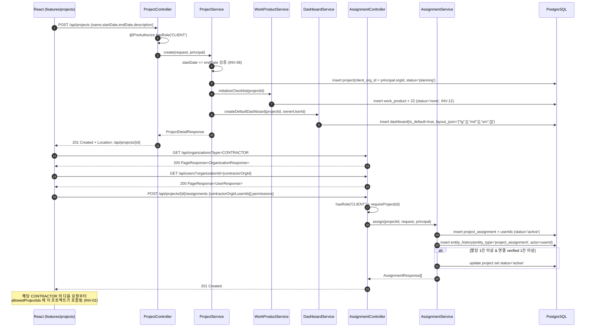
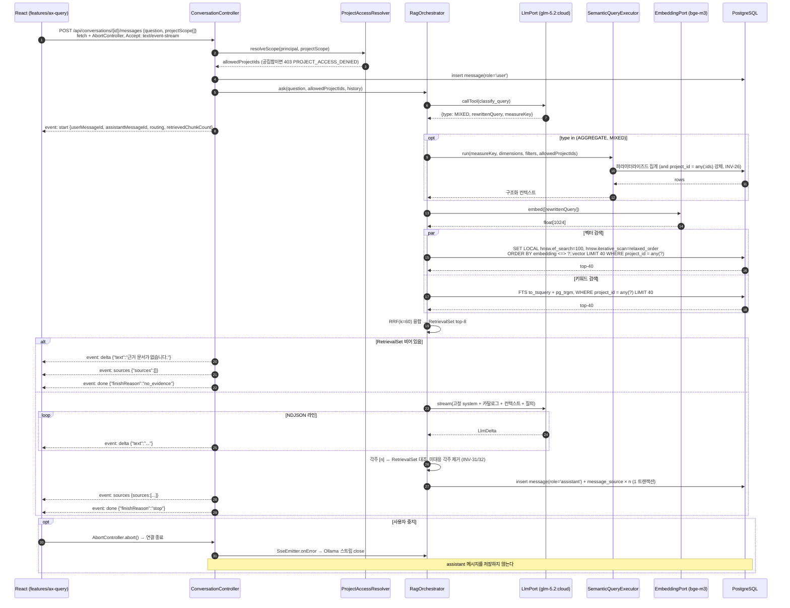

# AX-Link 논리 설계 — REST API 명세

| 항목 | 내용 |
| --- | --- |
| 문서 ID | `design/02-logical-api` |
| 버전 | v1.0 (2026-08-20) |
| 상위 문서 | `docs/AX-Link-PRD.md`, `design/01-conceptual-domain.md`, `design/01-conceptual-architecture.md` |
| 범위 | 구현 범위 1~7 전체의 HTTP 계약 |
| 계약 지위 | **이 문서가 백엔드·프론트 병렬 구현의 유일한 계약이다.** 여기 없는 엔드포인트·필드는 만들지 않는다 |

개념명·불변식 ID(`INV-xx`)·유스케이스 ID(`UC-xx`)는 `01-conceptual-domain.md` 를 그대로 참조한다.

---

## 1. API 공통 규약

### 1.1 기본

| 항목 | 확정값 |
| --- | --- |
| 베이스 경로 | `/api` (프론트는 Vite dev proxy `/api` → `http://localhost:8080`) |
| 미디어 타입 | 요청·응답 `application/json;charset=UTF-8`. 파일 업로드만 `multipart/form-data`, Q&A 스트리밍만 `text/event-stream` |
| 필드 네이밍 | **camelCase** 전면 적용. Jackson `PropertyNamingStrategies` 변경 없이 기본값 사용. DB 컬럼(snake_case)과의 변환은 엔티티 매핑이 담당 |
| DTO 형태 | 백엔드는 전부 `record`. 요청 `XxxRequest`, 응답 `XxxResponse`. 프론트 타입은 §3 인터페이스와 1:1 |
| ID 표기 | 모든 식별자는 UUID 문자열(`"3f2b...-..."`). 숫자 ID 없음 |
| null 정책 | 응답에서 값 없는 필드는 **키를 유지하고 `null`** 로 보낸다(`@JsonInclude` 기본값 유지). 프론트가 `undefined` 분기를 만들지 않게 한다 |
| 배열 정책 | 값 없는 배열은 `null` 이 아니라 `[]` |

### 1.2 인증 — Bearer JWT 로 확정

| 결정 | 내용 |
| --- | --- |
| 방식 | `Authorization: Bearer {accessToken}`. Access JWT 30분, Refresh 토큰 14일(DB 저장·1회용 회전) |
| Refresh 토큰 전달 | 응답 바디로 반환하고 프론트는 **메모리 + `sessionStorage`** 에 보관. 레이아웃·위젯 상태는 `INV-27` 로 클라이언트 저장이 금지되지만 토큰은 대상이 아니다 |
| 401 처리 | 만료 시 `AUTH_TOKEN_EXPIRED` → 프론트 인터셉터가 `POST /api/auth/refresh` 1회 재시도 후 실패하면 로그인 화면으로 이동 |
| 근거 | ① 프론트는 SPA 이고 API 는 단일 오리진이 아닐 수 있다(Vite dev 서버 분리) → 쿠키 SameSite 조정과 CSRF 토큰 파이프라인이 추가된다. ② Bearer 는 CSRF 대상이 아니므로 Spring Security 에서 `csrf().disable()` + `STATELESS` 로 끝난다. ③ `01-conceptual-architecture.md` §5.1 이 이미 `JwtAuthenticationFilter` 를 확정했다. 세션 쿠키를 쓰면 그 결정과 충돌한다 |
| 예외 경로 | 인증 없이 접근 가능한 경로는 `POST /api/auth/login`, `POST /api/auth/refresh`, `POST /api/auth/invitations/accept`, `GET /api/auth/invitations/{token}` 4개뿐이다 |

JWT 클레임:

```
sub        = userId (uuid)
orgId      = organizationId (uuid)
orgType    = CLIENT | CONTRACTOR | PLATFORM
role       = SUPER_ADMIN | CLIENT | CONTRACTOR
iat, exp
```

**`allowedProjectIds` 는 JWT 에 넣지 않는다.** 할당이 바뀌어도 토큰이 낡지 않아야 하므로 요청마다 `ProjectAccessResolver` 가 DB 에서 산출한다(§6).

### 1.3 페이지네이션·정렬

| 파라미터 | 타입 | 기본값 | 규칙 |
| --- | --- | --- | --- |
| `page` | int | `0` | **0-based**. 음수는 400 |
| `size` | int | `20` | 1~100. 초과 시 400(`VALIDATION_FAILED`) |
| `sort` | string | 엔드포인트별 기본값 | `field,asc` / `field,desc` 형식. 다중 정렬은 `sort` 파라미터 반복. **필드는 엔드포인트별 화이트리스트로만 허용**하며 밖의 값은 400 |

응답 봉투는 전 목록 엔드포인트 공통이다.

```ts
interface PageResponse<T> {
  content: T[];
  page: number;
  size: number;
  totalElements: number;
  totalPages: number;
  hasNext: boolean;
}
```

커서 페이지네이션은 쓰지 않는다. 목록 최대 규모(프로젝트 20 × 요구사항 수백)에서 offset 이 문제되지 않는다.

### 1.4 에러 응답

```ts
interface ErrorResponse {
  code: string;                            // §1.5 상수
  message: string;                         // 사용자 노출용 한국어 문장
  details: Record<string, unknown> | null; // 필드 오류·도구 원문 메시지 등
  path: string;                            // 요청 경로
  timestamp: string;                       // ISO-8601 UTC
}
```

- 모든 4xx·5xx 는 예외 없이 이 바디를 반환한다. 빈 바디 오류 응답을 만들지 않는다.
- Bean Validation 실패 시 `details = {"fieldErrors": [{"field": "startDate", "reason": "필수 값입니다"}]}`.
- 외부 도구 오류는 `details = {"toolStatus": 401, "toolMessage": "<도구 응답 원문>"}` 로 **원문을 그대로 전달**한다(PRD INT-002).

### 1.5 에러 코드 상수

| code | HTTP | 발생 지점 |
| --- | --- | --- |
| `VALIDATION_FAILED` | 400 | Bean Validation, 파라미터 화이트리스트 위반 |
| `AUTH_CREDENTIALS_INVALID` | 401 | 로그인 실패 |
| `AUTH_TOKEN_EXPIRED` | 401 | Access JWT 만료 |
| `AUTH_TOKEN_INVALID` | 401 | 서명 불일치·형식 오류·Refresh 재사용 감지 |
| `ROLE_FORBIDDEN` | 403 | 역할 게이트 실패(PRD §3.2 매트릭스) |
| `PROJECT_ACCESS_DENIED` | 403 | 대상 project_id 가 `allowedProjectIds` 밖 (INV-02/03/04) |
| `ASSIGNMENT_PERMISSION_DENIED` | 403 | `canConfigureIntegration` 등 세부 토글 미보유 (INV-05) |
| `RESOURCE_NOT_FOUND` | 404 | 식별자 미존재. **권한 밖 리소스도 존재 노출을 막기 위해 404 로 응답**(단 프로젝트 자체 접근은 403) |
| `DUPLICATE_RESOURCE` | 409 | 자연키 중복(조직명, 이메일, `(project_id, tool, target_resource)` 등) |
| `INVALID_STATE_TRANSITION` | 409 | §6.x 상태 전이도 밖 전이 (INV-15) |
| `PROJECT_CLOSED` | 409 | `closed` 프로젝트에 쓰기 시도 (INV-10) |
| `CLOSURE_GATE_UNSATISFIED` | 409 | 검수확인서 부재·필수 산출물 미승인·열린 시정조치 존재 (INV-07) |
| `WORK_PRODUCT_TYPE_REJECTED` | 422 | 22종 enum 밖 유형 (INV-11) |
| `CATALOG_VALIDATION_FAILED` | 422 | 시맨틱 카탈로그 화이트리스트 검증 실패 (INV-24) |
| `TOOL_AUTH_FAILED` | 422 | 연결 테스트 401/403 |
| `TOOL_RESOURCE_NOT_FOUND` | 422 | 연결 테스트 404(프로젝트 키·경로 오류) |
| `TOOL_UNREACHABLE` | 502 | 도구 네트워크 오류·타임아웃 |
| `DOCUMENT_PARSE_FAILED` | 422 | 텍스트 추출 실패 |
| `UNSUPPORTED_FILE_TYPE` | 415 | 허용 확장자 밖 |
| `PAYLOAD_TOO_LARGE` | 413 | 업로드 50MB 초과 |
| `SYNC_JOB_CONFLICT` | 409 | 해당 연결에 `running` 잡 존재 (INV-22) |
| `AI_UNAVAILABLE` | 503 | Ollama 연결 불가 |
| `AI_TOOL_CALL_FAILED` | 502 | `tool_calls` 누락(1회 재시도 후) |
| `INTERNAL_ERROR` | 500 | 그 외 |

### 1.6 HTTP 상태코드 사용 규칙

| 상태 | 사용처 |
| --- | --- |
| 200 | 조회 성공, 갱신(PATCH/PUT) 성공, 본문 있는 액션(POST) 성공 |
| 201 | 리소스 생성 성공. `Location` 헤더에 생성 리소스 경로. 본문은 생성된 리소스 전체 |
| 202 | 비동기 잡 접수(`POST /api/connections/{id}/sync`, 문서 업로드). 본문은 잡·문서 상태 |
| 204 | 본문 없는 성공(로그아웃, 삭제, 해제) |
| 4xx/5xx | §1.5 표대로. 그 외 상태코드를 만들지 않는다 |

`PUT` 은 전체 치환(레이아웃·매핑규칙)에만, `PATCH` 는 부분 수정에만 쓴다.

### 1.7 날짜·시각

| 종류 | 형식 | Java 타입 | 예 |
| --- | --- | --- | --- |
| 날짜 | `yyyy-MM-dd` | `LocalDate` | `"2026-03-01"` |
| 시각 | ISO-8601 UTC, 밀리초 3자리 + `Z` | `Instant` | `"2026-08-20T07:15:30.120Z"` |
| 기간 | 항상 `startDate` + `endDate` 한 쌍 | — | 열린 기간 표기 금지(PRD 6.1-6) |

`spring.jackson.time-zone=UTC`, `spring.jackson.serialization.write-dates-as-timestamps=false` 고정. 로컬 시각 변환은 전적으로 프론트 책임이다.

### 1.8 기타 규약

| 항목 | 규칙 |
| --- | --- |
| 대소문자 enum | 전송 값은 **대문자 스네이크**(`SUPER_ADMIN`, `REQUIREMENTS_SPEC`, `BACKFILL`). 단 표준 엔티티 상태값은 개념 모델과 동일한 **소문자**(`defined`, `submitted`, `open`) 를 유지한다 |
| 부분 조회 파라미터 | `q`(부분일치 검색), `status`, `projectId` 등 필터는 쿼리 파라미터. 다중값은 파라미터 반복(`status=open&status=closed`) |
| 비밀정보 | 응답에 평문 인증정보를 담지 않는다. 마스킹 `"****abcd"` 만 (INV-06) |
| 요청 크기 | JSON 본문 1MB, 업로드 50MB |
| CORS | dev 만 `http://localhost:5173` 허용. 운영은 동일 오리진 서빙 |

---

## 2. 엔드포인트 전수 표

역할 표기: **SA**=SUPER_ADMIN, **CL**=CLIENT, **CT**=CONTRACTOR. `CT*` 는 할당 세부 권한 토글 추가 검사가 붙는 항목.

### 2.1 auth

| 메서드 | 경로 | 요약 | 역할 | 요청 | 응답 | 주요 에러 |
| --- | --- | --- | --- | --- | --- | --- |
| POST | `/api/auth/login` | 로그인, 토큰 발급 | 익명 | `LoginRequest` | 200 `LoginResponse` | 401 `AUTH_CREDENTIALS_INVALID` |
| POST | `/api/auth/refresh` | Access 재발급(Refresh 회전) | 익명 | `RefreshTokenRequest` | 200 `LoginResponse` | 401 `AUTH_TOKEN_INVALID` |
| POST | `/api/auth/logout` | Refresh 폐기 | 전체 | `RefreshTokenRequest` | 204 | — |
| GET | `/api/auth/me` | 내 정보 + 접근 가능 프로젝트 | 전체 | — | 200 `MeResponse` | 401 |
| GET | `/api/auth/invitations/{token}` | 초대 유효성·이메일 확인 | 익명 | — | 200 `InvitationPreviewResponse` | 404 `RESOURCE_NOT_FOUND` |
| POST | `/api/auth/invitations/accept` | 초대 수락·최초 비밀번호 설정 | 익명 | `AcceptInvitationRequest` | 200 `LoginResponse` | 400, 404 |

### 2.2 organizations

| 메서드 | 경로 | 요약 | 역할 | 요청 | 응답 | 주요 에러 |
| --- | --- | --- | --- | --- | --- | --- |
| GET | `/api/organizations` | 조직 목록 (`type`, `q`, 페이지) | SA, CL | — | 200 `PageResponse<OrganizationResponse>` | 403 |
| POST | `/api/organizations` | 조직 등록 | SA | `OrganizationCreateRequest` | 201 `OrganizationResponse` | 409 `DUPLICATE_RESOURCE` |
| GET | `/api/organizations/{organizationId}` | 조직 상세 | SA, CL | — | 200 `OrganizationResponse` | 404 |
| PATCH | `/api/organizations/{organizationId}` | 조직 수정 | SA | `OrganizationUpdateRequest` | 200 `OrganizationResponse` | 404, 409 |

CL 의 조회 허용 범위는 `type=CONTRACTOR` 조직으로 한정한다(용역사 할당 화면의 선택 목록 원천). 정렬 화이트리스트: `name`, `createdAt`.

### 2.3 users

| 메서드 | 경로 | 요약 | 역할 | 요청 | 응답 | 주요 에러 |
| --- | --- | --- | --- | --- | --- | --- |
| GET | `/api/users` | 계정 목록 (`organizationId`, `role`, `status`, `q`) | SA, CL | — | 200 `PageResponse<UserResponse>` | 403 |
| POST | `/api/users` | 계정 생성 + 초대 발송 | SA | `UserCreateRequest` | 201 `UserResponse` | 409 `DUPLICATE_RESOURCE` |
| GET | `/api/users/{userId}` | 계정 상세 | SA, CL | — | 200 `UserResponse` | 404 |
| PATCH | `/api/users/{userId}` | 이름·역할·상태 수정 | SA | `UserUpdateRequest` | 200 `UserResponse` | 404, 409 |
| POST | `/api/users/{userId}/invitation-resend` | 초대 재발송 | SA | — | 204 | 404, 409 `INVALID_STATE_TRANSITION` |

CL 은 자사 조직 계정 + 자사 프로젝트에 할당된 용역사 계정만 조회한다. 정렬 화이트리스트: `name`, `email`, `createdAt`.

### 2.4 projects

| 메서드 | 경로 | 요약 | 역할 | 요청 | 응답 | 주요 에러 |
| --- | --- | --- | --- | --- | --- | --- |
| GET | `/api/projects` | 프로젝트 목록(카드 지표 포함) (`status`, `q`) | CL, CT, SA | — | 200 `PageResponse<ProjectSummaryResponse>` | 403 |
| POST | `/api/projects` | 프로젝트 생성 (UC-03) | CL | `ProjectCreateRequest` | 201 `ProjectDetailResponse` | 400 `VALIDATION_FAILED`, 409 |
| GET | `/api/projects/{projectId}` | 프로젝트 상세 | CL, CT, SA | — | 200 `ProjectDetailResponse` | 403, 404 |
| PATCH | `/api/projects/{projectId}` | 이름·기간·설명·SI 단계 수정 | CL | `ProjectUpdateRequest` | 200 `ProjectDetailResponse` | 403, 409 `PROJECT_CLOSED` |
| GET | `/api/projects/{projectId}/closure-check` | 종료 게이트 사전 판정(읽기) | CL | — | 200 `ProjectClosureResponse` | 403, 404 |
| POST | `/api/projects/{projectId}/close` | 프로젝트 종료 (UC-18) | CL | `ProjectCloseRequest` | 200 `ProjectDetailResponse` | 409 `CLOSURE_GATE_UNSATISFIED` |

정렬 화이트리스트: `name`, `startDate`, `endDate`, `createdAt`. 기본 `sort=createdAt,desc`.

### 2.5 project assignments

| 메서드 | 경로 | 요약 | 역할 | 요청 | 응답 | 주요 에러 |
| --- | --- | --- | --- | --- | --- | --- |
| GET | `/api/projects/{projectId}/assignments` | 할당 목록 | CL, CT | — | 200 `AssignmentResponse[]` | 403 |
| POST | `/api/projects/{projectId}/assignments` | 용역사 조직·계정 할당 (UC-04) | CL | `AssignmentCreateRequest` | 201 `AssignmentResponse[]` | 403, 409 `DUPLICATE_RESOURCE` |
| PATCH | `/api/projects/{projectId}/assignments/{assignmentId}` | 권한 토글 3종 수정 | CL | `AssignmentPermissionUpdateRequest` | 200 `AssignmentResponse` | 403, 404 |
| DELETE | `/api/projects/{projectId}/assignments/{assignmentId}` | 할당 해제(`revoked`) | CL | — | 204 | 403, 404 |

`POST` 는 `userIds` 배열을 받아 계정 수만큼 할당을 만들고 생성된 전체를 배열로 반환한다. 페이지네이션 없음(프로젝트당 수십 건 상한).

### 2.6 tool connections

| 메서드 | 경로 | 요약 | 역할 | 요청 | 응답 | 주요 에러 |
| --- | --- | --- | --- | --- | --- | --- |
| GET | `/api/projects/{projectId}/connections` | 연결 목록 | CL(조회), CT | — | 200 `ToolConnectionResponse[]` | 403 |
| POST | `/api/projects/{projectId}/connections` | 연결 등록 (UC-06) | CT* | `ToolConnectionCreateRequest` | 201 `ToolConnectionResponse` | 403 `ASSIGNMENT_PERMISSION_DENIED`, 409 |
| GET | `/api/connections/{connectionId}` | 연결 상세 | CL(조회), CT | — | 200 `ToolConnectionResponse` | 403, 404 |
| PATCH | `/api/connections/{connectionId}` | 연결 수정(인증정보 교체 포함) | CT* | `ToolConnectionUpdateRequest` | 200 `ToolConnectionResponse` | 403, 404 |
| DELETE | `/api/connections/{connectionId}` | 연결 삭제 | CT* | — | 204 | 403, 409 `SYNC_JOB_CONFLICT` |
| PATCH | `/api/connections/{connectionId}/status` | 활성/일시중지 전환 | CT* | `ToolConnectionStatusUpdateRequest` | 200 `ToolConnectionResponse` | 409 `INVALID_STATE_TRANSITION` |
| POST | `/api/connections/test` | **저장 전** 연결 테스트 (INT-002) | CT* | `ToolConnectionTestRequest` | 200 `ToolConnectionTestResponse` | 422 `TOOL_AUTH_FAILED`, 502 `TOOL_UNREACHABLE` |
| POST | `/api/connections/{connectionId}/test` | 저장된 연결 재테스트 | CT* | — | 200 `ToolConnectionTestResponse` | 422, 502 |
| POST | `/api/connections/{connectionId}/sync` | 수동 동기화 기동(BACKFILL/POLL) | CT* | `SyncTriggerRequest` | 202 `SyncJobResponse` | 409 `SYNC_JOB_CONFLICT`, 409 `PROJECT_CLOSED` |
| GET | `/api/connections/{connectionId}/mapping-rules` | 매핑 규칙 목록 | CL(조회), CT | — | 200 `MappingRuleResponse[]` | 403, 404 |
| PUT | `/api/connections/{connectionId}/mapping-rules` | 매핑 규칙 전체 치환 (UC-09) | CT* | `MappingRuleReplaceRequest` | 200 `MappingRuleResponse[]` | 400, 403 |

연결 테스트는 **성공/실패 모두 200 이 아니다**. 인증 실패는 422, 네트워크 실패는 502 로 내려 프론트가 `catch` 한 곳에서 Alert 를 그리게 한다. 200 은 접근 검증 성공만 뜻한다.

### 2.7 sync jobs

| 메서드 | 경로 | 요약 | 역할 | 요청 | 응답 | 주요 에러 |
| --- | --- | --- | --- | --- | --- | --- |
| GET | `/api/sync-jobs` | 잡 목록 (`projectId`, `connectionId`, `status`, `kind`) | SA, CL, CT | — | 200 `PageResponse<SyncJobResponse>` | 403 |
| GET | `/api/sync-jobs/{syncJobId}` | 잡 상세(오류 원문 포함) | SA, CL, CT | — | 200 `SyncJobResponse` | 403, 404 |
| POST | `/api/sync-jobs/{syncJobId}/retry` | 실패 잡 재시도 (UC-10) | CT* | — | 202 `SyncJobResponse` | 409 `INVALID_STATE_TRANSITION` |
| POST | `/api/sync-jobs/{syncJobId}/cancel` | 대기·실행 잡 취소 | CT* | — | 200 `SyncJobResponse` | 409 |

CT 는 자사 조직이 소유한 연결의 잡만 본다. 정렬 화이트리스트: `startedAt`, `finishedAt`. 기본 `sort=startedAt,desc`.

### 2.8 standard entities — 조회·상태 전이

프로젝트 종속 목록은 전부 `/api/projects/{projectId}/...` 아래에, 단건·전이는 `/api/{entity}/{id}` 아래에 둔다.

| 메서드 | 경로 | 요약 | 역할 | 요청 | 응답 | 주요 에러 |
| --- | --- | --- | --- | --- | --- | --- |
| GET | `/api/projects/{projectId}/requirements` | 요구사항 목록 (`status`, `priority`, `q`) | CL, CT | — | 200 `PageResponse<RequirementResponse>` | 403 |
| GET | `/api/requirements/{requirementId}` | 요구사항 상세(추적 링크 포함) | CL, CT | — | 200 `RequirementDetailResponse` | 403, 404 |
| PATCH | `/api/requirements/{requirementId}/status` | 상태 전이 | CL | `EntityStatusUpdateRequest` | 200 `RequirementResponse` | 409 `INVALID_STATE_TRANSITION` |
| GET | `/api/projects/{projectId}/issues` | 이슈 목록 (`status`, `severity`, `assignee`, `q`) | CL, CT | — | 200 `PageResponse<IssueResponse>` | 403 |
| GET | `/api/issues/{issueId}` | 이슈 상세 | CL, CT | — | 200 `IssueResponse` | 404 |
| GET | `/api/projects/{projectId}/work-products` | **22종 점검표**(항상 22행) (STD-001) | CL, CT | — | 200 `WorkProductChecklistResponse` | 403 |
| GET | `/api/work-products/{workProductId}` | 산출물 상세(버전 이력 포함) | CL, CT | — | 200 `WorkProductDetailResponse` | 404 |
| PATCH | `/api/work-products/{workProductId}/status` | 제출·승인·반려 전이 | CL, CT* | `WorkProductStatusUpdateRequest` | 200 `WorkProductResponse` | 403, 409 |
| GET | `/api/projects/{projectId}/risks` | 리스크 목록 (`status`, `severity`) | CL, CT | — | 200 `PageResponse<RiskResponse>` | 403 |
| GET | `/api/projects/{projectId}/change-requests` | 변경요청 목록 (STD-003) | CL, CT | — | 200 `PageResponse<ChangeRequestResponse>` | 403 |
| PATCH | `/api/change-requests/{changeRequestId}/status` | 변경요청 상태 전이 | CL | `EntityStatusUpdateRequest` | 200 `ChangeRequestResponse` | 409 |
| GET | `/api/projects/{projectId}/correction-actions` | 시정조치 목록 (STD-003) | CL, CT | — | 200 `PageResponse<CorrectionActionResponse>` | 403 |
| PATCH | `/api/correction-actions/{correctionActionId}/status` | 시정조치 상태 전이 | CL, CT | `EntityStatusUpdateRequest` | 200 `CorrectionActionResponse` | 409 |
| GET | `/api/projects/{projectId}/traceability` | **요구사항 추적표**(끊김 표시) (STD-002) | CL, CT | — | 200 `PageResponse<TraceabilityRowResponse>` | 403 |
| GET | `/api/projects/{projectId}/trace-links` | 추적 링크 원자료 (`fromType`, `linkKind`) | CL, CT | — | 200 `PageResponse<TraceLinkResponse>` | 403 |
| POST | `/api/projects/{projectId}/trace-links` | 수동 링크 생성(`origin=manual`) | CL, CT* | `TraceLinkCreateRequest` | 201 `TraceLinkResponse` | 409 `VALIDATION_FAILED`(고아 링크, INV-13) |
| DELETE | `/api/trace-links/{traceLinkId}` | 수동 링크 삭제 | CL, CT* | — | 204 | 403, 404 |
| GET | `/api/projects/{projectId}/progress-records` | 진척 기록 목록 | CL, CT | — | 200 `PageResponse<ProgressRecordResponse>` | 403 |
| GET | `/api/projects/{projectId}/acceptance-record` | 검수확인서 조회 | CL, CT | — | 200 `AcceptanceRecordResponse` | 404 |
| POST | `/api/projects/{projectId}/acceptance-record` | 검수확인서 등록 (STD-004) | CL | `AcceptanceRecordCreateRequest` | 201 `AcceptanceRecordResponse` | 409 `DUPLICATE_RESOURCE`(INV-17) |
| GET | `/api/entity-history` | 감사 이력 (`entityType`, `entityId` 필수) | SA, CL | — | 200 `PageResponse<EntityHistoryResponse>` | 403 |

정렬 화이트리스트: requirements `code,updatedAt,priority` / issues `updatedAt,severity,resolvedAt` / risks `severity,updatedAt` / change-requests·correction-actions `updatedAt,dueDate` / progress-records `period`.

### 2.9 dashboards

| 메서드 | 경로 | 요약 | 역할 | 요청 | 응답 | 주요 에러 |
| --- | --- | --- | --- | --- | --- | --- |
| GET | `/api/dashboards` | 대시보드 목록 (`projectId`, 미지정 시 통합 포함 전체) | CL, CT(읽기 허용 시) | — | 200 `DashboardSummaryResponse[]` | 403 |
| POST | `/api/dashboards` | 대시보드 생성 | CL | `DashboardCreateRequest` | 201 `DashboardDetailResponse` | 403 |
| GET | `/api/dashboards/{dashboardId}` | 대시보드 + 위젯 + 레이아웃 | CL, CT(읽기 허용 시) | — | 200 `DashboardDetailResponse` | 403, 404 |
| PATCH | `/api/dashboards/{dashboardId}` | 이름 수정 | CL | `DashboardUpdateRequest` | 200 `DashboardDetailResponse` | 403, 404 |
| DELETE | `/api/dashboards/{dashboardId}` | 삭제(기본 대시보드는 불가) | CL | — | 204 | 409 `INVALID_STATE_TRANSITION` |
| PUT | `/api/dashboards/{dashboardId}/layout` | **레이아웃 전체 치환**(UC-15, ADR-007) | CL | `DashboardLayoutUpdateRequest` | 200 `DashboardDetailResponse` | 403, 404 |

### 2.10 widgets (+ AI 생성 / 실행)

| 메서드 | 경로 | 요약 | 역할 | 요청 | 응답 | 주요 에러 |
| --- | --- | --- | --- | --- | --- | --- |
| POST | `/api/widgets/generate` | **자연어 → WidgetSpec 생성**(저장 안 함, UC-14) | CL | `WidgetGenerateRequest` | 200 `WidgetGenerateResponse` | 422 `CATALOG_VALIDATION_FAILED`, 503 `AI_UNAVAILABLE` |
| POST | `/api/widgets/preview` | 미저장 spec 실행(미리보기) | CL | `WidgetPreviewRequest` | 200 `WidgetDataResponse` | 422, 403 |
| POST | `/api/dashboards/{dashboardId}/widgets` | 위젯 저장·배치 | CL | `WidgetCreateRequest` | 201 `WidgetResponse` | 403, 422 |
| PATCH | `/api/widgets/{widgetId}` | spec 수정 | CL | `WidgetUpdateRequest` | 200 `WidgetResponse` | 403, 422 |
| DELETE | `/api/widgets/{widgetId}` | 위젯 삭제 | CL | — | 204 | 403, 404 |
| POST | `/api/widgets/{widgetId}/data` | **저장된 위젯 실행**(데이터 조회) | CL, CT(읽기 허용 시) | `WidgetDataRequest` | 200 `WidgetDataResponse` | 403, 422 |

위젯 실행이 `GET` 이 아니라 `POST` 인 이유: 실행 파라미터(프로젝트 범위 축소·기간 오버라이드)가 배열·객체이고, 응답은 캐시하지 않는다.

### 2.11 semantic catalog

| 메서드 | 경로 | 요약 | 역할 | 요청 | 응답 | 주요 에러 |
| --- | --- | --- | --- | --- | --- | --- |
| GET | `/api/semantic/catalog` | measure·dimension·filter 전체 카탈로그 | CL, CT | — | 200 `SemanticCatalogResponse` | 403 |
| GET | `/api/semantic/measures/{measureKey}` | 단일 measure 정의(허용 차원·필터) | CL, CT | — | 200 `SemanticMeasureResponse` | 404 |

카탈로그는 위젯 마법사의 "사전 정의 지표 선택" 목록 원천이자 `ToolSchema` enum 생성 원천이다. 응답에 `sqlTemplate` 은 **포함하지 않는다**(내부 구현 노출 금지).

### 2.12 conversations / messages (SSE)

| 메서드 | 경로 | 요약 | 역할 | 요청 | 응답 | 주요 에러 |
| --- | --- | --- | --- | --- | --- | --- |
| GET | `/api/conversations` | 대화 목록(핀 우선) | CL, CT | — | 200 `PageResponse<ConversationResponse>` | 403 |
| POST | `/api/conversations` | 대화 생성 | CL, CT | `ConversationCreateRequest` | 201 `ConversationResponse` | 403 |
| GET | `/api/conversations/{conversationId}` | 대화 상세 | CL, CT | — | 200 `ConversationResponse` | 404 |
| PATCH | `/api/conversations/{conversationId}` | 제목·핀·프로젝트 범위 수정 | CL, CT | `ConversationUpdateRequest` | 200 `ConversationResponse` | 403, 404 |
| DELETE | `/api/conversations/{conversationId}` | 대화 삭제 | CL, CT | — | 204 | 404 |
| GET | `/api/conversations/{conversationId}/messages` | 메시지 이력(출처 포함) | CL, CT | — | 200 `MessageResponse[]` | 404 |
| POST | `/api/conversations/{conversationId}/messages` | **질의 전송 → SSE 스트리밍**(QNA-003) | CL, CT | `AskRequest` | 200 `text/event-stream` (§4) | 403, 503 `AI_UNAVAILABLE` |
| POST | `/api/messages/{messageId}/feedback` | 응답 평가 👍/👎 (QNA-006) | CL, CT | `MessageFeedbackRequest` | 204 | 404 |
| GET | `/api/conversations/suggestions` | 추천 질문 칩 (`projectIds` 반복, QNA-005) | CL, CT | — | 200 `SuggestedQuestionsResponse` | 503 |

### 2.13 documents (업로드·정형화)

| 메서드 | 경로 | 요약 | 역할 | 요청 | 응답 | 주요 에러 |
| --- | --- | --- | --- | --- | --- | --- |
| GET | `/api/projects/{projectId}/documents` | 업로드 문서 목록 (`status`) | CL, CT | — | 200 `PageResponse<DocumentUploadResponse>` | 403 |
| POST | `/api/projects/{projectId}/documents` | 파일 업로드(multipart) → 추출·정형화 기동 | CL, CT* | multipart `file` | 202 `DocumentUploadResponse` | 413, 415, 403 |
| GET | `/api/documents/{documentId}` | 문서 상태 조회(폴링 대상) | CL, CT | — | 200 `DocumentUploadResponse` | 404 |
| GET | `/api/documents/{documentId}/draft` | 정형화 초안 조회 | CL, CT | — | 200 `StructuringDraftResponse` | 404, 409 `INVALID_STATE_TRANSITION` |
| POST | `/api/documents/{documentId}/draft/confirm` | 초안 확정 → 표준 적재·색인 (UC-11) | CL, CT* | `StructuringConfirmRequest` | 200 `StructuringConfirmResponse` | 422 `WORK_PRODUCT_TYPE_REJECTED` |
| POST | `/api/documents/{documentId}/draft/reject` | 초안 폐기 | CL, CT* | — | 204 | 404 |
| DELETE | `/api/documents/{documentId}` | 문서 삭제(확정 전만) | CL, CT* | — | 204 | 409 |
| GET | `/api/documents/{documentId}/content` | 원문 다운로드(내부 뷰어·출처 딥링크 대상) | CL, CT | — | 200 `application/octet-stream` | 403, 404 |

업로드는 **202 즉시 반환** 후 텍스트 추출·정형화가 비동기로 진행된다. 프론트는 `GET /api/documents/{documentId}` 를 2초 간격으로 폴링해 `status` 가 `structured` 가 되면 초안 화면으로 전환한다. 문서 업로드 전용 SSE 는 만들지 않는다(상태 4개짜리 진행에 스트림은 과하다).

---

## 3. 요청/응답 DTO 스키마

프론트 `frontend/src/types/` 에 그대로 옮긴다. Java 는 동일 필드명·순서의 `record`. `?` 표시가 없는 필드는 전부 필수(응답에서는 항상 존재, 요청에서는 `@NotNull`).

### 3.0 공통 타입

```ts
export type Role = 'SUPER_ADMIN' | 'CLIENT' | 'CONTRACTOR';
export type OrgType = 'CLIENT' | 'CONTRACTOR' | 'PLATFORM';
export type UserStatus = 'invited' | 'active' | 'disabled';
export type ProjectStatus = 'planning' | 'active' | 'closing' | 'closed';
export type SiPhase = 'SI.1' | 'SI.2' | 'SI.3' | 'SI.4' | 'SI.5' | 'SI.6';
export type PmActivity = 'PM.1' | 'PM.2' | 'PM.3' | 'PM.4';
export type ToolKind = 'GITHUB' | 'REDMINE';
export type ConnectionStatus = 'draft' | 'verified' | 'active' | 'paused' | 'failed';
export type SyncJobKind = 'BACKFILL' | 'POLL' | 'WEBHOOK';
export type SyncJobStatus = 'queued' | 'running' | 'succeeded' | 'failed' | 'cancelled';
export type RequirementStatus = 'defined' | 'designed' | 'implemented' | 'verified' | 'accepted' | 'rejected';
export type IssueStatus = 'open' | 'in_progress' | 'resolved' | 'closed';
export type WorkProductStatus = 'none' | 'draft' | 'submitted' | 'approved' | 'rejected';
export type RiskStatus = 'open' | 'mitigating' | 'closed';
export type ChangeRequestStatus = 'requested' | 'reviewing' | 'approved' | 'rejected' | 'applied';
export type CorrectionActionStatus = 'open' | 'done' | 'overdue';
export type Priority = 'MUST' | 'SHOULD' | 'COULD' | 'WONT';
export type Severity = 'critical' | 'high' | 'medium' | 'low';
export type TraceEntityType = 'requirement' | 'issue' | 'work_product';
export type TraceLinkKind = 'designs' | 'implements' | 'tests' | 'delivers';
export type DocumentStatus = 'uploaded' | 'extracting' | 'extracted' | 'structuring' | 'structured' | 'confirmed' | 'rejected' | 'failed';
export type WidgetTemplate =
  | 'stat-card' | 'bar-chart' | 'line-chart' | 'pie-chart'
  | 'progress-list' | 'data-table' | 'checklist' | 'gantt-summary';

export type WorkProductType =
  | 'STATEMENT_OF_WORK' | 'PROJECT_PLAN' | 'PROGRESS_STATUS_RECORD' | 'MEETING_RECORD'
  | 'CHANGE_REQUEST' | 'CORRECTION_REGISTER' | 'ACCEPTANCE_RECORD' | 'PROJECT_REPOSITORY'
  | 'REPOSITORY_BACKUP' | 'REQUIREMENTS_SPEC' | 'TRACEABILITY_RECORD' | 'SOFTWARE_DESIGN'
  | 'TEST_CASES_PROCEDURES' | 'SOFTWARE_COMPONENT' | 'SOFTWARE' | 'TEST_REPORT'
  | 'PRODUCT_OPERATION_GUIDE' | 'SOFTWARE_USER_DOC' | 'SOFTWARE_CONFIGURATION'
  | 'MAINTENANCE_DOC' | 'VERIFICATION_RESULTS' | 'VALIDATION_RESULTS';
```

`WorkProductType`·`SiPhase`·`PmActivity` 는 `frontend/src/standard/` 에 단일 정의하고 서버 enum 과 값 일치 테스트를 둔다(INV-18).

### 3.1 auth

```ts
export interface LoginRequest { email: string; password: string; }

export interface RefreshTokenRequest { refreshToken: string; }

export interface LoginResponse {
  accessToken: string;
  refreshToken: string;
  expiresIn: number;          // seconds
  user: MeResponse;
}

export interface MeResponse {
  userId: string;
  email: string;
  name: string;
  role: Role;
  organizationId: string;
  organizationName: string;
  organizationType: OrgType;
  allowedProjectIds: string[];       // §6 산출 결과. 화면 라우트 가드용
  permissionsByProject: Record<string, AssignmentPermissions>;  // CONTRACTOR 만 채워짐, 그 외 {}
}

export interface AssignmentPermissions {
  canConfigureIntegration: boolean;
  canUploadDocument: boolean;
  canReadDashboard: boolean;
}

export interface InvitationPreviewResponse {
  email: string;
  name: string;
  organizationName: string;
  role: Role;
  expiresAt: string;
}

export interface AcceptInvitationRequest { token: string; password: string; }
```

### 3.2 organizations / users

```ts
export interface OrganizationCreateRequest { name: string; type: OrgType; businessNo: string | null; }
export interface OrganizationUpdateRequest { name: string | null; businessNo: string | null; }

export interface OrganizationResponse {
  id: string;
  name: string;
  type: OrgType;
  businessNo: string | null;
  userCount: number;
  projectCount: number;
  createdAt: string;
}

export interface UserCreateRequest {
  organizationId: string;
  email: string;
  name: string;
  role: Role;
}

export interface UserUpdateRequest {
  name: string | null;
  role: Role | null;
  status: UserStatus | null;
}

export interface UserResponse {
  id: string;
  organizationId: string;
  organizationName: string;
  email: string;
  name: string;
  role: Role;
  status: UserStatus;
  lastLoginAt: string | null;
  createdAt: string;
}
```

### 3.3 projects

```ts
export interface ProjectCreateRequest {
  name: string;          // @NotBlank
  startDate: string;     // @NotNull LocalDate
  endDate: string;       // @NotNull LocalDate, startDate <= endDate (INV-08)
  description: string;   // @NotBlank (INV-09)
}

export interface ProjectUpdateRequest {
  name: string | null;
  startDate: string | null;
  endDate: string | null;
  description: string | null;
  currentSiPhase: SiPhase | null;
}

export interface ProjectSummaryResponse {
  id: string;
  name: string;
  status: ProjectStatus;
  startDate: string;
  endDate: string;
  currentSiPhase: SiPhase;
  clientOrgId: string;
  clientOrgName: string;
  contractorOrgNames: string[];
  requiredWorkProductApproved: number;   // n
  requiredWorkProductTotal: number;      // m
  openCorrectionActionCount: number;
  openRiskCount: number;
  updatedAt: string;
}

export interface ProjectDetailResponse {
  id: string;
  name: string;
  description: string;
  status: ProjectStatus;
  startDate: string;
  endDate: string;
  currentSiPhase: SiPhase;
  clientOrgId: string;
  clientOrgName: string;
  assignmentCount: number;
  connectionCount: number;
  defaultDashboardId: string;
  metrics: ProjectMetrics;
  createdAt: string;
  updatedAt: string;
}

export interface ProjectMetrics {
  requirementTotal: number;
  requirementAccepted: number;
  issueOpen: number;
  riskOpen: number;
  workProductApproved: number;
  workProductTotal: number;        // 항상 22 (INV-12)
  traceabilityCoverage: number;    // 0~100
  lastSyncedAt: string | null;
}

export interface ProjectCloseRequest { confirmationNote: string | null; }

export interface ProjectClosureResponse {
  projectId: string;
  closable: boolean;
  checks: ClosureCheck[];
}

export interface ClosureCheck {
  key: 'ACCEPTANCE_RECORD_EXISTS' | 'REQUIRED_WORK_PRODUCTS_APPROVED' | 'NO_OPEN_CORRECTION_ACTION';
  satisfied: boolean;
  detail: string;
}
```

### 3.4 assignments

```ts
export interface AssignmentCreateRequest {
  contractorOrgId: string;
  userIds: string[];                 // @NotEmpty
  permissions: AssignmentPermissions;
}

export interface AssignmentPermissionUpdateRequest { permissions: AssignmentPermissions; }

export interface AssignmentResponse {
  id: string;
  projectId: string;
  contractorOrgId: string;
  contractorOrgName: string;
  userId: string;
  userName: string;
  userEmail: string;
  permissions: AssignmentPermissions;
  status: 'active' | 'revoked';
  assignedAt: string;
}
```

### 3.5 tool connections / mapping rules

```ts
export interface ToolConnectionCreateRequest {
  tool: ToolKind;
  name: string;
  baseUrl: string;                  // https 만 허용
  targetResource: string;           // GitHub owner/repo 또는 Redmine 프로젝트 식별자
  credential: ToolCredentialRequest;
}

export interface ToolCredentialRequest {
  // GITHUB: Personal Access Token / REDMINE: API Key — 둘 다 토큰 하나
  accessToken: string;
}

export interface ToolConnectionUpdateRequest {
  name: string | null;
  baseUrl: string | null;
  targetResource: string | null;
  credential: ToolCredentialRequest | null;   // null 이면 기존 인증정보 유지
}

export interface ToolConnectionStatusUpdateRequest { status: 'active' | 'paused'; }

export interface ToolConnectionResponse {
  id: string;
  projectId: string;
  tool: ToolKind;
  name: string;
  baseUrl: string;
  targetResource: string;
  credentialMasked: string;         // "****abcd" (INV-06)
  status: ConnectionStatus;
  lastSyncedAt: string | null;
  lastSyncStatus: SyncJobStatus | null;
  lastSyncError: string | null;
  ingestedCount: number;
  mappingRuleCount: number;
  createdAt: string;
}

export interface ToolConnectionTestRequest {
  tool: ToolKind;
  baseUrl: string;
  targetResource: string;
  credential: ToolCredentialRequest;
}

export interface ToolConnectionTestResponse {
  reachable: boolean;
  resourceName: string;             // GitHub owner/repo / Redmine 프로젝트명
  detectedItemTypes: string[];      // Redmine Tracker 목록 등 → 매핑 규칙 시드 원천
  checkedAt: string;
}

export interface SyncTriggerRequest { kind: SyncJobKind; }   // BACKFILL | POLL

export interface MappingRuleResponse {
  id: string;
  connectionId: string;
  sourceKind: 'ISSUE_TYPE' | 'OBJECT_KIND' | 'TRACKER';
  sourceValue: string;              // "Story", "merge_request" 등
  targetEntity: 'requirement' | 'issue' | 'risk' | 'work_product' | 'trace_link' | 'progress_record';
  targetWorkProductType: WorkProductType | null;
  statusMap: Record<string, string>;  // 도구 상태 → 표준 상태
  enabled: boolean;
}

export interface MappingRuleReplaceRequest {
  rules: MappingRuleUpsertRequest[];
  reapply: 'NEXT_POLL' | 'BACKFILL_NOW';
}

export interface MappingRuleUpsertRequest {
  sourceKind: 'ISSUE_TYPE' | 'OBJECT_KIND' | 'TRACKER';
  sourceValue: string;
  targetEntity: 'requirement' | 'issue' | 'risk' | 'work_product' | 'trace_link' | 'progress_record';
  targetWorkProductType: WorkProductType | null;
  statusMap: Record<string, string>;
  enabled: boolean;
}
```

### 3.6 sync jobs

```ts
export interface SyncJobResponse {
  id: string;
  connectionId: string;
  connectionName: string;
  projectId: string;
  tool: ToolKind;
  kind: SyncJobKind;
  status: SyncJobStatus;
  startedAt: string | null;
  finishedAt: string | null;
  stats: SyncJobStats;
  error: string | null;             // 도구 응답 원문
  retryable: boolean;
}

export interface SyncJobStats {
  fetched: number;
  upserted: number;
  unmapped: number;                 // INV-21, 실패가 아님
  indexed: number;
  skippedUnchanged: number;
}
```

### 3.7 standard entities

```ts
export interface EntityStatusUpdateRequest { status: string; note: string | null; }

export interface SourceRef {
  tool: ToolKind | 'UPLOAD' | 'MANUAL';
  connectionId: string | null;
  externalId: string | null;
  externalUrl: string | null;
}

export interface RequirementResponse {
  id: string;
  projectId: string;
  code: string;
  title: string;
  priority: Priority;
  status: RequirementStatus;
  assignee: string | null;
  source: SourceRef;
  traceComplete: boolean;
  updatedAt: string;
}

export interface RequirementDetailResponse extends RequirementResponse {
  body: string;
  traceLinks: TraceLinkResponse[];
  history: EntityHistoryResponse[];
}

export interface IssueResponse {
  id: string;
  projectId: string;
  key: string;
  title: string;
  status: IssueStatus;
  severity: Severity | null;
  assignee: string | null;
  resolvedAt: string | null;
  source: SourceRef;
  updatedAt: string;
}

export interface WorkProductChecklistResponse {
  projectId: string;
  approvedCount: number;
  totalCount: number;               // 22
  items: WorkProductResponse[];     // 항상 22건 (INV-12)
}

export interface WorkProductResponse {
  id: string;
  projectId: string;
  type: WorkProductType;
  displayName: string;              // "요구사항정의서"
  title: string | null;
  version: string | null;
  status: WorkProductStatus;
  pmActivity: PmActivity | null;
  siActivity: SiPhase | null;
  applicable: boolean;
  fileUri: string | null;
  externalUrl: string | null;
  approvedBy: string | null;
  approvedAt: string | null;
  updatedAt: string;
}

export interface WorkProductDetailResponse extends WorkProductResponse {
  documentId: string | null;
  chunkCount: number;
  versions: WorkProductVersionResponse[];
  history: EntityHistoryResponse[];
}

export interface WorkProductVersionResponse {
  id: string; version: string; status: WorkProductStatus; approvedAt: string | null; createdAt: string;
}

export interface WorkProductStatusUpdateRequest {
  status: WorkProductStatus;        // draft | submitted | approved | rejected
  note: string | null;
}

export interface RiskResponse {
  id: string; projectId: string; title: string;
  probability: 'high' | 'medium' | 'low';
  impact: 'high' | 'medium' | 'low';
  severity: Severity;
  mitigation: string | null;
  status: RiskStatus;
  source: SourceRef;
  updatedAt: string;
}

export interface ChangeRequestResponse {
  id: string; projectId: string; code: string; title: string;
  reason: string; impactSummary: string | null;
  status: ChangeRequestStatus;
  source: SourceRef;
  updatedAt: string;
}

export interface CorrectionActionResponse {
  id: string; projectId: string; code: string;
  finding: string; action: string; owner: string | null;
  dueDate: string | null;
  status: CorrectionActionStatus;
  overdueDays: number;
  updatedAt: string;
}

export interface TraceLinkResponse {
  id: string;
  projectId: string;
  fromType: TraceEntityType; fromId: string; fromLabel: string;
  toType: TraceEntityType;   toId: string;   toLabel: string;
  linkKind: TraceLinkKind;
  origin: 'auto' | 'manual';
  status: 'active' | 'broken';
  externalUrl: string | null;
  createdAt: string;
}

export interface TraceLinkCreateRequest {
  fromType: TraceEntityType; fromId: string;
  toType: TraceEntityType;   toId: string;
  linkKind: TraceLinkKind;
}

export interface TraceabilityRowResponse {
  requirementId: string;
  requirementCode: string;
  requirementTitle: string;
  requirementStatus: RequirementStatus;
  designs: TraceCell[];
  implements: TraceCell[];
  tests: TraceCell[];
  brokenAt: TraceLinkKind[];        // 비어 있으면 추적 완전
}

export interface TraceCell { targetId: string; label: string; externalUrl: string | null; }

export interface ProgressRecordResponse {
  id: string; projectId: string; period: string;    // "2026-W12" 또는 "2026-03"
  plannedPct: number; actualPct: number;
  summary: string | null;
  source: SourceRef;
}

export interface AcceptanceRecordCreateRequest {
  acceptedBy: string;
  acceptedAt: string;               // LocalDate
  conditions: string | null;
  documentId: string | null;
}

export interface AcceptanceRecordResponse {
  id: string; projectId: string;
  acceptedBy: string; acceptedAt: string;
  conditions: string | null;
  documentUri: string | null;
  status: 'issued' | 'voided';
  createdAt: string;
}

export interface EntityHistoryResponse {
  id: string;
  entityType: string; entityId: string;
  field: string;
  fromValue: string | null; toValue: string | null;
  actor: string;                    // "system:sync:{connectionId}" 또는 userId
  actorName: string | null;
  changedAt: string;
}
```

### 3.8 dashboards / widgets

```ts
export interface DashboardCreateRequest {
  name: string;
  projectId: string | null;         // null = 전체 프로젝트 통합 대시보드
}

export interface DashboardUpdateRequest { name: string; }

export interface DashboardSummaryResponse {
  id: string; name: string;
  projectId: string | null; projectName: string | null;
  isDefault: boolean;
  widgetCount: number;
  editable: boolean;                // 요청자가 편집 모드 진입 가능한지
  updatedAt: string;
}

export interface DashboardDetailResponse {
  id: string; name: string;
  projectId: string | null; projectName: string | null;
  isDefault: boolean;
  editable: boolean;
  layout: DashboardLayout;
  widgets: WidgetResponse[];
  updatedAt: string;
}

export interface DashboardLayout {
  lg: GridItem[];
  md: GridItem[];
  sm: GridItem[];
}

export interface GridItem { i: string; x: number; y: number; w: number; h: number; minW: number | null; minH: number | null; }

export interface DashboardLayoutUpdateRequest { layout: DashboardLayout; }

export interface WidgetResponse {
  id: string;
  dashboardId: string;
  template: WidgetTemplate;
  title: string;
  spec: WidgetSpec;
  createdAt: string;
  updatedAt: string;
}

export interface WidgetCreateRequest { spec: WidgetSpec; gridItem: GridItem | null; }
export interface WidgetUpdateRequest { spec: WidgetSpec; }
```

`WidgetSpec` · 생성 · 실행 DTO 는 §5 에 모아 정의한다.

### 3.9 semantic catalog

```ts
export interface SemanticCatalogResponse {
  measures: SemanticMeasureResponse[];
  dimensions: SemanticDimensionResponse[];
  filters: SemanticFilterResponse[];
}

export interface SemanticMeasureResponse {
  key: string;                      // "issue_resolution_rate"
  label: string;                    // "이슈 처리율"
  description: string;              // LLM 노출용 문장
  unit: string | null;              // "%", "건", "일"
  allowedDimensions: string[];
  allowedFilters: string[];
  defaultTemplates: WidgetTemplate[];
  status: 'active' | 'deprecated';
}

export interface SemanticDimensionResponse {
  key: string;                      // "contractor_org"
  label: string;
  description: string;
  valueType: 'string' | 'date' | 'enum';
  enumValues: string[];             // valueType='enum' 일 때만, 그 외 []
  status: 'active' | 'deprecated';
}

export interface SemanticFilterResponse {
  field: string;                    // "period"
  label: string;
  ops: FilterOp[];
  valueType: 'string' | 'number' | 'date' | 'enum';
  enumValues: string[];
  status: 'active' | 'deprecated';
}

export type FilterOp =
  | 'eq' | 'ne' | 'in' | 'not_in'
  | 'gt' | 'gte' | 'lt' | 'lte'
  | 'between' | 'in_month' | 'last_n_days';
```

### 3.10 conversations / messages

```ts
export interface ConversationCreateRequest { title: string | null; projectScope: string[]; }

export interface ConversationUpdateRequest {
  title: string | null;
  pinned: boolean | null;
  projectScope: string[] | null;
}

export interface ConversationResponse {
  id: string;
  title: string;
  projectScope: string[];
  projectNames: string[];
  pinned: boolean;
  messageCount: number;
  lastMessageAt: string | null;
  createdAt: string;
}

export interface AskRequest {
  question: string;                 // @NotBlank, 최대 4000자
  projectScope: string[];           // 빈 배열 = 허용 전체
}

export interface MessageResponse {
  id: string;
  conversationId: string;
  seq: number;
  role: 'user' | 'assistant';
  content: string;
  routing: QueryRouting | null;     // assistant 만
  sources: MessageSourceResponse[];
  feedback: 'up' | 'down' | null;
  createdAt: string;
}

export interface QueryRouting {
  type: 'DOCUMENT' | 'AGGREGATE' | 'MIXED';
  rewrittenQuery: string;
  measureKey: string | null;
}

export interface MessageSourceResponse {
  footnoteNo: number;               // 본문 [n] 과 1:1 (INV-31)
  docChunkId: string;
  sourceType: 'work_product' | 'requirement' | 'issue' | 'risk' | 'change_request' | 'correction_action';
  sourceId: string;
  sourceLabel: string;              // "요구사항정의서 v1.2" / "PROJ-123"
  projectId: string;
  projectName: string;
  tool: ToolKind | 'UPLOAD';
  snippet: string;
  externalUrl: string | null;       // GitHub/Redmine 딥링크
  documentUrl: string | null;       // 업로드 문서 내부 뷰어 경로
  pageNo: number | null;
}

export interface MessageFeedbackRequest { feedback: 'up' | 'down'; }

export interface SuggestedQuestionsResponse { questions: string[]; }   // 정확히 4개
```

### 3.11 documents

```ts
export interface DocumentUploadResponse {
  id: string;
  projectId: string;
  fileName: string;
  fileSize: number;
  mimeType: string;
  status: DocumentStatus;
  uploadedBy: string;
  uploadedAt: string;
  extractedCharCount: number | null;
  draftAvailable: boolean;
  workProductId: string | null;     // 확정 후 채워짐
  error: string | null;
}

export interface StructuringDraftResponse {
  documentId: string;
  status: 'proposed' | 'confirmed' | 'rejected' | 'manual_override';
  suggestedType: WorkProductType | null;   // 22종 밖이면 null + rejectedTypeRaw 채움
  rejectedTypeRaw: string | null;          // INV-11 위반 값(수동 지정 유도용)
  confidence: number;                      // 0~1
  title: string | null;
  version: string | null;
  authoredDate: string | null;             // LocalDate
  pmActivity: PmActivity | null;
  siActivity: SiPhase | null;
  requirements: DraftRequirement[];
  createdAt: string;
}

export interface DraftRequirement {
  index: number;
  code: string | null;
  title: string;
  body: string;
  priority: Priority;
}

export interface StructuringConfirmRequest {
  type: WorkProductType;            // 사용자 최종 확정값. 서버가 22종 재검증 (TB-4)
  title: string;
  version: string;
  authoredDate: string | null;
  pmActivity: PmActivity | null;
  siActivity: SiPhase | null;
  requirements: DraftRequirement[]; // 사용자가 편집·삭제한 최종 목록
  workProductStatus: WorkProductStatus;  // draft | submitted
}

export interface StructuringConfirmResponse {
  workProductId: string;
  createdRequirementIds: string[];
  indexedChunkCount: number;
}
```

---

## 4. SSE 스트리밍 계약 (Q&A)

### 4.1 전송 규격

| 항목 | 값 |
| --- | --- |
| 엔드포인트 | `POST /api/conversations/{conversationId}/messages` |
| 요청 | `AskRequest` (JSON), 헤더 `Authorization: Bearer ...`, `Accept: text/event-stream` |
| 응답 | `Content-Type: text/event-stream;charset=UTF-8`, `Cache-Control: no-cache`, `X-Accel-Buffering: no` |
| 클라이언트 | `EventSource` 는 POST·인증 헤더를 못 쓰므로 **`fetch` + `ReadableStream` 수동 파싱**을 쓴다. 프론트 `lib/sse.ts` 에 파서 1개만 둔다 |
| 서버 | `SseEmitter` (타임아웃 190초 — 합성 상한 180초 + 여유) |
| 하트비트 | 15초마다 `event: ping` / `data: {}` — 프록시 유휴 종료 방지. 프론트는 무시 |

### 4.2 이벤트 타입

이벤트는 항상 **`start` → (`delta`*) → `sources` → `done`** 순서로 흐른다. 실패 시 어느 지점에서든 `error` 하나가 나가고 스트림이 닫힌다.

| event | 발생 시점 | data 스키마 |
| --- | --- | --- |
| `start` | 라우팅 완료·검색 완료 직후, 첫 토큰 전 | `SseStartEvent` |
| `delta` | 합성 토큰 수신마다 | `SseDeltaEvent` |
| `sources` | 합성 종료 후, 각주 검증 완료 시점 | `SseSourcesEvent` |
| `done` | 저장 완료 후 마지막 | `SseDoneEvent` |
| `error` | 실패 | `ErrorResponse` (§1.4 동일 바디) |
| `ping` | 15초 주기 | `{}` |

```ts
export interface SseStartEvent {
  conversationId: string;
  userMessageId: string;
  assistantMessageId: string;       // 서버가 미리 발급한 UUID
  routing: QueryRouting;
  retrievedChunkCount: number;      // 0 이면 delta 없이 고정 응답 후 done
}

export interface SseDeltaEvent { text: string; }

export interface SseSourcesEvent { sources: MessageSourceResponse[]; }

export interface SseDoneEvent {
  assistantMessageId: string;
  finishReason: 'stop' | 'no_evidence' | 'length';
  elapsedMs: number;
}
```

와이어 예시:

```
event: start
data: {"conversationId":"c1","userMessageId":"m1","assistantMessageId":"m2","routing":{"type":"MIXED","rewrittenQuery":"2026년 3월 요구사항 이행률","measureKey":"requirement_fulfillment_rate"},"retrievedChunkCount":8}

event: delta
data: {"text":"3월 기준 요구사항 이행률은 "}

event: delta
data: {"text":"72% 입니다 [1]."}

event: sources
data: {"sources":[{"footnoteNo":1,"docChunkId":"dc9","sourceType":"work_product","sourceId":"wp3","sourceLabel":"요구사항정의서 v1.2","projectId":"p1","projectName":"차세대포털","tool":"UPLOAD","snippet":"...","externalUrl":null,"documentUrl":"/api/documents/d7/content","pageNo":4}]}

event: done
data: {"assistantMessageId":"m2","finishReason":"stop","elapsedMs":8421}
```

### 4.3 각주·근거 규칙

| 규칙 | 처리 |
| --- | --- |
| 각주 1:1 (INV-31) | 합성 종료 후 본문의 `[n]` 을 스캔해 `RetrievalSet` 에 대응 청크가 없으면 **그 각주 표기를 본문에서 제거**한 뒤 저장한다. `sources` 이벤트는 제거 후 남은 각주만 담는다 |
| 인용 가능 집합 (INV-32) | `RetrievalSet` 밖 청크는 `sources` 에 실릴 수 없다 |
| 근거 0건 | `retrievedChunkCount = 0` 이면 LLM 을 호출하지 않는다. `delta` 로 고정 문구 1건을 보내고 `sources: []`, `finishReason: "no_evidence"` 로 종료 |
| 부분 삭제 반영 | 각주 제거로 본문이 바뀌므로, 프론트는 `delta` 누적본이 아니라 **`done` 이후 `GET /api/conversations/{id}/messages` 결과를 최종본으로 삼는다**. 스트리밍 중 표시는 임시 렌더 |

### 4.4 중지(abort) 처리

| 주체 | 동작 |
| --- | --- |
| 프론트 | 중지 버튼 → `AbortController.abort()` → fetch 연결 종료. 화면의 부분 답변은 그대로 두되 "중지됨" 배지를 붙이고, 재조회 시 사라진다 |
| 서버 | `SseEmitter.onError` / `onCompletion` 에서 연결 종료를 감지 → Ollama 응답 스트림 `close()` → 진행 중 합성 중단 |
| 저장 | **assistant 메시지를 저장하지 않는다.** user 메시지는 `start` 이벤트 시점에 이미 저장되어 있으므로 대화 이력에 질문만 남는다 |
| 별도 엔드포인트 | 만들지 않는다. 연결 종료가 곧 중지 신호다(HTTP 요청 1건 = 스트림 1건 대응이므로 별도 abort API 는 상태만 늘린다) |

---

## 5. AI 위젯 생성 계약

### 5.1 `WidgetSpec` 스키마 (PRD 4.3.3 확장)

```ts
export interface WidgetSpec {
  template: WidgetTemplate;
  title: string;
  query: WidgetQuery;
  options: WidgetOptions;
}

export interface WidgetQuery {
  measure: string;                  // semantic_measure.key
  dimensions: string[];             // 0~2개. semantic_dimension.key
  filters: WidgetFilter[];          // 0~5개
  projectScope: string[];           // 빈 배열 = 대시보드 기본 범위
  limit: number | null;             // data-table/progress-list 상한, 기본 50
}

export interface WidgetFilter {
  field: string;                    // semantic_filter.field
  op: FilterOp;
  value: string | number | string[] | number[];
}

export interface WidgetOptions {
  unit: string | null;              // "%" | "건" | "일"
  sort: 'asc' | 'desc' | null;
  threshold: WidgetThreshold | null;
  stacked: boolean | null;          // bar-chart 전용
  showLegend: boolean | null;
  compareWithPrevious: boolean | null;  // stat-card 증감 배지
  columns: string[] | null;         // data-table/checklist 표시 컬럼 화이트리스트
}

export interface WidgetThreshold { warn: number; critical: number; }
```

검증 규칙(서버, 실행 직전 — INV-24):

| # | 규칙 | 위반 시 |
| --- | --- | --- |
| V1 | `template` 이 8종 안 | `VALIDATION_FAILED` |
| V2 | `measure` 가 `semantic_measure` 에 `status='active'` 로 존재 | `CATALOG_VALIDATION_FAILED` |
| V3 | 모든 `dimensions[i]` 가 해당 measure 의 `allowedDimensions` 안 | `CATALOG_VALIDATION_FAILED` |
| V4 | 모든 `filters[i].field` 가 `allowedFilters` 안이고 `op` 가 그 필드의 `ops` 안 | `CATALOG_VALIDATION_FAILED` |
| V5 | `filters[i].value` 타입이 `valueType` 과 일치, `enum` 이면 `enumValues` 안 | `CATALOG_VALIDATION_FAILED` |
| V6 | `projectScope ⊆ allowedProjectIds`. 초과분은 **거부가 아니라 교집합으로 축소**(INV-25) | 축소 후 결과가 공집합이면 `PROJECT_ACCESS_DENIED` |
| V7 | `dimensions.length ≤ 2`, `filters.length ≤ 5` | `VALIDATION_FAILED` |

쿼리 조립은 검증 통과 후 `SemanticQueryBuilder` 가 `sql_template` + 바인딩 파라미터로만 수행한다. 문자열 연결 경로는 존재하지 않는다(INV-26).

### 5.2 생성 요청·응답

```ts
export interface WidgetGenerateRequest {
  prompt: string;                   // @NotBlank, 최대 500자. 예: "용역사별 이번 달 이슈 처리율"
  template: WidgetTemplate | null;  // 사용자가 1단계에서 고른 템플릿. null 이면 LLM 이 제안
  projectScope: string[];           // 위젯 대상 프로젝트. 빈 배열 = 대시보드 기본 범위
  dashboardId: string | null;       // 기본 범위 해석용
}

export interface WidgetGenerateResponse {
  status: 'GENERATED' | 'NOT_EXPRESSIBLE';
  spec: WidgetSpec | null;
  preview: WidgetDataResponse | null;
  rejection: WidgetGenerationRejection | null;
}

export interface WidgetGenerationRejection {
  reason: string;                   // "카탈로그에 없는 지표를 요구했습니다"
  unmatchedTerms: string[];         // ["코드 커버리지"]
  suggestedAction: 'ASK_IN_QNA';
  suggestedQuestion: string;        // Q&A 로 넘길 질문 문장
}
```

**생성 실패 응답 규칙**: 카탈로그로 표현 불가한 프롬프트는 **에러가 아니라 200 + `status: 'NOT_EXPRESSIBLE'`** 이다. 프론트는 마법사 3단계에 "Q&A로 질문하기" 버튼을 그린다(PRD 4.3.3 말미). 422 `CATALOG_VALIDATION_FAILED` 는 **LLM 이 카탈로그 밖 값을 반환하고 1회 재시도도 실패한 시스템 오류**일 때만 쓴다. 둘을 구분하지 않으면 프론트가 정상 흐름을 에러 토스트로 표시하게 된다.

호출 순서:

```
prompt + 카탈로그 → LlmPort.callTool(build_widget_spec, glm-5.2:cloud)
  → tool_calls 없음 → 1회 재시도 → 실패 시 502 AI_TOOL_CALL_FAILED
  → arguments 를 V1~V7 검증
      → 통과: spec 확정 → preview 실행 → 200 GENERATED
      → measure 미매칭(모델이 "표현 불가" 도구 인자를 반환한 경우 포함): 200 NOT_EXPRESSIBLE
      → 그 외 위반: 위반 사유를 덧붙여 1회 재시도 → 재실패 시 422
```

`build_widget_spec` 도구의 `parameters` enum 은 요청 시점의 `semantic_*` 카탈로그에서 런타임 생성한다(하드코딩 금지). 도구 스키마 전문은 `05-ai-pipeline` 이 정의한다.

### 5.3 실행(데이터 조회) 계약

```ts
export interface WidgetPreviewRequest { spec: WidgetSpec; }

export interface WidgetDataRequest {
  projectScopeOverride: string[] | null;   // 조회 시 범위 축소만 가능
  periodOverride: WidgetFilter | null;     // field='period' 필터 1건 치환
}

export interface WidgetDataResponse {
  measure: string;
  measureLabel: string;
  unit: string | null;
  dimensions: string[];
  columns: WidgetColumn[];
  rows: WidgetRow[];
  total: WidgetRow | null;                 // stat-card 용 합계·단일값
  previousTotal: WidgetRow | null;         // compareWithPrevious=true 일 때
  appliedProjectIds: string[];             // 실제 적용된 범위(축소 결과 확인용)
  truncated: boolean;                      // limit 로 잘렸는지
  generatedAt: string;
}

export interface WidgetColumn {
  key: string;
  label: string;
  type: 'string' | 'number' | 'date' | 'percent' | 'status';
}

export type WidgetRow = Record<string, string | number | null>;
```

렌더 경로는 `WidgetResponse.spec.template` → `Record<WidgetTemplate, WidgetRenderer>` 조회 1단계다(ADR-006, INV-28). 알 수 없는 `template` 값은 에러 카드를 렌더한다. 프론트에 위젯 유니온 타입을 선언하지 않는다.

---

## 6. 권한 판정 규칙

### 6.1 3단 게이트

모든 요청은 아래 순서를 통과한다. **순서를 바꾸지 않는다** — 역할 게이트가 먼저 걸러야 존재 여부 노출이 줄어든다.

```
G1 인증      JwtAuthenticationFilter        → AuthPrincipal(userId, orgId, orgType, role)
G2 역할      @PreAuthorize("hasRole(...)")  → 실패 403 ROLE_FORBIDDEN
G3 프로젝트   ProjectAccessResolver          → allowedProjectIds 산출 후 쿼리에 바인딩
G4 세부권한   AssignmentPermissionChecker    → 연동설정·업로드에만 추가 적용
```

### 6.2 `allowedProjectIds` 산출 (의사코드)

```java
Set<UUID> allowedProjectIds(AuthPrincipal p) {
  return switch (p.role()) {
    case SUPER_ADMIN -> projectRepository.findAllIds();                       // 감사 목적 읽기 전용
    case CLIENT      -> projectRepository.findIdsByClientOrgId(p.orgId());     // INV-03
    case CONTRACTOR  -> assignmentRepository
                          .findProjectIdsByUserIdAndStatus(p.userId(), ACTIVE); // INV-02
  };
}

Set<UUID> resolveScope(AuthPrincipal p, List<UUID> requested) {
  Set<UUID> allowed = allowedProjectIds(p);
  if (requested == null || requested.isEmpty()) return allowed;   // 미지정 = 허용 전체
  Set<UUID> intersection = intersect(requested, allowed);
  if (intersection.isEmpty()) throw new ProjectAccessDeniedException();
  return intersection;                                            // 축소만, 확장 불가 (INV-25)
}

void requireProject(AuthPrincipal p, UUID projectId) {
  if (!allowedProjectIds(p).contains(projectId)) throw new ProjectAccessDeniedException();  // 403
}

void requirePermission(AuthPrincipal p, UUID projectId, Permission perm) {
  if (p.role() == CLIENT && perm == UPLOAD_DOCUMENT) return;       // CLIENT 는 업로드 상시 허용
  var a = assignmentRepository.findActive(p.userId(), projectId)
            .orElseThrow(ProjectAccessDeniedException::new);
  if (!a.permissions().has(perm)) throw new AssignmentPermissionDeniedException();  // INV-05
}
```

**산출 결과 캐싱**: 요청 스코프(`@RequestScope`) 캐시만 둔다. 세션·JWT 캐시는 두지 않는다 — 할당 해제가 즉시 반영되어야 한다.

### 6.3 쿼리 주입 지점

| 지점 | 클래스 | 주입 방식 |
| --- | --- | --- |
| 프로젝트 종속 목록 조회 | `*Repository` 의 모든 목록 메서드 | 시그니처가 `Collection<UUID> projectIds` 를 **필수 인자로 요구**한다. 이 인자 없는 조회 메서드를 정의하지 않는다 |
| 시맨틱 집계 | `SemanticQueryBuilder.build(spec, allowedProjectIds)` | `sql_template` 의 고정 자리에 `and project_id = any(:projectIds)` 를 **빌더가 무조건 부착**. 템플릿 작성자가 빼먹을 수 없는 구조 |
| 하이브리드 검색 | `HybridSearchRepository.search(queryVector, text, projectIds, limit)` | 벡터 SQL·FTS SQL 양쪽 `where project_id = any(?)` |
| RAG 프롬프트 | — | **프로젝트 ID 를 프롬프트에 넣지 않는다.** 컨텍스트에 실리는 청크는 이미 필터를 통과한 것뿐이다 (INV-04) |
| 단건 조회 | `*Service.get(id, principal)` | 조회 후 엔티티의 `projectId` 를 `requireProject` 로 재확인. 통과 실패 시 404(존재 노출 방지) |

### 6.4 엔드포인트 그룹별 인가 규칙

| 그룹 | 규칙(의사코드) |
| --- | --- |
| organizations / users | `require(role == SUPER_ADMIN)` — 단 `GET` 은 `role in (SUPER_ADMIN, CLIENT)` 이고 CLIENT 는 `type=CONTRACTOR` 또는 자사 조직으로 결과를 축소 |
| projects `GET` | `scope = allowedProjectIds(p)` → `where id in scope` |
| projects `POST` | `require(role == CLIENT)`, `clientOrgId = p.orgId` 강제(요청 바디로 받지 않는다) |
| projects `PATCH`/`close` | `require(role == CLIENT)` + `requireProject` + `require(project.clientOrgId == p.orgId)` + `require(project.status != closed)` |
| assignments 쓰기 | `require(role == CLIENT)` + `requireProject` |
| connections `POST/PATCH/DELETE/sync/test` | `require(role == CONTRACTOR)` + `requirePermission(CONFIGURE_INTEGRATION)` + `require(project.status != closed)` |
| connections `GET` | `requireProject` (CLIENT 는 조회만, 쓰기 메서드 자체를 403) |
| sync-jobs `GET` | `where connection.project_id in scope` (+ CT 는 `connection.created_by_org = p.orgId`) |
| standard `GET` | `where project_id in scope` |
| standard 상태 전이 | requirement·change_request → `require(role == CLIENT)`; work_product `submitted` → CT*(`UPLOAD_DOCUMENT`), `approved`/`rejected` → CLIENT; correction_action → CLIENT 또는 담당 CT |
| acceptance-record `POST` | `require(role == CLIENT)` + `requireProject` |
| dashboards 쓰기 | `require(role == CLIENT)` + 대상 대시보드의 `projectId ∈ scope`(통합 대시보드는 `ownerUserId == p.userId`) |
| dashboards 읽기 | CLIENT: scope. CONTRACTOR: `requirePermission(READ_DASHBOARD)` 인 프로젝트의 대시보드만 |
| widgets `generate`/`preview`/`data` | `spec.query.projectScope = resolveScope(p, spec.query.projectScope)` 를 **실행 전에 반드시 치환**한 뒤 쿼리 조립 |
| conversations | `require(conversation.userId == p.userId)`. 타인 대화는 404 |
| messages `POST` | `scope = resolveScope(p, req.projectScope)` → 검색·집계 양쪽에 바인딩 |
| documents `POST/confirm/reject/DELETE` | `requirePermission(UPLOAD_DOCUMENT)` + `require(project.status != closed)` |
| documents `GET`/`content` | `requireProject` |
| entity-history `GET` | SUPER_ADMIN 전체, CLIENT 는 `entityId` 가 자사 프로젝트 소속인 경우만 |

---

## 7. 주요 시나리오 시퀀스

### 7.1 프로젝트 생성 → 용역사 할당 (UC-03 → UC-04)



### 7.2 연동 등록 → 동기화 → 표준 적재 (UC-06 → UC-07 → UC-08)

```mermaid
sequenceDiagram
  autonumber
  participant UI as React (features/connections)
  participant CC as ToolConnectionController
  participant CS as ToolConnectionService
  participant CON as GitHubConnector (ToolConnector)
  participant GH as GitHub REST
  participant SJS as SyncJobService
  participant MAP as MappingRuleEngine
  participant STD as StandardEntityService
  participant IDX as IndexingService
  participant EMB as EmbeddingPort (bge-m3)
  participant DB as PostgreSQL

  UI->>CC: POST /api/connections/test {tool,baseUrl,targetResource,credential}
  CC->>CC: hasRole('CONTRACTOR') + requirePermission(CONFIGURE_INTEGRATION)
  CC->>CON: verify(spec)
  CON->>GH: GET /repos/{owner}/{repo}
  alt 401/403
    GH-->>CON: error
    CON-->>CC: ToolAuthException(원문)
    CC-->>UI: 422 {code:"TOOL_AUTH_FAILED", details:{toolMessage:"..."}}
  else 200
    GH-->>CON: repo + labels[]
    CON-->>CC: ToolConnectionTestResponse
    CC-->>UI: 200 {reachable:true, detectedItemTypes:["GITHUB_ISSUE","GITHUB_PULL_REQUEST"]}
  end

  UI->>CC: POST /api/projects/{projectId}/connections
  CC->>CS: create(request, principal)
  CS->>DB: insert tool_connection(auth_encrypted = AES-256-GCM, status='verified')
  CS->>DB: insert mapping_rule × detectedItemTypes (기본 규칙 시드)
  CS->>SJS: enqueue(connectionId, BACKFILL)
  SJS->>DB: insert sync_job(kind='BACKFILL', status='queued')
  CS-->>UI: 201 ToolConnectionResponse

  Note over SJS: @Scheduled(15분) 또는 즉시 워커
  SJS->>DB: pg_try_advisory_lock(hashtext(connection_id))  (INV-22)
  SJS->>DB: update sync_job set status='running'
  SJS->>CON: fetchSince(connection, cursor = last_synced_at - 60s)
  loop 페이지네이션 + 지수 백오프(1s→16s, 5회)
    CON->>GH: GET /repos/{owner}/{repo}/issues?since={cursor}&state=all
    GH-->>CON: issues[]
  end
  CON->>DB: upsert raw_artifact (content_hash 동일 시 스킵) (INV-20)
  CON-->>SJS: List<RawRecord>
  SJS->>MAP: apply(mappingRules, rawRecords)
  MAP-->>SJS: List<StandardChange> + unmappedCount (INV-21)
  SJS->>STD: upsertAll(changes)
  STD->>DB: insert ... on conflict (tool_connection_id, external_id) do update (INV-14)
  STD->>DB: insert entity_history (변경 필드만) (INV-16)
  STD-->>SJS: changedSourceIds
  SJS->>IDX: reindex(changedSourceIds)
  IDX->>EMB: embed(chunkTexts) 배치 32건
  EMB-->>IDX: float[1024][]
  IDX->>DB: delete doc_chunk where source_id in (...) ; insert doc_chunk
  SJS->>DB: update sync_job(status='succeeded', stats_json) ; update tool_connection.last_synced_at (INV-23)

  UI->>CC: GET /api/sync-jobs?connectionId={id}
  CC-->>UI: 200 PageResponse<SyncJobResponse>
```

### 7.3 질의 → 검색 → 스트리밍 응답 (UC-16)



---

## 8. 다음 문서로 넘기는 항목

| 항목 | 후속 문서 |
| --- | --- |
| 테이블 DDL·인덱스·Flyway 순서 | `02-data-model` |
| `ToolConnector` 시그니처, GitHub·Redmine 페이징·백오프 상세 | `04-integration` |
| `ToolSchema` 4종 JSON Schema 전문, 프롬프트 본문, 청킹 파라미터, RRF 구현 | `05-ai-pipeline` |
| `semantic_measure` 초기 행 값과 `sql_template` | `05-semantic-catalog` |
| 라우트 트리, 위젯 렌더러 8종 props, shadcn 설치 목록 | `06-frontend` |
