# AX-Link 논리 설계 — 논리 데이터 모델

| 항목 | 내용 |
| --- | --- |
| 문서 ID | `design/02-logical-datamodel` |
| 버전 | v1.0 (2026-08-20) |
| 상위 문서 | `docs/AX-Link-PRD.md`, `design/01-conceptual-domain.md`, `design/01-conceptual-architecture.md` |
| 후속 문서 | `03-api-spec`, `04-integration`, `05-ai-pipeline`, `06-frontend` |
| 지위 | **이후 DDL·Flyway 마이그레이션·JPA 엔티티의 유일한 근거.** 여기 확정한 테이블명·컬럼명·enum 값은 후속 문서가 그대로 쓴다 |

---

## 0. 표기·타입 규약

### 0.1 명명 규칙

| 대상 | 규칙 | 예 |
| --- | --- | --- |
| 테이블 | `snake_case` 단수형 | `work_product`, `tool_connection` |
| 컬럼 | `snake_case` | `client_org_id`, `last_synced_at` |
| FK 컬럼 | `<참조테이블>_id`. 역할이 둘 이상이면 역할 접두 | `project_id`, `client_org_id`, `contractor_org_id` |
| PK 제약 | `pk_<table>` | `pk_work_product` |
| FK 제약 | `fk_<table>__<참조테이블>` | `fk_widget__dashboard` |
| UNIQUE | `uq_<table>__<컬럼들>` | `uq_requirement__source` |
| CHECK | `ck_<table>__<컬럼>` | `ck_project__period` |
| 인덱스 | `ix_<table>__<컬럼들>` (특수: `ix_doc_chunk__embedding_hnsw`) | `ix_issue__project_status` |
| enum 값 | `CONSTANT_CASE` | `WORK_PRODUCT`, `IN_PROGRESS` |

### 0.2 논리 타입 → PostgreSQL 타입

| 논리 타입 | PostgreSQL | 비고 |
| --- | --- | --- |
| `ID` | `uuid` | 기본값 `gen_random_uuid()` (pgcrypto) |
| `CODE` | `varchar(64)` | 사람이 읽는 짧은 식별 코드 |
| `NAME` | `varchar(200)` | |
| `TITLE` | `varchar(500)` | 도구 원천 제목이 길다 |
| `TEXT` | `text` | 길이 제한 없음 |
| `ENUM` | `varchar(40)` + `CHECK` | §0.4 |
| `BOOL` | `boolean` | |
| `INT` | `integer` | |
| `PCT` | `numeric(5,2)` | 0.00 ~ 100.00 |
| `DATE` | `date` | |
| `TS` | `timestamptz` | 전 테이블 UTC 저장 |
| `JSON` | `jsonb` | §5 에서 스키마 확정 |
| `ID[]` | `uuid[]` | |
| `KEY[]` | `text[]` | 카탈로그 키 배열 |
| `VECTOR` | `vector(1024)` | pgvector 0.8.0 |
| `TSV` | `tsvector` | 생성 컬럼 |
| `URL` | `text` | 외부 URL 은 길이를 신뢰하지 않는다 |
| `HASH` | `char(64)` | SHA-256 hex |

### 0.3 공통 컬럼 (전 테이블 · 이후 표에서 반복 서술하지 않는다)

| 컬럼 | 타입 | 필수 | 기본값 | 설명 |
| --- | --- | :-: | --- | --- |
| `id` | `ID` | ✅ | `gen_random_uuid()` | PK. 전 테이블 surrogate key |
| `created_at` | `TS` | ✅ | `now()` | 행 생성 시각 |
| `updated_at` | `TS` | ✅ | `now()` | 행 최종 변경 시각. 애플리케이션(JPA `@PreUpdate`)이 갱신. DB 트리거를 두지 않는다 |

예외: `entity_history`, `raw_artifact`, `message_source`, `doc_chunk` 는 append-only 또는 전량 재삽입 대상이므로 `updated_at` 을 두지 않는다(§1 표의 "공통열" 열에 명시).

### 0.4 enum 저장 방식 — `varchar` + `CHECK`

PostgreSQL 네이티브 `create type ... as enum` 을 쓰지 않는다.

| 이유 | 내용 |
| --- | --- |
| 마이그레이션 | 네이티브 enum 은 값 추가에 `ALTER TYPE`, 제거·순서변경이 사실상 불가. `CHECK` 는 제약 교체 한 줄 |
| JPA | `@Enumerated(EnumType.STRING)` + `varchar` 로 추가 타입 핸들러 없이 매핑된다 |
| 강제력 | 동일. `CHECK (col in (...))` 도 DB 레벨 거부다 (INV-11 충족) |

규격: `varchar(40) not null constraint ck_<table>__<column> check (<column> in ('A','B',...))`.
Java enum 은 `kr.co.axlink.standard.domain` (표준 모델) 또는 각 도메인 패키지에 두고, 프론트는 `frontend/src/standard/` 에 동일 값을 단일 정의한다(INV-18).

### 0.5 원천 연동 공통 컬럼 (연동으로 적재되는 표준 엔티티 6종)

적용 대상: `requirement`, `issue`, `risk`, `work_product`, `code_change`, `progress_record`.

| 컬럼 | 타입 | 필수 | 기본값 | 제약 | 설명 |
| --- | --- | :-: | --- | --- | --- |
| `tool_connection_id` | `ID` | — | `null` | FK → `tool_connection(id)` **ON DELETE SET NULL** | 원천 연결. 수기·문서 유래 행은 `null` |
| `external_id` | `varchar(255)` | — | `null` | | 도구 내 식별자(GitHub issue number, Redmine issue id 등) |
| `external_url` | `URL` | — | `null` | | 원문 딥링크. 출처 카드·추적표에서 그대로 사용 |
| `source_kind` | `ENUM` | ✅ | `'MANUAL'` | `TOOL` / `DOCUMENT` / `MANUAL` | 유래 구분. 정형화 확정분은 `DOCUMENT` |

**upsert 유니크 키 (INV-14)** — 전 6개 테이블에 동일하게 부분 유니크 인덱스를 건다.

```
uq_<table>__source  unique (tool_connection_id, external_id)
                    where tool_connection_id is not null and external_id is not null
```

부분 인덱스인 이유: 문서·수기 유래 행은 두 컬럼이 `null` 이라 전체 유니크로는 다중 `null` 행을 관리할 수 없다.
연결이 삭제되어도 표준 데이터는 남아야 하므로 FK 는 `SET NULL` 이고, 이때 해당 행은 유니크 인덱스 대상에서 자연히 빠진다.

### 0.6 PostgreSQL 확장

| 확장 | 용도 | 사용 지점 |
| --- | --- | --- |
| `vector` (0.8.0) | 임베딩 저장·HNSW 검색 | `doc_chunk.embedding` |
| `pg_trgm` | 한국어 부분일치 보조 검색 | `doc_chunk.content`, `work_product.title`, `requirement.title` GIN trgm 인덱스 |
| `pgcrypto` | `gen_random_uuid()` | 전 테이블 PK 기본값 |

Flyway `V1__extensions.sql` 에서 `create extension if not exists` 3건을 먼저 실행한다. 실패하면 기동이 실패한다(ADR-002).

---

## 1. 엔티티 목록

컨텍스트 코드는 `01-conceptual-domain` §1.1 을 따른다. 규모는 프로젝트 20개 · 프로젝트당 용역사 3개 · 문서 300건 · 청크 30/문서 · 폴링 15분 기준 **운영 1년차** 추정이다.

| # | 테이블 | 컨텍스트 | 목적 | 공통열 | 예상 행수(1년) |
| --- | --- | --- | --- | --- | --- |
| 1 | `organization` | IAM | 발주사·용역사 조직 | 전체 | 50 |
| 2 | `app_user` | IAM | 로그인 계정 | 전체 | 500 |
| 3 | `user_invitation` | IAM | 초대 토큰·비밀번호 설정 링크 (ADM-002) | 전체 | 600 |
| 4 | `refresh_token` | IAM | Refresh JWT 저장·회전 (아키텍처 §5.1) | `id`,`created_at` | 20,000 (30일 보관) |
| 5 | `project_assignment` | IAM | 프로젝트 × 용역사 계정 할당 + 세부 권한 | 전체 | 200 |
| 6 | `project` | PRJ | 사업 단위. 모든 표준 데이터의 귀속 루트 | 전체 | 20 |
| 7 | `tool_connection` | INT | 프로젝트-도구 연결. 인증정보·매핑규칙·동기화 커서 보유 | 전체 | 60 |
| 8 | `sync_job` | INT | 수집 실행 1회 단위 | 전체 | 2,100,000 → **90일 보관** 후 삭제 시 520,000 |
| 9 | `raw_artifact` | INT | 도구 응답 원본 무손실 보존 | `id`,`created_at` | 200,000 |
| 10 | `document_upload` | INT | 업로드 파일 + 추출 텍스트 | 전체 | 6,000 |
| 11 | `requirement` | STD | 요구사항 (SI.2) | 전체 + §0.5 | 12,000 |
| 12 | `issue` | STD | 이슈·결함 | 전체 + §0.5 | 60,000 |
| 13 | `work_product` | STD | 산출물 22종 | 전체 + §0.5 | 3,000 (프로젝트당 22 × 버전) |
| 14 | `risk` | STD | 리스크 (PM.2·PM.3) | 전체 + §0.5 | 1,500 |
| 15 | `code_change` | STD | GitHub 형상 이력(Commit·PR·Actions Run·Release·Tag) | 전체 + §0.5 | 150,000 |
| 16 | `trace_link` | STD | 요구사항↔설계↔구현↔시험 추적 링크 | 전체 | 40,000 |
| 17 | `change_request` | STD | 변경요청 (PM.2) | 전체 | 1,200 |
| 18 | `correction_action` | STD | 시정조치 대장 (PM.3) | 전체 | 2,000 |
| 19 | `progress_record` | STD | 기간별 계획 대비 실적 (PM.2·PM.3) | 전체 + §0.5 | 2,000 |
| 20 | `meeting_record` | STD | 회의록 (PM.2) | 전체 | 1,500 |
| 21 | `acceptance_record` | STD | 검수확인서 (PM.4). 프로젝트 종료의 유일한 전제 | 전체 | 30 |
| 22 | `entity_history` | STD | 상태 전이·권한 변경 append-only 감사 (ADR-011) | `id`,`created_at` | 400,000 |
| 23 | `semantic_measure` | INS | measure 카탈로그 | 전체 | 13 (시드) |
| 24 | `semantic_dimension` | INS | dimension 카탈로그 | 전체 | 11 (시드) |
| 25 | `semantic_filter` | INS | filter 카탈로그 (field × op) | 전체 | 14 (시드) |
| 26 | `dashboard` | INS | 위젯 배치판. 레이아웃 단일 원천 | 전체 | 60 |
| 27 | `widget` | INS | 위젯 인스턴스. 본질은 `spec_json` | 전체 | 600 |
| 28 | `doc_chunk` | KNW | 검색 단위 청크 + 1024차원 임베딩 | `id`,`created_at` | 180,000 |
| 29 | `structuring_draft` | KNW | 문서 정형화 미확정 초안 | 전체 | 6,000 |
| 30 | `conversation` | KNW | Q&A 스레드 | 전체 | 5,000 |
| 31 | `message` | KNW | 대화 내 한 턴 | 전체 | 60,000 |
| 32 | `message_source` | KNW | 각주 `[n]` ↔ 근거 청크 1:1 | `id`,`created_at` | 200,000 |

**개념 문서 대비 조정 3건**

| 조정 | 내용 | 근거 |
| --- | --- | --- |
| `MappingRule` 을 테이블로 두지 않음 | `tool_connection.mapping_rules_json` (jsonb) 로 저장 | PRD §5.2 명시. 규칙은 연결과 함께 읽고 함께 쓰며 단독 조회·집계 요건이 없다(§5.2) |
| `SyncCursor` 를 테이블로 두지 않음 | `tool_connection.last_synced_at` + `last_sync_cursor` 컬럼 | 아키텍처 §4.1 "커서는 `tool_connection.last_synced_at` 에 성공 시에만 갱신" |
| `AuditEntry` 를 별도 테이블로 두지 않음 | `entity_history` 에 `entity_type = PROJECT_ASSIGNMENT / TOOL_CONNECTION / APP_USER / ORGANIZATION` 으로 append | ADR-011. 조회 패턴이 "이 개체가 언제 무엇으로 바뀌었나" 하나 |

**신설 1건**

| 신설 | 내용 | 근거 |
| --- | --- | --- |
| `code_change` | GitHub Commit·PR·Actions Run·Release·Tag 를 담는 형상 이력 테이블 | `work_product` 는 `(project_id, type, version)` 유니크 + 프로젝트당 22행 불변(INV-12)이라 커밋 수만 개를 담을 수 없다. `code_activity_count`·`test_pass_rate` measure 의 base table 이자 `trace_link` 의 from 측 실체가 필요하다(INV-13 고아 링크 금지) |

---

## 2. 엔티티별 속성 정의

각 표는 §0.3 공통 컬럼과 §0.5 원천 연동 공통 컬럼을 **생략**한다. "필수"는 `NOT NULL` 을 뜻한다.

### 2.1 IAM

#### `organization`

| 컬럼 | 타입 | 필수 | 기본값 | 제약 | 설명 |
| --- | --- | :-: | --- | --- | --- |
| `name` | `NAME` | ✅ | | `uq_organization__name` | 조직명. 전역 유일 |
| `type` | `ENUM` | ✅ | | `org_type` | `CLIENT` / `CONTRACTOR` |
| `business_no` | `varchar(20)` | — | `null` | | 사업자등록번호(선택, ADM-001) |
| `status` | `ENUM` | ✅ | `'ACTIVE'` | `org_status` | `ACTIVE` / `DISABLED` |

#### `app_user`

| 컬럼 | 타입 | 필수 | 기본값 | 제약 | 설명 |
| --- | --- | :-: | --- | --- | --- |
| `organization_id` | `ID` | ✅ | | FK → `organization` ON DELETE RESTRICT | 계정은 정확히 1개 조직 소속 (INV-01) |
| `email` | `varchar(254)` | ✅ | | `uq_app_user__email` (lower(email)) | 로그인 ID. 전역 유일 |
| `name` | `NAME` | ✅ | | | 표시 이름 |
| `password_hash` | `varchar(72)` | — | `null` | | bcrypt. `INVITED` 상태에서는 `null` |
| `role` | `ENUM` | ✅ | | `role` | 계정당 정확히 1개 (INV-01) |
| `status` | `ENUM` | ✅ | `'INVITED'` | `user_status` | `INVITED` → `ACTIVE` → `DISABLED` |
| `last_login_at` | `TS` | — | `null` | | |

`ck_app_user__role_org` : `role = 'SUPER_ADMIN'` 이 아니면 소속 조직 `type` 과 `role` 이 일치해야 한다 → DB CHECK 로는 타 테이블 참조가 불가하므로 **애플리케이션 검증**(§8, INV-01).

#### `user_invitation`

| 컬럼 | 타입 | 필수 | 기본값 | 제약 | 설명 |
| --- | --- | :-: | --- | --- | --- |
| `app_user_id` | `ID` | ✅ | | FK → `app_user` ON DELETE CASCADE | 피초대 계정 |
| `token_hash` | `HASH` | ✅ | | `uq_user_invitation__token_hash` | 초대 토큰 SHA-256. 평문은 메일에만 존재 |
| `expires_at` | `TS` | ✅ | | | 발급 + 72시간 |
| `accepted_at` | `TS` | — | `null` | | 수락 시각. 값이 있으면 재사용 불가 |
| `invited_by_user_id` | `ID` | ✅ | | FK → `app_user` ON DELETE RESTRICT | SUPER_ADMIN |

#### `refresh_token`

| 컬럼 | 타입 | 필수 | 기본값 | 제약 | 설명 |
| --- | --- | :-: | --- | --- | --- |
| `app_user_id` | `ID` | ✅ | | FK → `app_user` ON DELETE CASCADE | |
| `token_hash` | `HASH` | ✅ | | `uq_refresh_token__token_hash` | 회전 시 새 행 insert + 구 행 `revoked_at` 설정 |
| `expires_at` | `TS` | ✅ | | | 발급 + 14일 |
| `revoked_at` | `TS` | — | `null` | | 회전·로그아웃 시각 |
| `user_agent` | `varchar(300)` | — | `null` | | 세션 식별 표시용 |

#### `project_assignment`

| 컬럼 | 타입 | 필수 | 기본값 | 제약 | 설명 |
| --- | --- | :-: | --- | --- | --- |
| `project_id` | `ID` | ✅ | | FK → `project` ON DELETE CASCADE | |
| `contractor_org_id` | `ID` | ✅ | | FK → `organization` ON DELETE RESTRICT | 용역사 조직 |
| `user_id` | `ID` | ✅ | | FK → `app_user` ON DELETE CASCADE | 용역사 계정 |
| `permissions_json` | `JSON` | ✅ | `'{"canConfigureIntegration":false,"canUploadDocument":false,"canReadDashboard":false}'` | §5.1 스키마 | 세부 권한 토글 3종 (PRJ-004) |
| `status` | `ENUM` | ✅ | `'ACTIVE'` | `assignment_status` | `ACTIVE` / `REVOKED` |
| `assigned_by_user_id` | `ID` | ✅ | | FK → `app_user` ON DELETE RESTRICT | CLIENT |
| `revoked_at` | `TS` | — | `null` | | |

- `uq_project_assignment__active` : `unique (project_id, user_id) where status = 'ACTIVE'` — 같은 계정을 같은 프로젝트에 중복 활성 할당 금지
- `ix_project_assignment__user_status` : `(user_id, status)` — `ProjectScope` 산출 쿼리의 주 경로 (INV-02)

### 2.2 PRJ

#### `project`

| 컬럼 | 타입 | 필수 | 기본값 | 제약 | 설명 |
| --- | --- | :-: | --- | --- | --- |
| `client_org_id` | `ID` | ✅ | | FK → `organization` ON DELETE RESTRICT | 발주사. CLIENT 접근 판정 기준 (INV-03) |
| `name` | `NAME` | ✅ | | `uq_project__client_name` (client_org_id, name) | **필수 4 중 1** (INV-09) |
| `start_date` | `DATE` | ✅ | | | **필수 4 중 2** |
| `end_date` | `DATE` | ✅ | | | **필수 4 중 3** |
| `description` | `TEXT` | ✅ | | `ck_project__description` `length(btrim(description)) > 0` | **필수 4 중 4** |
| `status` | `ENUM` | ✅ | `'PLANNING'` | `project_status` | `PLANNING`/`ACTIVE`/`CLOSING`/`CLOSED` |
| `current_si_phase` | `ENUM` | — | `null` | `iso_activity` 중 `SI_*` 만 | 현재 SI 단계. 목록 카드 표시용 (PRJ-002) |
| `closed_at` | `TS` | — | `null` | | `status = CLOSED` 전이 시각 |

- `ck_project__period` : `start_date <= end_date` (INV-08)
- `ck_project__si_phase` : `current_si_phase is null or current_si_phase in ('SI_1','SI_2','SI_3','SI_4','SI_5','SI_6')`
- `ck_project__closed_at` : `(status = 'CLOSED') = (closed_at is not null)`

### 2.3 INT

#### `tool_connection`

| 컬럼 | 타입 | 필수 | 기본값 | 제약 | 설명 |
| --- | --- | :-: | --- | --- | --- |
| `project_id` | `ID` | ✅ | | FK → `project` ON DELETE CASCADE | |
| `contractor_org_id` | `ID` | ✅ | | FK → `organization` ON DELETE RESTRICT | 연결을 소유한 용역사. `contractor_org` dimension 의 근원 (§7.3) |
| `tool` | `ENUM` | ✅ | | `tool_type` | `GITHUB`/`REDMINE` |
| `name` | `NAME` | ✅ | | | 화면 표시명 |
| `base_url` | `URL` | ✅ | | | 도구 베이스 URL |
| `target_resource` | `varchar(300)` | ✅ | | | GitHub `owner/repo` / Redmine 프로젝트 식별자 |
| `auth_encrypted` | `TEXT` | ✅ | | | AES-256-GCM Base64 (`IV+ciphertext+tag`). 평문 반환 금지 (INV-06) |
| `auth_hint` | `varchar(20)` | ✅ | | | 마스킹 표시용 마지막 4자 (`****abcd`) |
| `mapping_rules_json` | `JSON` | ✅ | `'{"version":1,"rules":[]}'` | §5.2 스키마 | 연결 생성 시 도구별 기본 규칙 시드 |
| `webhook_secret_encrypted` | `TEXT` | — | `null` | | 1차 미사용. 컬럼만 유지 (ADR-008) |
| `status` | `ENUM` | ✅ | `'DRAFT'` | `tool_connection_status` | `DRAFT`→`VERIFIED`→`ACTIVE`→`PAUSED`/`FAILED` |
| `last_verified_at` | `TS` | — | `null` | | 연결 테스트 성공 시각 (INT-002) |
| `last_synced_at` | `TS` | — | `null` | | **동기화 커서.** 잡 `SUCCEEDED` 시에만 전진 (INV-23) |
| `last_sync_cursor` | `varchar(300)` | — | `null` | | 시각으로 표현 불가한 도구용 페이지 토큰. GitHub·Redmine 은 `null` |
| `last_error` | `TEXT` | — | `null` | | 최근 실패 원인 원문 (INT-002 규칙) |

- `uq_tool_connection__target` : `unique (project_id, tool, target_resource)`
- `ix_tool_connection__poll` : `(status, last_synced_at)` — 스케줄러의 활성 연결 조회

#### `sync_job`

| 컬럼 | 타입 | 필수 | 기본값 | 제약 | 설명 |
| --- | --- | :-: | --- | --- | --- |
| `tool_connection_id` | `ID` | ✅ | | FK → `tool_connection` ON DELETE CASCADE | |
| `kind` | `ENUM` | ✅ | | `sync_job_kind` | `BACKFILL`/`POLL`/`WEBHOOK`(예약) |
| `status` | `ENUM` | ✅ | `'QUEUED'` | `sync_job_status` | |
| `cursor_from` | `TS` | — | `null` | | 이번 잡의 조회 시작 시각 (`last_synced_at - 60s`) |
| `cursor_to` | `TS` | — | `null` | | 성공 시 전진시킬 시각 |
| `started_at` | `TS` | — | `null` | | `RUNNING` 진입 시각 |
| `finished_at` | `TS` | — | `null` | | 종결 시각 |
| `stats_json` | `JSON` | ✅ | `'{}'` | §5.6 스키마 | 페치·승격·미매핑·색인 건수 |
| `error_code` | `ENUM` | — | `null` | `error_code` | `TOOL_AUTH_FAILED` 등 |
| `error` | `TEXT` | — | `null` | | 도구 API 오류 원문 (INT-004 표시용) |
| `retry_of_job_id` | `ID` | — | `null` | FK → `sync_job` ON DELETE SET NULL | 재시도 원본 잡 |

- `uq_sync_job__running` : `unique (tool_connection_id) where status = 'RUNNING'` (INV-22)
- `ix_sync_job__connection_started` : `(tool_connection_id, started_at desc)` — 동기화 현황 화면
- 보관: `finished_at < now() - interval '90 days'` 인 `SUCCEEDED` 행은 일 1회 배치 삭제. `FAILED` 는 보존

#### `raw_artifact`

| 컬럼 | 타입 | 필수 | 기본값 | 제약 | 설명 |
| --- | --- | :-: | --- | --- | --- |
| `tool_connection_id` | `ID` | ✅ | | FK → `tool_connection` ON DELETE CASCADE | |
| `external_id` | `varchar(255)` | ✅ | | | 도구 내 식별자 |
| `object_kind` | `varchar(60)` | ✅ | | | `GITHUB_ISSUE`, `GITHUB_PULL_REQUEST` 등 원천 개체 종류 |
| `payload_jsonb` | `JSON` | ✅ | | §5.7 | 도구 응답 원본 무손실 (INV-20) |
| `content_hash` | `HASH` | ✅ | | | `payload_jsonb` 정규화 직렬화의 SHA-256. 동일하면 승격·색인 스킵 |
| `fetched_at` | `TS` | ✅ | `now()` | | |
| `sync_job_id` | `ID` | — | `null` | FK → `sync_job` ON DELETE SET NULL | 수집한 잡 |

- `uq_raw_artifact__source` : `unique (tool_connection_id, external_id)` — 최신본 1행 유지(upsert). 이력은 `entity_history` 가 담당
- `ix_raw_artifact__hash` : `(tool_connection_id, content_hash)`

#### `document_upload`

| 컬럼 | 타입 | 필수 | 기본값 | 제약 | 설명 |
| --- | --- | :-: | --- | --- | --- |
| `project_id` | `ID` | ✅ | | FK → `project` ON DELETE CASCADE | |
| `uploaded_by_user_id` | `ID` | ✅ | | FK → `app_user` ON DELETE RESTRICT | |
| `original_filename` | `varchar(300)` | ✅ | | | 원본 파일명은 **컬럼 값으로만** 보관 (TB-5) |
| `stored_path` | `varchar(300)` | ✅ | | | `axlink.storage.root` 하위 UUID 기반 경로 |
| `content_type` | `varchar(120)` | ✅ | | | 검증된 MIME |
| `file_ext` | `ENUM` | ✅ | | `upload_ext` | `HWP`/`HWPX`/`DOCX`/`XLSX`/`PDF` |
| `size_bytes` | `bigint` | ✅ | | `ck_document_upload__size` `> 0 and <= 104857600` | 100MB 상한 |
| `file_hash` | `HASH` | ✅ | | `uq_document_upload__file` (project_id, file_hash) | 동일 파일 재업로드 차단 |
| `extracted_text` | `TEXT` | — | `null` | | Tika/hwplib 추출 결과 |
| `page_count` | `INT` | — | `null` | | 출처 카드의 페이지 번호 표기용 |
| `status` | `ENUM` | ✅ | `'UPLOADED'` | `document_upload_status` | `UPLOADED`→`EXTRACTED`→`STRUCTURED`→`CONFIRMED`/`REJECTED`/`FAILED` |
| `error` | `TEXT` | — | `null` | | 추출·정형화 실패 원인 |

### 2.4 STD — ISO 29110 표준 엔티티

#### `requirement`

| 컬럼 | 타입 | 필수 | 기본값 | 제약 | 설명 |
| --- | --- | :-: | --- | --- | --- |
| `project_id` | `ID` | ✅ | | FK → `project` ON DELETE CASCADE | |
| `code` | `CODE` | — | `null` | `uq_requirement__code` `(project_id, code) where code is not null` | 요구사항 번호(`REQ-001`). 도구 유래는 `null` 가능 |
| `title` | `TITLE` | ✅ | | | |
| `body` | `TEXT` | — | `null` | | 본문. 청킹 대상 |
| `priority` | `ENUM` | ✅ | `'SHOULD'` | `requirement_priority` | MoSCoW. 정형화 매핑(필수→`MUST`, 선택→`COULD`) |
| `status` | `ENUM` | ✅ | `'DEFINED'` | `requirement_status` | §6.3 전이도 |
| `work_product_id` | `ID` | — | `null` | FK → `work_product` ON DELETE SET NULL | 유래 산출물(`REQUIREMENTS_SPEC` 등) |
| `document_upload_id` | `ID` | — | `null` | FK → `document_upload` ON DELETE SET NULL | 정형화 유래 문서 |
| `assignee` | `NAME` | — | `null` | | 도구 담당자 표시명(계정 매칭 안 함) |
| `source_created_at` | `TS` | — | `null` | | 원천 생성 시각 |
| `source_updated_at` | `TS` | — | `null` | | 원천 갱신 시각. 커서 비교용 |

- `ix_requirement__project_status` : `(project_id, status)`
- `ix_requirement__title_trgm` : `gin (title gin_trgm_ops)`

#### `issue`

| 컬럼 | 타입 | 필수 | 기본값 | 제약 | 설명 |
| --- | --- | :-: | --- | --- | --- |
| `project_id` | `ID` | ✅ | | FK → `project` ON DELETE CASCADE | |
| `issue_key` | `CODE` | — | `null` | | 도구 이슈 키(`PROJ-123`). 추적 링크 자동 생성의 매칭 키 |
| `title` | `TITLE` | ✅ | | | |
| `body` | `TEXT` | — | `null` | | |
| `status` | `ENUM` | ✅ | `'OPEN'` | `issue_status` | |
| `severity` | `ENUM` | ✅ | `'MAJOR'` | `issue_severity` | |
| `assignee` | `NAME` | — | `null` | | |
| `source_created_at` | `TS` | — | `null` | | `issue_avg_resolution_days` 의 시작점 |
| `source_updated_at` | `TS` | — | `null` | | |
| `resolved_at` | `TS` | — | `null` | | `issue_avg_resolution_days` 의 끝점 |

- `ix_issue__project_status` : `(project_id, status)`
- `ix_issue__key` : `(project_id, issue_key)` — 추적 링크 자동 매칭
- `ck_issue__resolved` : `status in ('RESOLVED','CLOSED') or resolved_at is null`

#### `work_product`

| 컬럼 | 타입 | 필수 | 기본값 | 제약 | 설명 |
| --- | --- | :-: | --- | --- | --- |
| `project_id` | `ID` | ✅ | | FK → `project` ON DELETE CASCADE | |
| `type` | `ENUM` | ✅ | | `work_product_type` **22종** | 밖의 값은 DB 가 거부 (INV-11) |
| `version` | `varchar(40)` | ✅ | `'0'` | | 초기화 행은 `'0'`. 이후 문서 버전 문자열 |
| `title` | `TITLE` | — | `null` | | 미제출 행은 `null` |
| `status` | `ENUM` | ✅ | `'NONE'` | `work_product_status` | `NONE`/`DRAFT`/`SUBMITTED`/`APPROVED`/`REJECTED` |
| `applicable` | `BOOL` | ✅ | `true` | | 프로젝트 적용 대상 여부 (STD-001). 승인률 분모 |
| `is_current` | `BOOL` | ✅ | `true` | | 점검표에 노출되는 최신 버전 행 |
| `pm_activity` | `ENUM` | — | `null` | `iso_activity` 중 `PM_*` | §3.2 매핑표 값으로 시드 |
| `si_activity` | `ENUM` | — | `null` | `iso_activity` 중 `SI_*` | |
| `document_upload_id` | `ID` | — | `null` | FK → `document_upload` ON DELETE SET NULL | 업로드 유래 |
| `file_uri` | `URL` | — | `null` | | 내부 뷰어 경로 |
| `authored_at` | `DATE` | — | `null` | | 문서 작성일(정형화 추출) |
| `submitted_at` | `TS` | — | `null` | | |
| `approved_by_user_id` | `ID` | — | `null` | FK → `app_user` ON DELETE SET NULL | CLIENT |
| `approved_at` | `TS` | — | `null` | | |
| `reject_reason` | `TEXT` | — | `null` | | |

- `uq_work_product__version` : `unique (project_id, type, version)`
- `uq_work_product__current` : `unique (project_id, type) where is_current` — 프로젝트당 유형별 현재 행 정확히 1개 (INV-12)
- `ck_work_product__approved` : `(status = 'APPROVED') = (approved_at is not null)`
- `ix_work_product__project_status` : `(project_id, status) where is_current`

#### `risk`

| 컬럼 | 타입 | 필수 | 기본값 | 제약 | 설명 |
| --- | --- | :-: | --- | --- | --- |
| `project_id` | `ID` | ✅ | | FK → `project` ON DELETE CASCADE | |
| `title` | `TITLE` | ✅ | | | |
| `body` | `TEXT` | — | `null` | | |
| `probability` | `ENUM` | ✅ | `'MEDIUM'` | `risk_level` | `LOW`/`MEDIUM`/`HIGH`/`CRITICAL` |
| `impact` | `ENUM` | ✅ | `'MEDIUM'` | `risk_level` | |
| `severity` | `ENUM` | ✅ | | `risk_level` | **애플리케이션 계산 후 저장**. 규칙: `max(probability, impact)`, 둘 다 `HIGH` 이상이면 `CRITICAL` |
| `mitigation` | `TEXT` | — | `null` | | 완화 계획 |
| `owner` | `NAME` | — | `null` | | |
| `status` | `ENUM` | ✅ | `'OPEN'` | `risk_status` | `OPEN`/`MITIGATING`/`CLOSED` |
| `identified_at` | `DATE` | — | `null` | | |
| `closed_at` | `TS` | — | `null` | | |

- `ix_risk__project_status_severity` : `(project_id, status, severity)` — `open_risk_count` measure 의 주 경로

#### `code_change`

| 컬럼 | 타입 | 필수 | 기본값 | 제약 | 설명 |
| --- | --- | :-: | --- | --- | --- |
| `project_id` | `ID` | ✅ | | FK → `project` ON DELETE CASCADE | |
| `kind` | `ENUM` | ✅ | | `code_change_kind` | `COMMIT`/`MERGE_REQUEST`/`PIPELINE`/`RELEASE`/`TAG` |
| `title` | `TITLE` | ✅ | | | 커밋 메시지 첫 줄 / MR 제목 / 릴리스명 |
| `ref_name` | `varchar(300)` | — | `null` | | 브랜치·태그·SHA |
| `state` | `ENUM` | ✅ | | `code_change_state` | `OPENED`/`MERGED`/`CLOSED`/`SUCCESS`/`FAILED`/`CANCELED`/`CREATED` |
| `author` | `NAME` | — | `null` | | |
| `occurred_at` | `TS` | ✅ | | | 커밋일·병합일·파이프라인 종료일. 기간 dimension 축 |
| `work_product_id` | `ID` | — | `null` | FK → `work_product` ON DELETE SET NULL | 상태를 갱신한 산출물 행(`SOFTWARE_COMPONENT`·`TEST_REPORT`·`SOFTWARE`·`SOFTWARE_CONFIGURATION`) |

- `ix_code_change__project_kind_time` : `(project_id, kind, occurred_at desc)` — `code_activity_count`·`test_pass_rate`

#### `trace_link`

| 컬럼 | 타입 | 필수 | 기본값 | 제약 | 설명 |
| --- | --- | :-: | --- | --- | --- |
| `project_id` | `ID` | ✅ | | FK → `project` ON DELETE CASCADE | from·to 가 같은 프로젝트임을 담보 (INV-13) |
| `from_type` | `ENUM` | ✅ | | `trace_entity_type` | |
| `from_id` | `ID` | ✅ | | **FK 없음**(다형 참조) | |
| `to_type` | `ENUM` | ✅ | | `trace_entity_type` | |
| `to_id` | `ID` | ✅ | | **FK 없음** | |
| `link_kind` | `ENUM` | ✅ | | `trace_link_kind` | `DESIGNS`/`IMPLEMENTS`/`TESTS`/`DELIVERS` |
| `origin` | `ENUM` | ✅ | `'AUTO'` | `trace_link_origin` | `AUTO`/`MANUAL` |
| `status` | `ENUM` | ✅ | `'ACTIVE'` | `trace_link_status` | `ACTIVE`/`BROKEN` |
| `created_by_user_id` | `ID` | — | `null` | FK → `app_user` ON DELETE SET NULL | `MANUAL` 일 때만 |

- `uq_trace_link__edge` : `unique (from_type, from_id, to_type, to_id, link_kind)`
- `ix_trace_link__to` : `(to_type, to_id, link_kind)` — 요구사항 추적표의 역방향 전개
- 다형 참조라 FK 를 걸 수 없다. 실재 검증은 링크 생성 서비스가 수행한다(§8 INV-13)

#### `change_request`

| 컬럼 | 타입 | 필수 | 기본값 | 제약 | 설명 |
| --- | --- | :-: | --- | --- | --- |
| `project_id` | `ID` | ✅ | | FK → `project` ON DELETE CASCADE | |
| `code` | `CODE` | ✅ | | `uq_change_request__code` (project_id, code) | `CR-001` |
| `title` | `TITLE` | ✅ | | | |
| `reason` | `TEXT` | ✅ | | | 변경 사유 |
| `impact_summary` | `TEXT` | — | `null` | | 영향 분석 요약 |
| `status` | `ENUM` | ✅ | `'REQUESTED'` | `change_request_status` | |
| `requested_by_user_id` | `ID` | — | `null` | FK → `app_user` ON DELETE SET NULL | |
| `decided_by_user_id` | `ID` | — | `null` | FK → `app_user` ON DELETE SET NULL | |
| `requested_at` | `TS` | ✅ | `now()` | | |
| `decided_at` | `TS` | — | `null` | | |
| `applied_at` | `TS` | — | `null` | | |

#### `correction_action`

| 컬럼 | 타입 | 필수 | 기본값 | 제약 | 설명 |
| --- | --- | :-: | --- | --- | --- |
| `project_id` | `ID` | ✅ | | FK → `project` ON DELETE CASCADE | |
| `code` | `CODE` | ✅ | | `uq_correction_action__code` (project_id, code) | `CA-001` |
| `finding` | `TEXT` | ✅ | | | 발견된 부적합 |
| `action` | `TEXT` | — | `null` | | 조치 내용 |
| `owner` | `NAME` | — | `null` | | |
| `due_date` | `DATE` | ✅ | | | 기한. `correction_overdue_count` 기준 |
| `status` | `ENUM` | ✅ | `'OPEN'` | `correction_status` | `OPEN`/`DONE`/`OVERDUE` |
| `source_work_product_id` | `ID` | — | `null` | FK → `work_product` ON DELETE SET NULL | 발생원(`VERIFICATION_RESULTS` 등) |
| `done_at` | `TS` | — | `null` | | |

- `ix_correction_action__project_status_due` : `(project_id, status, due_date)`
- `OVERDUE` 는 상태 컬럼과 `due_date < current_date` **양쪽 모두**로 판정한다(배치가 상태를 늦게 갱신해도 measure 는 정확)

#### `progress_record`

| 컬럼 | 타입 | 필수 | 기본값 | 제약 | 설명 |
| --- | --- | :-: | --- | --- | --- |
| `project_id` | `ID` | ✅ | | FK → `project` ON DELETE CASCADE | |
| `period_start` | `DATE` | ✅ | | | |
| `period_end` | `DATE` | ✅ | | `ck_progress_record__period` `period_start <= period_end` | |
| `planned_pct` | `PCT` | ✅ | `0` | `ck_progress_record__planned` `0 <= x <= 100` | 계획 진척률 |
| `actual_pct` | `PCT` | ✅ | `0` | `ck_progress_record__actual` `0 <= x <= 100` | 실적 진척률 |
| `summary` | `TEXT` | — | `null` | | 기간 요약. 청킹 대상 |

- `uq_progress_record__period` : `unique (project_id, period_start, period_end)` — 기간별 upsert

#### `meeting_record`

| 컬럼 | 타입 | 필수 | 기본값 | 제약 | 설명 |
| --- | --- | :-: | --- | --- | --- |
| `project_id` | `ID` | ✅ | | FK → `project` ON DELETE CASCADE | |
| `title` | `TITLE` | ✅ | | | |
| `held_at` | `TS` | ✅ | | `uq_meeting_record__held` (project_id, held_at, title) | |
| `attendees` | `TEXT` | — | `null` | | 참석자 나열 |
| `minutes` | `TEXT` | — | `null` | | 회의 내용. 청킹 대상 |
| `work_product_id` | `ID` | — | `null` | FK → `work_product` ON DELETE SET NULL | `MEETING_RECORD` 산출물 행 |

#### `acceptance_record`

| 컬럼 | 타입 | 필수 | 기본값 | 제약 | 설명 |
| --- | --- | :-: | --- | --- | --- |
| `project_id` | `ID` | ✅ | | FK → `project` ON DELETE CASCADE | |
| `accepted_by_user_id` | `ID` | ✅ | | FK → `app_user` ON DELETE RESTRICT | CLIENT 계정 |
| `accepted_at` | `TS` | ✅ | | | 인수일 |
| `conditions` | `TEXT` | — | `null` | | 조건부 인수 조건 |
| `work_product_id` | `ID` | — | `null` | FK → `work_product` ON DELETE SET NULL | `ACCEPTANCE_RECORD` 산출물 행 |
| `status` | `ENUM` | ✅ | `'ISSUED'` | `acceptance_status` | `ISSUED`/`VOIDED` |
| `voided_at` | `TS` | — | `null` | | |

- `uq_acceptance_record__issued` : `unique (project_id) where status = 'ISSUED'` (INV-17)

#### `entity_history`

| 컬럼 | 타입 | 필수 | 기본값 | 제약 | 설명 |
| --- | --- | :-: | --- | --- | --- |
| `entity_type` | `ENUM` | ✅ | | `history_entity_type` | |
| `entity_id` | `ID` | ✅ | | **FK 없음**(다형) | |
| `project_id` | `ID` | — | `null` | FK → `project` ON DELETE CASCADE | 프로젝트 범위 감사 조회용. 조직·계정 이력은 `null` |
| `field` | `varchar(60)` | ✅ | | | 변경된 컬럼명 |
| `from_value` | `TEXT` | — | `null` | | 이전 값 문자열 |
| `to_value` | `TEXT` | — | `null` | | 이후 값 문자열 |
| `changed_at` | `TS` | ✅ | `now()` | | |
| `actor` | `varchar(120)` | ✅ | | | 사용자 UUID 또는 `system:sync:{tool_connection_id}` |

- `ix_entity_history__entity` : `(entity_type, entity_id, changed_at desc)` (ADR-011)
- `ix_entity_history__project` : `(project_id, changed_at desc)`
- append-only. `UPDATE`/`DELETE` 권한을 애플리케이션 DB 롤에서 제거한다(`revoke update, delete on entity_history`)

### 2.5 INS

#### `semantic_measure`

행 구조와 실제 시드 값은 §7 에서 전량 확정한다.

| 컬럼 | 타입 | 필수 | 기본값 | 제약 | 설명 |
| --- | --- | :-: | --- | --- | --- |
| `key` | `CODE` | ✅ | | `uq_semantic_measure__key` | LLM tool schema 의 `enum` 값이 되는 키 |
| `label` | `NAME` | ✅ | | | 화면 표시명(한국어) |
| `description` | `TEXT` | ✅ | | | **LLM 노출용** 설명. tool schema 의 `description` 에 그대로 들어간다 |
| `base_table` | `varchar(60)` | ✅ | `ck_semantic_measure__base_table` | 허용 테이블 화이트리스트 | 별칭 `e` 로 FROM 절에 들어간다 |
| `join_clause` | `TEXT` | — | `null` | | 고정 JOIN 문자열. **카탈로그 관리자만 작성**하며 LLM 이 만들 수 없다 |
| `row_filter` | `TEXT` | — | `null` | | 고정 WHERE 조각 (예: `e.kind = 'PIPELINE'`) |
| `value_expr` | `TEXT` | ✅ | | | 집계식. SELECT 절의 값 컬럼 |
| `value_type` | `ENUM` | ✅ | | `measure_value_type` | `COUNT`/`RATE_PCT`/`DAYS`/`PCT_POINT` |
| `unit` | `varchar(10)` | — | `null` | | `%`, `건`, `일` |
| `allowed_dimensions` | `KEY[]` | ✅ | `'{}'` | | `semantic_dimension.key` 목록 |
| `allowed_filters` | `KEY[]` | ✅ | `'{}'` | | `semantic_filter.key` 목록 |
| `default_dimension` | `CODE` | — | `null` | | dimension 미지정 시 사용 |
| `status` | `ENUM` | ✅ | `'ACTIVE'` | `catalog_status` | `ACTIVE`/`DEPRECATED`. `DEPRECATED` 는 enum 생성에서 제외 |

`base_table`·`join_clause`·`row_filter`·`value_expr` 는 **DB 시드 데이터이자 SQL 조각**이다. 사용자·LLM 입력이 이 컬럼에 도달하는 경로는 존재하지 않는다(쓰기 API 없음, Flyway 시드 + DBA 수정만). `SemanticQueryBuilder` 는 이 조각들과 화이트리스트 통과 dimension·filter 만으로 파라미터라이즈드 SQL 을 조립한다(INV-26).

#### `semantic_dimension`

| 컬럼 | 타입 | 필수 | 기본값 | 제약 | 설명 |
| --- | --- | :-: | --- | --- | --- |
| `key` | `CODE` | ✅ | | `uq_semantic_dimension__key` | |
| `label` | `NAME` | ✅ | | | |
| `description` | `TEXT` | ✅ | | | LLM 노출용 |
| `select_expr` | `TEXT` | ✅ | | | GROUP BY 축 식 |
| `label_expr` | `TEXT` | — | `null` | | 표시 라벨 식(조직명 등). `null` 이면 `select_expr` 사용 |
| `requires_join` | `TEXT` | — | `null` | | 이 dimension 사용 시 덧붙일 JOIN |
| `value_type` | `ENUM` | ✅ | | `dimension_value_type` | `CATEGORY`/`TIME` |
| `status` | `ENUM` | ✅ | `'ACTIVE'` | `catalog_status` | |

#### `semantic_filter`

| 컬럼 | 타입 | 필수 | 기본값 | 제약 | 설명 |
| --- | --- | :-: | --- | --- | --- |
| `key` | `CODE` | ✅ | | `uq_semantic_filter__key` | `field` 와 `op` 의 조합 키 (예: `status__in`) |
| `field` | `CODE` | ✅ | | | LLM 이 쓰는 필드명 |
| `op` | `ENUM` | ✅ | | `filter_op` | `IN`/`EQ`/`BETWEEN`/`IN_MONTH`/`LAST_N_DAYS`/`GTE`/`LTE` |
| `label` | `NAME` | ✅ | | | |
| `description` | `TEXT` | ✅ | | | LLM 노출용 |
| `column_expr` | `TEXT` | ✅ | | | 좌변 SQL 식 |
| `value_type` | `ENUM` | ✅ | | `filter_value_type` | `ENUM_LIST`/`UUID_LIST`/`DATE_RANGE`/`MONTH_TOKEN`/`INT` |
| `enum_values` | `KEY[]` | — | `null` | | `ENUM_LIST` 일 때 허용값. tool schema 의 enum 으로 노출 |
| `status` | `ENUM` | ✅ | `'ACTIVE'` | `catalog_status` | |

- `uq_semantic_filter__field_op` : `unique (field, op)`

#### `dashboard`

| 컬럼 | 타입 | 필수 | 기본값 | 제약 | 설명 |
| --- | --- | :-: | --- | --- | --- |
| `project_id` | `ID` | — | `null` | FK → `project` ON DELETE CASCADE | `null` = 전체 프로젝트 통합 대시보드 |
| `owner_user_id` | `ID` | ✅ | | FK → `app_user` ON DELETE CASCADE | CLIENT |
| `name` | `NAME` | ✅ | | | |
| `layout_json` | `JSON` | ✅ | `'{"version":1,"lg":[],"md":[],"sm":[]}'` | §5.4 스키마 | **레이아웃의 유일한 원천** (ADR-007, INV-27) |
| `is_default` | `BOOL` | ✅ | `false` | | 프로젝트 생성 시 자동 생성분 |
| `status` | `ENUM` | ✅ | `'ACTIVE'` | `dashboard_status` | `ACTIVE`/`DELETED` |

- `uq_dashboard__name` : `unique (owner_user_id, coalesce(project_id, '00000000-0000-0000-0000-000000000000'::uuid), name) where status = 'ACTIVE'`
- `uq_dashboard__default` : `unique (project_id) where is_default and status = 'ACTIVE'` — UC-03 자동 생성분은 프로젝트당 1개

#### `widget`

| 컬럼 | 타입 | 필수 | 기본값 | 제약 | 설명 |
| --- | --- | :-: | --- | --- | --- |
| `dashboard_id` | `ID` | ✅ | | FK → `dashboard` ON DELETE CASCADE | |
| `template` | `ENUM` | ✅ | | `widget_template` **8종** | 렌더러 맵의 키 |
| `title` | `NAME` | ✅ | | | |
| `spec_json` | `JSON` | ✅ | | §5.3 스키마 | **위젯의 본질.** 코드가 아니라 데이터 (ADR-006) |
| `status` | `ENUM` | ✅ | `'ACTIVE'` | `widget_status` | `ACTIVE`/`DELETED` |
| `created_by_user_id` | `ID` | ✅ | | FK → `app_user` ON DELETE RESTRICT | |

- `ix_widget__dashboard` : `(dashboard_id) where status = 'ACTIVE'`
- 배치 좌표는 `widget` 에 두지 않는다. `dashboard.layout_json` 이 `widget.id` 를 키로 참조한다(§5.4)

### 2.6 KNW

#### `doc_chunk`

§6 에서 검색 모델을 상술한다.

| 컬럼 | 타입 | 필수 | 기본값 | 제약 | 설명 |
| --- | --- | :-: | --- | --- | --- |
| `project_id` | `ID` | ✅ | | FK → `project` ON DELETE CASCADE | 권한 필터 축. NOT NULL (INV-30) |
| `source_type` | `ENUM` | ✅ | | `doc_source_type` | 원천 엔티티 종류 |
| `source_id` | `ID` | ✅ | | **FK 없음**(다형) | 원천 행 id |
| `chunk_index` | `INT` | ✅ | | `ck_doc_chunk__index` `>= 0` | 원천 내 순번 |
| `content` | `TEXT` | ✅ | | `ck_doc_chunk__content` `length(btrim(content)) > 0` | 청크 본문 |
| `content_tsv` | `TSV` | ✅ | 생성 컬럼 | §6.3 | FTS 대상 |
| `embedding` | `VECTOR` | ✅ | | `vector(1024)` | 정확히 1024차원 (INV-29) |
| `embedding_model` | `varchar(60)` | ✅ | `'bge-m3'` | | 차원 마이그레이션 추적 |
| `token_count` | `INT` | — | `null` | | 컨텍스트 예산 계산 |
| `source_title` | `TITLE` | ✅ | | | 출처 카드 제목 |
| `source_uri` | `URL` | ✅ | | | 원문 딥링크 또는 내부 뷰어 경로. NOT NULL (INV-30) |
| `content_hash` | `HASH` | ✅ | | | 재색인 스킵 판정 |
| `meta_json` | `JSON` | ✅ | `'{}'` | §5.5 스키마 | 활동 태그·페이지·헤딩 경로 |
| `indexed_at` | `TS` | ✅ | `now()` | | |

- `uq_doc_chunk__source` : `unique (source_type, source_id, chunk_index)`
- `ix_doc_chunk__embedding_hnsw` : `using hnsw (embedding vector_cosine_ops) with (m = 16, ef_construction = 64)`
- `ix_doc_chunk__tsv` : `using gin (content_tsv)`
- `ix_doc_chunk__content_trgm` : `using gin (content gin_trgm_ops)`
- `ix_doc_chunk__project` : `(project_id)` — HNSW iterative scan 의 필터 보조
- `ix_doc_chunk__source_lookup` : `(source_type, source_id)` — 재색인 시 전량 삭제

`status` 컬럼을 두지 않는다. 개념 문서의 `stale`/`reindexed` 상태는 **delete + insert 전량 교체**로 구현되므로 값이 저장될 시점이 없다(아키텍처 §4.1 "부분 갱신하지 않는다").

#### `structuring_draft`

| 컬럼 | 타입 | 필수 | 기본값 | 제약 | 설명 |
| --- | --- | :-: | --- | --- | --- |
| `document_upload_id` | `ID` | ✅ | | FK → `document_upload` ON DELETE CASCADE, `uq_structuring_draft__upload` | 업로드 1건당 초안 1건 |
| `model` | `varchar(60)` | ✅ | `'deepseek-v4-pro:cloud'` | | 사용 모델 기록 |
| `draft_json` | `JSON` | ✅ | | §5.8 스키마 | tool calling 결과를 서버가 검증·정규화한 초안 |
| `proposed_type` | `ENUM` | — | `null` | `work_product_type` | 22종 통과분만. 밖이면 `null` + `type_rejected = true` |
| `type_rejected` | `BOOL` | ✅ | `false` | | 모델이 22종 밖 유형을 반환해 수동 지정으로 강등됨 (INT-006) |
| `status` | `ENUM` | ✅ | `'PROPOSED'` | `structuring_draft_status` | `PROPOSED`/`CONFIRMED`/`REJECTED`/`MANUAL_OVERRIDE` |
| `confirmed_by_user_id` | `ID` | — | `null` | FK → `app_user` ON DELETE SET NULL | |
| `confirmed_at` | `TS` | — | `null` | | |
| `work_product_id` | `ID` | — | `null` | FK → `work_product` ON DELETE SET NULL | 확정 결과로 만들어진 산출물 행 (INV-33) |

#### `conversation`

| 컬럼 | 타입 | 필수 | 기본값 | 제약 | 설명 |
| --- | --- | :-: | --- | --- | --- |
| `user_id` | `ID` | ✅ | | FK → `app_user` ON DELETE CASCADE | 소유자 |
| `title` | `NAME` | ✅ | `'새 대화'` | | 첫 질의로 자동 갱신 |
| `project_scope` | `ID[]` | ✅ | `'{}'` | | 선택된 프로젝트 목록. **빈 배열 = 권한 내 전체** |
| `pinned` | `BOOL` | ✅ | `false` | | 사이드바 고정 (QNA-001) |
| `status` | `ENUM` | ✅ | `'ACTIVE'` | `conversation_status` | `ACTIVE`/`DELETED` |
| `last_message_at` | `TS` | — | `null` | | 목록 정렬 키 |

- `ix_conversation__user` : `(user_id, pinned desc, last_message_at desc) where status = 'ACTIVE'`
- `project_scope` 는 **표시·기본값**이다. 실행 시 권한 축소는 `ProjectAccessResolver` 가 다시 수행한다(INV-25)

#### `message`

| 컬럼 | 타입 | 필수 | 기본값 | 제약 | 설명 |
| --- | --- | :-: | --- | --- | --- |
| `conversation_id` | `ID` | ✅ | | FK → `conversation` ON DELETE CASCADE | |
| `seq` | `INT` | ✅ | | `uq_message__seq` (conversation_id, seq) | 대화 내 순번 |
| `role` | `ENUM` | ✅ | | `message_role` | `USER`/`ASSISTANT` |
| `content` | `TEXT` | ✅ | | | 각주 후처리를 마친 최종 본문 (INV-31) |
| `status` | `ENUM` | ✅ | `'COMPLETE'` | `message_status` | `STREAMING`/`COMPLETE`/`ABORTED` |
| `route_type` | `ENUM` | — | `null` | `query_route_type` | `DOCUMENT`/`AGGREGATE`/`MIXED`. `ASSISTANT` 행에만 |
| `rewritten_query` | `TEXT` | — | `null` | | 재작성된 질의(디버깅·재현) |
| `feedback` | `ENUM` | — | `null` | `message_feedback` | `UP`/`DOWN` (QNA-006) |
| `latency_ms` | `INT` | — | `null` | | 응답 지연 측정 |

중지(`ABORTED`)된 응답은 저장하지 않는다(아키텍처 §4.2). `ABORTED` 값은 서버가 스트림 중 예외로 종료된 경우에만 남긴다.

#### `message_source`

| 컬럼 | 타입 | 필수 | 기본값 | 제약 | 설명 |
| --- | --- | :-: | --- | --- | --- |
| `message_id` | `ID` | ✅ | | FK → `message` ON DELETE CASCADE | |
| `footnote_no` | `INT` | ✅ | | `uq_message_source__footnote` (message_id, footnote_no), `ck` `>= 1` | 본문 `[n]` 과 1:1 (INV-31) |
| `doc_chunk_id` | `ID` | — | `null` | FK → `doc_chunk` ON DELETE SET NULL | 재색인으로 청크가 사라져도 출처 카드는 유지 |
| `source_type` | `ENUM` | ✅ | | `doc_source_type` | 스냅샷 |
| `source_title` | `TITLE` | ✅ | | | 스냅샷 |
| `snippet` | `TEXT` | ✅ | | | 근거 발췌 스냅샷 |
| `external_url` | `URL` | ✅ | | | 딥링크 스냅샷 (QNA-004) |
| `page_no` | `INT` | — | `null` | | 업로드 문서 페이지 |

---

## 3. 열거형 전수 정의

전 enum 은 §0.4 규격(`varchar(40)` + `CHECK`)으로 저장한다. "Java" 열은 enum 클래스가 놓일 패키지다.

### 3.1 IAM·PRJ

| enum | 값 | Java |
| --- | --- | --- |
| `org_type` | `CLIENT`, `CONTRACTOR` | `kr.co.axlink.org.domain.OrgType` |
| `org_status` | `ACTIVE`, `DISABLED` | `kr.co.axlink.org.domain.OrgStatus` |
| `role` | `SUPER_ADMIN`, `CLIENT`, `CONTRACTOR` | `kr.co.axlink.org.domain.Role` |
| `user_status` | `INVITED`, `ACTIVE`, `DISABLED` | `kr.co.axlink.org.domain.UserStatus` |
| `assignment_status` | `ACTIVE`, `REVOKED` | `kr.co.axlink.project.domain.AssignmentStatus` |
| `project_status` | `PLANNING`, `ACTIVE`, `CLOSING`, `CLOSED` | `kr.co.axlink.project.domain.ProjectStatus` |

### 3.2 STD 공통

| enum | 값 | Java |
| --- | --- | --- |
| `iso_activity` | `PM_1`, `PM_2`, `PM_3`, `PM_4`, `SI_1`, `SI_2`, `SI_3`, `SI_4`, `SI_5`, `SI_6` | `kr.co.axlink.standard.domain.Iso29110Activity` |
| `source_kind` | `TOOL`, `DOCUMENT`, `MANUAL` | `kr.co.axlink.standard.domain.SourceKind` |

`iso_activity` 값 표기는 PRD 의 `PM.1` 을 CONSTANT_CASE 로 옮긴 것이다. 화면 표시 라벨(`PM.1`)은 프론트 `standard/` 의 라벨 맵이 담당한다.

### 3.3 `work_product_type` — 22종 (PRD §5.3 전수)

| # | 값 | 화면 이름 | `pm_activity` | `si_activity` |
| --- | --- | --- | --- | --- |
| 1 | `STATEMENT_OF_WORK` | 과업지시서 | `PM_1` | — |
| 2 | `PROJECT_PLAN` | 사업수행계획서 | `PM_1` | — |
| 3 | `PROGRESS_STATUS_RECORD` | 진척 보고 | `PM_2` | — |
| 4 | `MEETING_RECORD` | 회의록 | `PM_2` | — |
| 5 | `CHANGE_REQUEST` | 변경 요청서 | `PM_2` | — |
| 6 | `CORRECTION_REGISTER` | 시정조치 대장 | `PM_3` | — |
| 7 | `ACCEPTANCE_RECORD` | 검수확인서 | `PM_4` | — |
| 8 | `PROJECT_REPOSITORY` | 사업 저장소 | `PM_1` | — |
| 9 | `REPOSITORY_BACKUP` | 저장소 백업 | `PM_2` | — |
| 10 | `REQUIREMENTS_SPEC` | 요구사항정의서 | — | `SI_2` |
| 11 | `TRACEABILITY_RECORD` | 요구사항추적표 | — | `SI_2` |
| 12 | `SOFTWARE_DESIGN` | 설계서 | — | `SI_3` |
| 13 | `TEST_CASES_PROCEDURES` | 시험계획서 | — | `SI_3` |
| 14 | `SOFTWARE_COMPONENT` | 프로그램 구성요소 | — | `SI_4` |
| 15 | `SOFTWARE` | 통합 소프트웨어 | — | `SI_5` |
| 16 | `TEST_REPORT` | 시험결과서 | — | `SI_5` |
| 17 | `PRODUCT_OPERATION_GUIDE` | 운영지침서 | — | `SI_5` |
| 18 | `SOFTWARE_USER_DOC` | 사용자취급설명서 | — | `SI_5` |
| 19 | `SOFTWARE_CONFIGURATION` | 소프트웨어 형상 | — | `SI_6` |
| 20 | `MAINTENANCE_DOC` | 유지보수문서 | — | `SI_6` |
| 21 | `VERIFICATION_RESULTS` | 검토 결과 | `PM_3` | — |
| 22 | `VALIDATION_RESULTS` | 확인 결과 | `PM_4` | — |

Java: `kr.co.axlink.standard.domain.WorkProductType`. 프론트: `frontend/src/standard/workProductType.ts` (값·화면 이름·활동 3열을 한 곳에 정의, INV-18).
`pm_activity`/`si_activity` 열은 UC-03 의 22행 초기화 시드 값이다. PRD §5.3 표에 두 활동이 함께 적힌 유형(3·13·11 등)은 **주 활동 하나만** 시드하고 나머지는 화면 라벨에서 처리한다.

### 3.4 STD 상태 enum

| enum | 값 | Java |
| --- | --- | --- |
| `work_product_status` | `NONE`, `DRAFT`, `SUBMITTED`, `APPROVED`, `REJECTED` | `WorkProductStatus` |
| `requirement_status` | `DEFINED`, `DESIGNED`, `IMPLEMENTED`, `VERIFIED`, `ACCEPTED`, `REJECTED` | `RequirementStatus` |
| `requirement_priority` | `MUST`, `SHOULD`, `COULD`, `WONT` | `RequirementPriority` |
| `issue_status` | `OPEN`, `IN_PROGRESS`, `RESOLVED`, `CLOSED` | `IssueStatus` |
| `issue_severity` | `BLOCKER`, `CRITICAL`, `MAJOR`, `MINOR`, `TRIVIAL` | `IssueSeverity` |
| `risk_status` | `OPEN`, `MITIGATING`, `CLOSED` | `RiskStatus` |
| `risk_level` | `LOW`, `MEDIUM`, `HIGH`, `CRITICAL` | `RiskLevel` (probability·impact·severity 공용) |
| `change_request_status` | `REQUESTED`, `REVIEWING`, `APPROVED`, `REJECTED`, `APPLIED` | `ChangeRequestStatus` |
| `correction_status` | `OPEN`, `DONE`, `OVERDUE` | `CorrectionStatus` |
| `acceptance_status` | `ISSUED`, `VOIDED` | `AcceptanceStatus` |
| `trace_link_kind` | `DESIGNS`, `IMPLEMENTS`, `TESTS`, `DELIVERS` | `TraceLinkKind` |
| `trace_link_origin` | `AUTO`, `MANUAL` | `TraceLinkOrigin` |
| `trace_link_status` | `ACTIVE`, `BROKEN` | `TraceLinkStatus` |
| `trace_entity_type` | `REQUIREMENT`, `ISSUE`, `WORK_PRODUCT`, `RISK`, `CODE_CHANGE`, `CHANGE_REQUEST`, `CORRECTION_ACTION` | `TraceEntityType` |
| `code_change_kind` | `COMMIT`, `MERGE_REQUEST`, `PIPELINE`, `RELEASE`, `TAG` | `CodeChangeKind` |
| `code_change_state` | `OPENED`, `MERGED`, `CLOSED`, `SUCCESS`, `FAILED`, `CANCELED`, `CREATED` | `CodeChangeState` |
| `history_entity_type` | `PROJECT`, `PROJECT_ASSIGNMENT`, `ORGANIZATION`, `APP_USER`, `TOOL_CONNECTION`, `REQUIREMENT`, `ISSUE`, `WORK_PRODUCT`, `RISK`, `CODE_CHANGE`, `TRACE_LINK`, `CHANGE_REQUEST`, `CORRECTION_ACTION`, `PROGRESS_RECORD`, `ACCEPTANCE_RECORD`, `DOCUMENT_UPLOAD` | `HistoryEntityType` |

### 3.5 INT enum

| enum | 값 | Java |
| --- | --- | --- |
| `tool_type` | `GITHUB`, `REDMINE` | `kr.co.axlink.integration.domain.ToolType` |
| `tool_connection_status` | `DRAFT`, `VERIFIED`, `ACTIVE`, `PAUSED`, `FAILED` | `ToolConnectionStatus` |
| `sync_job_kind` | `BACKFILL`, `POLL`, `WEBHOOK` | `SyncJobKind` |
| `sync_job_status` | `QUEUED`, `RUNNING`, `SUCCEEDED`, `FAILED`, `CANCELLED` | `SyncJobStatus` |
| `mapping_source_kind` | `OBJECT_KIND`, `TRACKER` | `MappingSourceKind` |
| `upload_ext` | `HWP`, `HWPX`, `DOCX`, `XLSX`, `PDF` | `UploadExt` |
| `document_upload_status` | `UPLOADED`, `EXTRACTED`, `STRUCTURED`, `CONFIRMED`, `REJECTED`, `FAILED` | `DocumentUploadStatus` |
| `error_code` | `AI_UNAVAILABLE`, `TOOL_AUTH_FAILED`, `TOOL_RESOURCE_NOT_FOUND`, `TOOL_RATE_LIMITED`, `TOOL_UNAVAILABLE`, `CATALOG_VALIDATION_FAILED`, `PROJECT_ACCESS_DENIED`, `WORK_PRODUCT_TYPE_REJECTED`, `EMBEDDING_DIMENSION_MISMATCH`, `DOCUMENT_PARSE_FAILED`, `INTERNAL_ERROR` | `kr.co.axlink.common.error.ErrorCode` |

2026-08-21 범위 확정: 형상관리는 `GITHUB`, 프로젝트 관리는 `REDMINE` 만 남기고 `JIRA`·`GITLAB`·`NOTION` 은 제외했다.
`WEBHOOK` 은 **값만 예약**한다. 커넥터·수신기 코드는 이 범위에서 만들지 않는다(ADR-008).

### 3.6 INS·KNW enum

| enum | 값 | Java |
| --- | --- | --- |
| `widget_template` | `STAT_CARD`, `BAR_CHART`, `LINE_CHART`, `PIE_CHART`, `PROGRESS_LIST`, `DATA_TABLE`, `CHECKLIST`, `GANTT_SUMMARY` | `kr.co.axlink.dashboard.domain.WidgetTemplate` |
| `widget_status` | `ACTIVE`, `DELETED` | `WidgetStatus` |
| `dashboard_status` | `ACTIVE`, `DELETED` | `DashboardStatus` |
| `catalog_status` | `ACTIVE`, `DEPRECATED` | `kr.co.axlink.semantic.domain.CatalogStatus` |
| `measure_value_type` | `COUNT`, `RATE_PCT`, `DAYS`, `PCT_POINT` | `MeasureValueType` |
| `dimension_value_type` | `CATEGORY`, `TIME` | `DimensionValueType` |
| `filter_op` | `IN`, `EQ`, `BETWEEN`, `IN_MONTH`, `LAST_N_DAYS`, `GTE`, `LTE` | `FilterOp` |
| `filter_value_type` | `ENUM_LIST`, `UUID_LIST`, `DATE_RANGE`, `MONTH_TOKEN`, `INT` | `FilterValueType` |
| `doc_source_type` | `WORK_PRODUCT`, `REQUIREMENT`, `ISSUE`, `RISK`, `CHANGE_REQUEST`, `CORRECTION_ACTION`, `MEETING_RECORD`, `PROGRESS_RECORD`, `DOCUMENT_UPLOAD` | `kr.co.axlink.rag.domain.DocSourceType` |
| `structuring_draft_status` | `PROPOSED`, `CONFIRMED`, `REJECTED`, `MANUAL_OVERRIDE` | `kr.co.axlink.document.domain.StructuringDraftStatus` |
| `conversation_status` | `ACTIVE`, `DELETED` | `ConversationStatus` |
| `message_role` | `USER`, `ASSISTANT` | `MessageRole` |
| `message_status` | `STREAMING`, `COMPLETE`, `ABORTED` | `MessageStatus` |
| `message_feedback` | `UP`, `DOWN` | `MessageFeedback` |
| `query_route_type` | `DOCUMENT`, `AGGREGATE`, `MIXED` | `QueryRouteType` |

**`widget_template` 표기 변경**: PRD §4.3.3 예시 JSON 의 `"bar-chart"` 는 본 문서에서 `BAR_CHART` 로 확정한다. 근거 — 전 enum 을 CONSTANT_CASE 로 통일해야 서버 Java enum · DB CHECK · 프론트 `standard/` 3자 일치 테스트(INV-18)를 단일 규칙으로 돌릴 수 있다. 프론트 렌더러 맵의 키도 `BAR_CHART` 다.

---

## 4. 관계와 카디널리티

### 4.1 FK 전수 목록

| # | 자식(테이블.컬럼) | 부모 | 카디널리티 | ON DELETE | 근거 |
| --- | --- | --- | --- | --- | --- |
| 1 | `app_user.organization_id` | `organization` | 1:N | RESTRICT | 계정이 남은 조직은 지울 수 없다 |
| 2 | `user_invitation.app_user_id` | `app_user` | 1:N | CASCADE | 계정 소멸 시 초대도 무의미 |
| 3 | `user_invitation.invited_by_user_id` | `app_user` | 1:N | RESTRICT | 감사 추적 보존 |
| 4 | `refresh_token.app_user_id` | `app_user` | 1:N | CASCADE | |
| 5 | `project.client_org_id` | `organization` | 1:N | RESTRICT | 프로젝트 보유 조직 삭제 금지 |
| 6 | `project_assignment.project_id` | `project` | 1:N | CASCADE | |
| 7 | `project_assignment.contractor_org_id` | `organization` | 1:N | RESTRICT | |
| 8 | `project_assignment.user_id` | `app_user` | 1:N | CASCADE | |
| 9 | `project_assignment.assigned_by_user_id` | `app_user` | 1:N | RESTRICT | |
| 10 | `tool_connection.project_id` | `project` | 1:N | CASCADE | |
| 11 | `tool_connection.contractor_org_id` | `organization` | 1:N | RESTRICT | |
| 12 | `sync_job.tool_connection_id` | `tool_connection` | 1:N | CASCADE | |
| 13 | `sync_job.retry_of_job_id` | `sync_job` | 1:N (자기참조) | SET NULL | |
| 14 | `raw_artifact.tool_connection_id` | `tool_connection` | 1:N | CASCADE | 원본은 연결에 귀속 |
| 15 | `raw_artifact.sync_job_id` | `sync_job` | 1:N | SET NULL | 잡 90일 정리 후에도 원본 유지 |
| 16 | `document_upload.project_id` | `project` | 1:N | CASCADE | |
| 17 | `document_upload.uploaded_by_user_id` | `app_user` | 1:N | RESTRICT | |
| 18~23 | `requirement`·`issue`·`work_product`·`risk`·`code_change`·`progress_record`**`.project_id`** | `project` | 1:N | CASCADE | 표준 데이터는 프로젝트에 귀속 |
| 24~29 | 동 6개 테이블**`.tool_connection_id`** | `tool_connection` | 1:N | **SET NULL** | **연결을 지워도 표준 데이터는 남는다.** upsert 유니크는 부분 인덱스라 자연히 해제된다 |
| 30 | `requirement.work_product_id` | `work_product` | 1:N | SET NULL | |
| 31 | `requirement.document_upload_id` | `document_upload` | 1:N | SET NULL | |
| 32 | `work_product.document_upload_id` | `document_upload` | 1:N | SET NULL | |
| 33 | `work_product.approved_by_user_id` | `app_user` | 1:N | SET NULL | |
| 34 | `code_change.work_product_id` | `work_product` | 1:N | SET NULL | |
| 35 | `trace_link.project_id` | `project` | 1:N | CASCADE | |
| 36 | `trace_link.created_by_user_id` | `app_user` | 1:N | SET NULL | |
| 37 | `change_request.project_id` | `project` | 1:N | CASCADE | |
| 38 | `change_request.requested_by_user_id` / `.decided_by_user_id` | `app_user` | 1:N | SET NULL | |
| 39 | `correction_action.project_id` | `project` | 1:N | CASCADE | |
| 40 | `correction_action.source_work_product_id` | `work_product` | 1:N | SET NULL | |
| 41 | `meeting_record.project_id` | `project` | 1:N | CASCADE | |
| 42 | `meeting_record.work_product_id` | `work_product` | 1:N | SET NULL | |
| 43 | `acceptance_record.project_id` | `project` | 1:N | CASCADE | |
| 44 | `acceptance_record.accepted_by_user_id` | `app_user` | 1:N | RESTRICT | 검수자는 지울 수 없다 |
| 45 | `acceptance_record.work_product_id` | `work_product` | 1:N | SET NULL | |
| 46 | `entity_history.project_id` | `project` | 1:N | CASCADE | |
| 47 | `dashboard.project_id` | `project` | 1:N | CASCADE | `null` 허용(통합 대시보드) |
| 48 | `dashboard.owner_user_id` | `app_user` | 1:N | CASCADE | |
| 49 | `widget.dashboard_id` | `dashboard` | 1:N | CASCADE | |
| 50 | `widget.created_by_user_id` | `app_user` | 1:N | RESTRICT | |
| 51 | `doc_chunk.project_id` | `project` | 1:N | CASCADE | |
| 52 | `structuring_draft.document_upload_id` | `document_upload` | **1:1** | CASCADE | |
| 53 | `structuring_draft.work_product_id` | `work_product` | 1:N | SET NULL | |
| 54 | `structuring_draft.confirmed_by_user_id` | `app_user` | 1:N | SET NULL | |
| 55 | `conversation.user_id` | `app_user` | 1:N | CASCADE | |
| 56 | `message.conversation_id` | `conversation` | 1:N | CASCADE | |
| 57 | `message_source.message_id` | `message` | 1:N | CASCADE | |
| 58 | `message_source.doc_chunk_id` | `doc_chunk` | 1:N | **SET NULL** | 재색인으로 청크가 교체돼도 출처 카드 스냅샷은 살아 있어야 한다 |

**FK 를 걸지 않는 다형 참조 3곳**: `trace_link.from_id`/`to_id`, `entity_history.entity_id`, `doc_chunk.source_id`. 실재 검증은 §8 에서 애플리케이션 강제로 매핑한다.

### 4.2 유니크 제약 전수

| 테이블 | 제약명 | 정의 | 목적 |
| --- | --- | --- | --- |
| `organization` | `uq_organization__name` | `(name)` | 조직명 유일 |
| `app_user` | `uq_app_user__email` | `(lower(email))` | 로그인 ID 유일 |
| `user_invitation` | `uq_user_invitation__token_hash` | `(token_hash)` | |
| `refresh_token` | `uq_refresh_token__token_hash` | `(token_hash)` | 토큰 회전 |
| `project` | `uq_project__client_name` | `(client_org_id, name)` | 발주사 내 프로젝트명 유일 |
| `project_assignment` | `uq_project_assignment__active` | `(project_id, user_id) where status = 'ACTIVE'` | 중복 활성 할당 금지 |
| `tool_connection` | `uq_tool_connection__target` | `(project_id, tool, target_resource)` | 같은 리소스 이중 연결 금지 |
| `sync_job` | `uq_sync_job__running` | `(tool_connection_id) where status = 'RUNNING'` | INV-22 |
| `raw_artifact` | `uq_raw_artifact__source` | `(tool_connection_id, external_id)` | 원본 최신본 1행 |
| `document_upload` | `uq_document_upload__file` | `(project_id, file_hash)` | 동일 파일 재업로드 차단 |
| **`requirement`** | **`uq_requirement__source`** | **`(tool_connection_id, external_id) where 둘 다 not null`** | **INV-14 upsert 키** |
| `requirement` | `uq_requirement__code` | `(project_id, code) where code is not null` | 요구사항 번호 유일 |
| **`issue`** | **`uq_issue__source`** | 동상 | **INV-14** |
| **`work_product`** | **`uq_work_product__source`** | 동상 | **INV-14** |
| `work_product` | `uq_work_product__version` | `(project_id, type, version)` | |
| `work_product` | `uq_work_product__current` | `(project_id, type) where is_current` | INV-12 |
| **`risk`** | **`uq_risk__source`** | 동상 | **INV-14** |
| **`code_change`** | **`uq_code_change__source`** | 동상 | **INV-14** |
| **`progress_record`** | **`uq_progress_record__source`** | 동상 | **INV-14** |
| `progress_record` | `uq_progress_record__period` | `(project_id, period_start, period_end)` | 기간별 upsert |
| `trace_link` | `uq_trace_link__edge` | `(from_type, from_id, to_type, to_id, link_kind)` | 중복 링크 금지 |
| `change_request` | `uq_change_request__code` | `(project_id, code)` | |
| `correction_action` | `uq_correction_action__code` | `(project_id, code)` | |
| `meeting_record` | `uq_meeting_record__held` | `(project_id, held_at, title)` | |
| `acceptance_record` | `uq_acceptance_record__issued` | `(project_id) where status = 'ISSUED'` | INV-17 |
| `semantic_measure` / `_dimension` / `_filter` | `uq_..._key` | `(key)` | 카탈로그 키 유일 |
| `semantic_filter` | `uq_semantic_filter__field_op` | `(field, op)` | |
| `dashboard` | `uq_dashboard__default` | `(project_id) where is_default and status='ACTIVE'` | 프로젝트당 기본 1개 |
| `doc_chunk` | `uq_doc_chunk__source` | `(source_type, source_id, chunk_index)` | |
| `structuring_draft` | `uq_structuring_draft__upload` | `(document_upload_id)` | 1:1 |
| `message` | `uq_message__seq` | `(conversation_id, seq)` | |
| `message_source` | `uq_message_source__footnote` | `(message_id, footnote_no)` | INV-31 |

### 4.3 ER 다이어그램

```mermaid
erDiagram
  organization ||--o{ app_user : "employs"
  organization ||--o{ project : "owns (client_org_id)"
  organization ||--o{ project_assignment : "assigned (contractor_org_id)"
  organization ||--o{ tool_connection : "owns (contractor_org_id)"
  app_user ||--o{ user_invitation : "invited"
  app_user ||--o{ refresh_token : "sessions"
  app_user ||--o{ project_assignment : "granted"
  app_user ||--o{ dashboard : "owns"
  app_user ||--o{ conversation : "owns"

  project ||--o{ project_assignment : "has"
  project ||--o{ tool_connection : "integrates"
  project ||--o{ document_upload : "receives"
  project ||--o{ requirement : "has"
  project ||--o{ issue : "has"
  project ||--o{ work_product : "has 22 types"
  project ||--o{ risk : "has"
  project ||--o{ code_change : "has"
  project ||--o{ trace_link : "scopes"
  project ||--o{ change_request : "has"
  project ||--o{ correction_action : "has"
  project ||--o{ progress_record : "has"
  project ||--o{ meeting_record : "has"
  project ||--o| acceptance_record : "closes with"
  project ||--o{ dashboard : "has"
  project ||--o{ doc_chunk : "scopes"
  project ||--o{ entity_history : "scopes"

  tool_connection ||--o{ sync_job : "runs"
  tool_connection ||--o{ raw_artifact : "ingests"
  tool_connection ||--o{ requirement : "upsert (tool_connection_id, external_id)"
  tool_connection ||--o{ issue : "upsert (tool_connection_id, external_id)"
  tool_connection ||--o{ work_product : "upsert (tool_connection_id, external_id)"
  tool_connection ||--o{ risk : "upsert (tool_connection_id, external_id)"
  tool_connection ||--o{ code_change : "upsert (tool_connection_id, external_id)"
  tool_connection ||--o{ progress_record : "upsert (tool_connection_id, external_id)"
  sync_job ||--o{ raw_artifact : "produced"

  document_upload ||--|| structuring_draft : "drafts"
  document_upload ||--o{ work_product : "materializes"
  document_upload ||--o{ requirement : "extracts"
  structuring_draft }o--o| work_product : "confirmed into"

  work_product ||--o{ requirement : "specifies"
  work_product ||--o{ code_change : "evidenced by"
  work_product ||--o{ correction_action : "found in"
  work_product ||--o| acceptance_record : "documents"
  work_product ||--o{ meeting_record : "documents"

  dashboard ||--o{ widget : "contains"
  semantic_measure ||--o{ widget : "referenced by spec_json.query.measure"
  semantic_dimension ||--o{ widget : "referenced by spec_json.query.dimensions"
  semantic_filter ||--o{ widget : "referenced by spec_json.query.filters"

  conversation ||--o{ message : "contains"
  message ||--o{ message_source : "cites"
  doc_chunk ||--o{ message_source : "cited by"
```



`trace_link` 와 `entity_history` 는 다형 참조라 ER 선을 그리지 않고 `project` 범위 관계만 표기했다. `semantic_*` → `widget` 선은 물리 FK 가 아니라 `spec_json` 안의 키 참조다(§5.3).

---

## 5. 정규화·비정규화 판단

### 5.0 판단 요약

| 대상 | 판단 | 근거 |
| --- | --- | --- |
| `permissions_json` | jsonb 유지 | 필드 3개 고정, 항상 할당 행과 함께 읽고 쓴다. 개별 필드 집계 요건 없음. 컬럼 3개로 펼치면 토글 추가 때마다 마이그레이션 |
| `mapping_rules_json` | jsonb 유지 | 규칙은 연결 단위로 통째 로드해 엔진에 넘긴다. 규칙 단위 조회·정렬·집계 요건 없음. 테이블화하면 조인 1회가 항상 붙는데 이득이 없다 |
| `spec_json` | jsonb 유지 | **ADR-006 의 본질.** 정규화하면 위젯 종류마다 컬럼·테이블이 늘어 ax-pms 실패를 재현한다 |
| `layout_json` | jsonb 유지 | react-grid-layout 직렬화 포맷을 그대로 왕복시킨다. 브레이크포인트 3종 × 위젯 N개를 행으로 펼치면 저장 1회가 delete+bulk insert 가 된다 |
| `meta_json` | jsonb 유지 | 출처 종류마다 메타 키가 다르다(페이지·헤딩경로·이슈키). 공통 컬럼으로 못 묶는다 |
| `stats_json` | jsonb 유지 | 잡 종류별 카운터 집합이 다르고 화면 표시 전용이다 |
| `payload_jsonb` | jsonb 필수 | 무손실 보존이 목적. 스키마를 정의하는 순간 무손실이 아니다 (INV-20) |
| `draft_json` | jsonb 유지 | 확정 전 임시 구조. 확정 시 정규화 테이블(`work_product`·`requirement`)로 옮겨진다 |
| `allowed_dimensions` / `allowed_filters` | `text[]` (jsonb 아님) | 값이 키 목록뿐이고 `= ANY(...)` 포함 검사만 한다. 배열이 더 싸고 GIN 인덱스도 가능 |
| `conversation.project_scope` | `uuid[]` | 동일 이유 |
| **비정규화 1건** — `risk.severity` | 계산 결과를 컬럼에 저장 | `open_risk_count` 를 심각도별로 그룹핑해야 하는데 매번 CASE 식을 돌리면 인덱스를 못 쓴다. 계산 규칙은 애플리케이션 단일 지점 |
| **비정규화 2건** — `message_source` 의 `source_title`·`snippet`·`external_url` | 청크 값 스냅샷 | 재색인이 청크를 교체해도 과거 답변의 출처 카드는 그대로여야 한다 |
| **비정규화 3건** — `trace_link.project_id` | from/to 로부터 유도 가능 | 권한 필터(`project_id = ANY(?)`)를 조인 없이 부착하기 위해 필수 (INV-04) |
| **비정규화 4건** — `tool_connection.last_synced_at` | 잡 이력에서 유도 가능 | 커서를 잡 테이블 스캔으로 구하면 폴링마다 대량 스캔이 붙는다 |

이하 각 jsonb 의 스키마를 JSON Schema (draft 2020-12) 수준으로 확정한다. 서버는 이 스키마를 **Java record 로 역직렬화**해 검증한다(별도 JSON Schema 라이브러리를 추가하지 않는다 — 역직렬화 실패가 곧 검증 실패다).

### 5.1 `project_assignment.permissions_json`

```json
{
  "$id": "axlink:assignment-permissions",
  "type": "object",
  "additionalProperties": false,
  "required": ["canConfigureIntegration", "canUploadDocument", "canReadDashboard"],
  "properties": {
    "canConfigureIntegration": { "type": "boolean" },
    "canUploadDocument":       { "type": "boolean" },
    "canReadDashboard":        { "type": "boolean" }
  }
}
```

Java: `record AssignmentPermissions(boolean canConfigureIntegration, boolean canUploadDocument, boolean canReadDashboard)`.

### 5.2 `tool_connection.mapping_rules_json`

```json
{
  "$id": "axlink:mapping-rules",
  "type": "object",
  "additionalProperties": false,
  "required": ["version", "rules"],
  "properties": {
    "version": { "const": 1 },
    "rules": {
      "type": "array",
      "items": {
        "type": "object",
        "additionalProperties": false,
        "required": ["sourceKind", "sourceValue", "targetEntity", "enabled"],
        "properties": {
          "sourceKind":   { "enum": ["OBJECT_KIND", "TRACKER"] },
          "sourceValue":  { "type": "string", "minLength": 1, "maxLength": 120 },
          "targetEntity": { "enum": ["REQUIREMENT", "ISSUE", "RISK", "WORK_PRODUCT", "CODE_CHANGE", "PROGRESS_RECORD", "IGNORE"] },
          "targetWorkProductType": { "enum": ["<work_product_type 22종>"] },
          "statusMap": {
            "type": "object",
            "description": "원천 상태값 → 표준 상태 enum. 키는 도구 상태 문자열, 값은 targetEntity 의 상태 enum 값",
            "additionalProperties": { "type": "string", "maxLength": 40 }
          },
          "enabled": { "type": "boolean" }
        }
      },
      "maxItems": 200
    }
  }
}
```

- `targetEntity = WORK_PRODUCT` 이면 `targetWorkProductType` 이 필수다(애플리케이션 검증).
- `targetEntity = IGNORE` 는 명시적 무시. 규칙 자체가 없는 개체는 `unmapped` 로 집계된다(INV-21).
- 연결 생성 시 시드되는 기본 규칙은 `01-conceptual-domain` §3.3 표를 그대로 옮긴다. 상세 시드 값은 `04-integration` 이 확정한다.

### 5.3 `widget.spec_json`

```json
{
  "$id": "axlink:widget-spec",
  "type": "object",
  "additionalProperties": false,
  "required": ["template", "title", "query"],
  "properties": {
    "template": { "enum": ["STAT_CARD","BAR_CHART","LINE_CHART","PIE_CHART","PROGRESS_LIST","DATA_TABLE","CHECKLIST","GANTT_SUMMARY"] },
    "title":    { "type": "string", "minLength": 1, "maxLength": 200 },
    "query": {
      "type": "object",
      "additionalProperties": false,
      "required": ["measure"],
      "properties": {
        "measure":    { "type": "string", "description": "semantic_measure.key" },
        "dimensions": { "type": "array", "items": { "type": "string" }, "maxItems": 2, "default": [] },
        "filters": {
          "type": "array",
          "maxItems": 6,
          "items": {
            "type": "object",
            "additionalProperties": false,
            "required": ["field", "op", "value"],
            "properties": {
              "field": { "type": "string", "description": "semantic_filter.field" },
              "op":    { "enum": ["IN","EQ","BETWEEN","IN_MONTH","LAST_N_DAYS","GTE","LTE"] },
              "value": { "description": "filter_value_type 에 따른 스칼라 · 배열 · [from,to] 2원소 배열" }
            }
          },
          "default": []
        },
        "projectScope": { "type": "array", "items": { "type": "string", "format": "uuid" }, "default": [] }
      }
    },
    "options": {
      "type": "object",
      "additionalProperties": false,
      "properties": {
        "unit":  { "type": "string", "maxLength": 10 },
        "sort":  { "enum": ["ASC", "DESC", "NONE"], "default": "DESC" },
        "limit": { "type": "integer", "minimum": 1, "maximum": 100, "default": 20 },
        "threshold": {
          "type": "object",
          "additionalProperties": false,
          "properties": { "warn": { "type": "number" }, "critical": { "type": "number" } }
        },
        "compareToPrevious": { "type": "boolean", "default": false }
      }
    }
  }
}
```

검증 3단계 — 이 순서를 바꾸지 않는다.

| 단계 | 검증 | 실패 시 |
| --- | --- | --- |
| 1 | record 역직렬화 (형태·타입) | `CATALOG_VALIDATION_FAILED` |
| 2 | `measure` ∈ `semantic_measure(status=ACTIVE)`, `dimensions` ⊆ 해당 measure 의 `allowed_dimensions`, `(field,op)` ∈ 해당 measure 의 `allowed_filters` (INV-24) | 프롬프트에 사유 첨부 후 **1회** 재시도 → 실패 시 "Q&A로 질문하기" |
| 3 | `projectScope ∩ ProjectScope(요청자)` 로 **축소**. 빈 배열이면 `ProjectScope` 전체. 확장은 불가 (INV-25) | `PROJECT_ACCESS_DENIED` |

### 5.4 `dashboard.layout_json`

```json
{
  "$id": "axlink:dashboard-layout",
  "type": "object",
  "additionalProperties": false,
  "required": ["version", "lg", "md", "sm"],
  "properties": {
    "version": { "const": 1 },
    "lg": { "$ref": "#/$defs/items" },
    "md": { "$ref": "#/$defs/items" },
    "sm": { "$ref": "#/$defs/items" }
  },
  "$defs": {
    "items": {
      "type": "array",
      "maxItems": 100,
      "items": {
        "type": "object",
        "additionalProperties": false,
        "required": ["i", "x", "y", "w", "h"],
        "properties": {
          "i":      { "type": "string", "format": "uuid", "description": "widget.id" },
          "x":      { "type": "integer", "minimum": 0, "maximum": 11 },
          "y":      { "type": "integer", "minimum": 0 },
          "w":      { "type": "integer", "minimum": 1, "maximum": 12 },
          "h":      { "type": "integer", "minimum": 1, "maximum": 24 },
          "minW":   { "type": "integer", "minimum": 1, "maximum": 12 },
          "minH":   { "type": "integer", "minimum": 1 },
          "static": { "type": "boolean", "default": false }
        }
      }
    }
  }
}
```

그리드 상수: 12컬럼, `rowHeight = 80`, 브레이크포인트 `lg/md/sm` (PRD §4.3.1). 저장 시 서버가 `i` 값이 해당 대시보드의 `ACTIVE` 위젯 id 집합과 일치하는지 검증한다. 불일치 항목은 저장 전에 제거한다.

### 5.5 `doc_chunk.meta_json`

```json
{
  "$id": "axlink:doc-chunk-meta",
  "type": "object",
  "additionalProperties": false,
  "properties": {
    "isoActivity":   { "enum": ["PM_1","PM_2","PM_3","PM_4","SI_1","SI_2","SI_3","SI_4","SI_5","SI_6"] },
    "workProductType": { "type": "string", "description": "work_product_type 22종. source_type=WORK_PRODUCT 일 때" },
    "headingPath":   { "type": "array", "items": { "type": "string", "maxLength": 200 }, "maxItems": 6 },
    "pageNo":        { "type": "integer", "minimum": 1 },
    "issueKey":      { "type": "string", "maxLength": 64 },
    "status":        { "type": "string", "maxLength": 40 },
    "toolType":      { "enum": ["GITHUB", "REDMINE"] },
    "charRange":     { "type": "array", "items": { "type": "integer" }, "minItems": 2, "maxItems": 2 }
  }
}
```

`meta_json` 은 **검색 필터 축이 아니다.** 필터는 전부 정규 컬럼(`project_id`, `source_type`)으로 건다. `meta_json` 은 출처 카드 표시와 답변 프롬프트의 컨텍스트 헤더 조립에만 쓴다.

### 5.6 `sync_job.stats_json`

```json
{
  "$id": "axlink:sync-job-stats",
  "type": "object",
  "additionalProperties": false,
  "properties": {
    "pagesFetched":    { "type": "integer", "minimum": 0 },
    "recordsFetched":  { "type": "integer", "minimum": 0 },
    "rawUpserted":     { "type": "integer", "minimum": 0 },
    "unchangedSkipped":{ "type": "integer", "minimum": 0, "description": "content_hash 동일로 스킵" },
    "promotedInserted":{ "type": "integer", "minimum": 0 },
    "promotedUpdated": { "type": "integer", "minimum": 0 },
    "unmapped":        { "type": "integer", "minimum": 0, "description": "INV-21. 잡 실패 아님" },
    "traceLinksCreated": { "type": "integer", "minimum": 0 },
    "chunksReindexed": { "type": "integer", "minimum": 0 },
    "retries":         { "type": "integer", "minimum": 0 },
    "byEntity": {
      "type": "object",
      "additionalProperties": { "type": "integer", "minimum": 0 },
      "description": "표준 엔티티별 승격 건수. 키는 REQUIREMENT / ISSUE / RISK / WORK_PRODUCT / CODE_CHANGE / PROGRESS_RECORD"
    }
  }
}
```

### 5.7 `raw_artifact.payload_jsonb`

**스키마를 정의하지 않는다.** 도구 응답 JSON 을 필드 손실 없이 그대로 담는 것이 유일한 계약이다(INV-20). 제약은 두 가지뿐이다.

| 제약 | 내용 |
| --- | --- |
| 최상위 타입 | `object` (`ck_raw_artifact__payload` : `jsonb_typeof(payload_jsonb) = 'object'`) |
| 크기 | 애플리케이션이 1MB 초과 페이로드를 저장 전 거부하고 `sync_job.stats_json.unmapped` 로 집계 |

읽기는 매핑 엔진이 화이트리스트 경로(`$.fields.issuetype.name` 등)로만 수행한다(TB-2). `payload_jsonb` 에 GIN 인덱스를 걸지 않는다 — 조회 경로가 `(tool_connection_id, external_id)` 하나뿐이다.

### 5.8 `structuring_draft.draft_json`

`deepseek-v4-pro:cloud` 의 `structure_work_product` tool arguments 를 서버가 검증·정규화한 결과다. **모델 원문이 아니라 정규화 후 형태**를 저장한다.

```json
{
  "$id": "axlink:structuring-draft",
  "type": "object",
  "additionalProperties": false,
  "required": ["title", "requirements"],
  "properties": {
    "proposedType":    { "type": ["string", "null"], "description": "work_product_type 22종 통과값. 밖이면 null" },
    "rawProposedType": { "type": ["string", "null"], "description": "모델이 실제로 반환한 문자열. 거부 사유 표시용" },
    "title":           { "type": "string", "minLength": 1, "maxLength": 500 },
    "version":         { "type": ["string", "null"], "maxLength": 40 },
    "authoredAt":      { "type": ["string", "null"], "format": "date" },
    "isoActivity":     { "type": ["string", "null"], "enum": ["PM_1","PM_2","PM_3","PM_4","SI_1","SI_2","SI_3","SI_4","SI_5","SI_6", null] },
    "requirements": {
      "type": "array",
      "maxItems": 500,
      "items": {
        "type": "object",
        "additionalProperties": false,
        "required": ["title", "priority"],
        "properties": {
          "code":     { "type": ["string", "null"], "maxLength": 64 },
          "title":    { "type": "string", "minLength": 1, "maxLength": 500 },
          "body":     { "type": ["string", "null"] },
          "priority": { "enum": ["MUST", "SHOULD", "COULD", "WONT"] },
          "sourcePage": { "type": ["integer", "null"], "minimum": 1 }
        }
      }
    },
    "confidence": { "type": "number", "minimum": 0, "maximum": 1 }
  }
}
```

확정(`CONFIRMED`) 시 서버가 하는 일: `work_product` 1행 upsert(+`is_current` 전환) → `requirements[]` 를 `requirement` 행으로 insert(`source_kind = DOCUMENT`) → `doc_chunk` 색인. 확정 전에는 표준 테이블에 아무것도 쓰지 않는다(INV-33).

---

## 6. 검색·색인 데이터 모델

### 6.1 `doc_chunk` 설계 요지

| 항목 | 확정 |
| --- | --- |
| 임베딩 컬럼 | `embedding vector(1024)` NOT NULL. `bge-m3` 실측 차원과 정확히 일치. 변환 로직 없음 (INV-29) |
| 벡터 인덱스 | `using hnsw (embedding vector_cosine_ops) with (m = 16, ef_construction = 64)` |
| 검색 연산자 | `<=>` (코사인 거리). 유사도는 `1 - (embedding <=> ?)` |
| 세션 파라미터 | `SET LOCAL hnsw.ef_search = 100`, `SET LOCAL hnsw.iterative_scan = relaxed_order` (아키텍처 §6.2) |
| 권한 축 | `project_id` NOT NULL + `ix_doc_chunk__project`. 모든 검색에 `project_id = ANY(?)` 바인딩 (INV-04) |
| 출처 축 | `source_type`, `source_id`, `source_title`, `source_uri` — 재색인 단위이자 출처 카드 원천 (INV-30) |
| 재색인 단위 | `(source_type, source_id)` 전량 delete → insert. 부분 갱신 없음 |
| 스킵 판정 | 원천 행의 `content_hash` 가 기존 청크들의 해시와 동일하면 재색인 생략 |
| 차원 검증 | 기동 시 `EmbeddingPort.dimension()` 과 `information_schema` 의 `vector` 타입 차원을 비교. 불일치면 기동 실패 |

### 6.2 `source_type` × `source_id` 대응표

| `source_type` | `source_id` 참조 | 청킹 단위 | `source_uri` |
| --- | --- | --- | --- |
| `WORK_PRODUCT` | `work_product.id` | 표제 계층 기반 500~1,000토큰, 오버랩 15% | `file_uri` 또는 `external_url` |
| `DOCUMENT_UPLOAD` | `document_upload.id` | 동상 (확정 전 초안 검색용) | 내부 뷰어 `/documents/{id}#page={n}` |
| `REQUIREMENT` | `requirement.id` | `code + title + body` 1청크 | `external_url` 또는 `/projects/{p}/requirements/{id}` |
| `ISSUE` | `issue.id` | `issue_key + title + body` 1청크 | `external_url` |
| `RISK` | `risk.id` | `title + body + mitigation` 1청크 | 내부 경로 |
| `CHANGE_REQUEST` | `change_request.id` | `code + title + reason + impact_summary` 1청크 | 내부 경로 |
| `CORRECTION_ACTION` | `correction_action.id` | `code + finding + action` 1청크 | 내부 경로 |
| `MEETING_RECORD` | `meeting_record.id` | `minutes` 를 500~1,000토큰 분할 | 내부 경로 |
| `PROGRESS_RECORD` | `progress_record.id` | `summary` 1청크 | 내부 경로 |

`code_change` 는 색인하지 않는다. 커밋 메시지 15만 건은 검색 노이즈만 늘리고, 질의는 "어떤 MR 이 이 요구사항을 구현했나" 형태라 추적표(`trace_link`) 조회가 정답이다.

### 6.3 FTS · pg_trgm 대상

`content_tsv` 생성 컬럼 정의:

```sql
content_tsv tsvector generated always as (
  to_tsvector('simple', coalesce(source_title, '') || ' ' || content)
) stored
```

| 항목 | 확정 | 근거 |
| --- | --- | --- |
| FTS config | `'simple'` | PostgreSQL 기본 설치에 한국어 형태소 사전이 없다. `korean` config 를 가정하면 배포가 깨진다. `simple` 은 공백·구두점 토크나이즈만 하며 영문 키워드·이슈 키·숫자에 그대로 동작한다 |
| 한국어 부분일치 보완 | `pg_trgm` GIN 인덱스 (`content gin_trgm_ops`) + `similarity(content, ?) > 0.1` | 조사가 붙는 한국어는 `simple` 토큰이 어긋난다. trigram 이 이 구멍을 메운다 |
| 어휘 검색 점수 | `ts_rank_cd(content_tsv, plainto_tsquery('simple', ?))` 와 `similarity()` 중 **큰 값**으로 단일 랭킹 | 두 신호를 별도 리스트로 나누면 RRF 입력이 3개가 되어 가중치 튜닝 대상이 늘어난다 |
| 보조 trgm 인덱스 | `requirement.title`, `work_product.title`, `issue.title` | 검색이 아니라 화면 목록의 부분일치 필터용 |

### 6.4 하이브리드 검색 쿼리 형태 (확정)

```sql
-- ① 벡터 (top-40)
SET LOCAL hnsw.ef_search = 100;
SET LOCAL hnsw.iterative_scan = relaxed_order;
SELECT id, source_type, source_id, source_title, source_uri, content, meta_json,
       1 - (embedding <=> :qvec) AS score
  FROM doc_chunk
 WHERE project_id = ANY(:allowedProjectIds)
 ORDER BY embedding <=> :qvec
 LIMIT 40;

-- ② 어휘 (top-40)
SELECT id, source_type, source_id, source_title, source_uri, content, meta_json,
       greatest(ts_rank_cd(content_tsv, plainto_tsquery('simple', :q)),
                similarity(content, :q)) AS score
  FROM doc_chunk
 WHERE project_id = ANY(:allowedProjectIds)
   AND (content_tsv @@ plainto_tsquery('simple', :q) OR content % :q)
 ORDER BY score DESC
 LIMIT 40;
```

두 결과를 애플리케이션에서 RRF 융합(`score = Σ 1/(60 + rank)`)해 top-8 을 컨텍스트로 쓴다. **두 쿼리 모두 `project_id = ANY(?)` 를 쿼리 빌더가 무조건 부착한다** — 이 파라미터 없는 조회 메서드를 리포지토리에 만들지 않는다(INV-04).

`RetrievalSet` 은 이 top-8 의 메모리 표현이다. 테이블로 저장하지 않는다 — 인용 가능 집합(INV-32)의 영속 형태는 답변 저장 시의 `message_source` 이며, 그 이전에는 요청 생명주기 안에서만 존재한다.

### 6.5 색인 인덱스 요약

| 인덱스 | 정의 | 용도 |
| --- | --- | --- |
| `ix_doc_chunk__embedding_hnsw` | `hnsw (embedding vector_cosine_ops) with (m=16, ef_construction=64)` | 벡터 top-40 |
| `ix_doc_chunk__tsv` | `gin (content_tsv)` | FTS |
| `ix_doc_chunk__content_trgm` | `gin (content gin_trgm_ops)` | 한국어 부분일치 |
| `ix_doc_chunk__project` | `btree (project_id)` | iterative scan 필터 보조 |
| `ix_doc_chunk__source_lookup` | `btree (source_type, source_id)` | 재색인 시 전량 삭제 |
| `uq_doc_chunk__source` | `unique (source_type, source_id, chunk_index)` | 중복 청크 방지 |

초기 백필 시 HNSW 인덱스를 나중에 만든다(아키텍처 §6.2 재구축 전략). Flyway 마이그레이션은 인덱스를 포함하되, 대량 백필 운영 절차에서 `DROP INDEX` → 적재 → `CREATE INDEX CONCURRENTLY` 를 허용한다.

---

## 7. 시맨틱 레이어 데이터 모델

### 7.1 쿼리 조립 규격

`SemanticQueryBuilder` 가 검증 통과한 `spec_json.query` 로 조립하는 SQL 골격은 **하나뿐이다**.

```sql
SELECT <dimension.select_expr AS d0[, d1]>,        -- dimensions 없으면 생략
       <measure.value_expr>            AS value
  FROM <measure.base_table> e
       <measure.join_clause>
       <dimension.requires_join ...>
 WHERE e.project_id = ANY(:allowedProjectIds)      -- 항상 부착 (INV-04, INV-25)
   AND <measure.row_filter>                        -- 있으면
   AND <filter.column_expr> <op 바인딩>            -- 검증 통과 filter 만
 GROUP BY <d0[, d1]>                               -- dimensions 있을 때만
 ORDER BY value <options.sort>
 LIMIT :limit;
```

값이 SQL 문자열에 연결되는 지점은 없다. `op` 별 바인딩 형태:

| `op` | SQL 조각 | 바인딩 |
| --- | --- | --- |
| `IN` | `<expr> = ANY(:pN)` | 배열 |
| `EQ` | `<expr> = :pN` | 스칼라 |
| `GTE` / `LTE` | `<expr> >= :pN` / `<= :pN` | 스칼라 |
| `BETWEEN` | `<expr> between :pN and :pN1` | 2원소 |
| `IN_MONTH` | `date_trunc('month', <expr>) = date_trunc('month', :pN::date)` | `current` → 서버가 `current_date` 로 치환 |
| `LAST_N_DAYS` | `<expr> >= now() - (:pN \|\| ' days')::interval` | 정수 |

### 7.2 `semantic_measure` 시드 13행 (전수)

컬럼 순서: `key` / `label` / `base_table` (별칭 `e`) / `value_expr` / `value_type`·`unit` / `allowed_dimensions` / `allowed_filters`.
`join_clause`·`row_filter` 는 값이 있는 행만 별도 표(§7.2.1)에 적는다.

| # | `key` | `label` | `base_table` | `value_expr` | 타입·단위 | `allowed_dimensions` | `allowed_filters` |
| --- | --- | --- | --- | --- | --- | --- | --- |
| 1 | `requirement_fulfillment_rate` | 요구사항 이행률 | `requirement` | `round(100.0 * count(*) filter (where e.status in ('VERIFIED','ACCEPTED')) / nullif(count(*), 0), 2)` | `RATE_PCT` `%` | `project`, `contractor_org`, `requirement_priority`, `requirement_status`, `period_month` | `project_id__in`, `requirement_priority__in`, `requirement_status__in`, `contractor_org_id__in`, `period__between`, `period__in_month`, `period__last_n_days` |
| 2 | `requirement_test_trace_rate` | 요구사항→시험 추적률 | `requirement` | `round(100.0 * count(distinct e.id) filter (where tl.id is not null) / nullif(count(distinct e.id), 0), 2)` | `RATE_PCT` `%` | `project`, `contractor_org`, `requirement_priority`, `requirement_status` | `project_id__in`, `requirement_priority__in`, `requirement_status__in`, `period__between` |
| 3 | `work_product_approval_rate` | 산출물 승인률 | `work_product` | `round(100.0 * count(*) filter (where e.status = 'APPROVED') / nullif(count(*), 0), 2)` | `RATE_PCT` `%` | `project`, `work_product_type`, `iso_activity`, `work_product_status` | `project_id__in`, `work_product_type__in`, `work_product_status__in`, `iso_activity__in` |
| 4 | `work_product_missing_count` | 미제출 산출물 수 | `work_product` | `count(*) filter (where e.status = 'NONE')` | `COUNT` `건` | `project`, `work_product_type`, `iso_activity` | `project_id__in`, `work_product_type__in`, `iso_activity__in` |
| 5 | `issue_resolution_rate` | 이슈 처리율 | `issue` | `round(100.0 * count(*) filter (where e.status in ('RESOLVED','CLOSED')) / nullif(count(*), 0), 2)` | `RATE_PCT` `%` | `project`, `contractor_org`, `issue_severity`, `issue_status`, `assignee`, `period_month`, `period_week` | `project_id__in`, `issue_status__in`, `issue_severity__in`, `contractor_org_id__in`, `period__between`, `period__in_month`, `period__last_n_days` |
| 6 | `issue_avg_resolution_days` | 이슈 평균 처리일 | `issue` | `round(avg(extract(epoch from (e.resolved_at - e.source_created_at)) / 86400.0)::numeric, 2)` | `DAYS` `일` | `project`, `contractor_org`, `issue_severity`, `assignee`, `period_month` | `project_id__in`, `issue_severity__in`, `contractor_org_id__in`, `period__between`, `period__in_month` |
| 7 | `open_issue_count` | 열린 이슈 수 | `issue` | `count(*)` | `COUNT` `건` | `project`, `contractor_org`, `issue_severity`, `assignee` | `project_id__in`, `issue_severity__in`, `contractor_org_id__in`, `period__last_n_days` |
| 8 | `open_risk_count` | 열린 리스크 수 | `risk` | `count(*)` | `COUNT` `건` | `project`, `risk_severity`, `risk_status`, `period_month` | `project_id__in`, `risk_severity__in`, `risk_status__in`, `period__between` |
| 9 | `correction_overdue_count` | 시정조치 지연 건수 | `correction_action` | `count(*)` | `COUNT` `건` | `project`, `correction_status`, `period_month` | `project_id__in`, `correction_status__in`, `period__between`, `period__last_n_days` |
| 10 | `change_request_count` | 변경요청 처리 현황 | `change_request` | `count(*)` | `COUNT` `건` | `project`, `change_request_status`, `period_month` | `project_id__in`, `change_request_status__in`, `period__between`, `period__in_month` |
| 11 | `code_activity_count` | 커밋·MR 활동량 | `code_change` | `count(*)` | `COUNT` `건` | `project`, `contractor_org`, `code_change_kind`, `period_month`, `period_week`, `assignee` | `project_id__in`, `code_change_kind__in`, `contractor_org_id__in`, `period__between`, `period__in_month`, `period__last_n_days` |
| 12 | `test_pass_rate` | 시험 통과율 | `code_change` | `round(100.0 * count(*) filter (where e.state = 'SUCCESS') / nullif(count(*), 0), 2)` | `RATE_PCT` `%` | `project`, `contractor_org`, `period_month`, `period_week` | `project_id__in`, `contractor_org_id__in`, `period__between`, `period__in_month`, `period__last_n_days` |
| 13 | `schedule_variance_pct` | 일정 진척(계획 대비) | `progress_record` | `round(avg(e.actual_pct - e.planned_pct), 2)` | `PCT_POINT` `%p` | `project`, `period_month`, `period_week` | `project_id__in`, `period__between`, `period__in_month` |

#### 7.2.1 `join_clause` · `row_filter` · `default_dimension`

| `key` | `join_clause` | `row_filter` | `default_dimension` |
| --- | --- | --- | --- |
| `requirement_fulfillment_rate` | — | — | `project` |
| `requirement_test_trace_rate` | `left join trace_link tl on tl.to_type = 'REQUIREMENT' and tl.to_id = e.id and tl.link_kind = 'TESTS' and tl.status = 'ACTIVE'` | — | `project` |
| `work_product_approval_rate` | — | `e.is_current and e.applicable` | `work_product_type` |
| `work_product_missing_count` | — | `e.is_current and e.applicable` | `work_product_type` |
| `issue_resolution_rate` | — | — | `project` |
| `issue_avg_resolution_days` | — | `e.resolved_at is not null and e.source_created_at is not null` | `project` |
| `open_issue_count` | — | `e.status in ('OPEN','IN_PROGRESS')` | `issue_severity` |
| `open_risk_count` | — | `e.status <> 'CLOSED'` | `risk_severity` |
| `correction_overdue_count` | — | `e.status = 'OVERDUE' or (e.status = 'OPEN' and e.due_date < current_date)` | `project` |
| `change_request_count` | — | — | `change_request_status` |
| `code_activity_count` | — | `e.kind in ('COMMIT','MERGE_REQUEST')` | `period_month` |
| `test_pass_rate` | — | `e.kind = 'PIPELINE'` | `period_month` |
| `schedule_variance_pct` | — | — | `period_month` |

#### 7.2.2 `description` (LLM 노출 문구)

| `key` | `description` |
| --- | --- |
| `requirement_fulfillment_rate` | 요구사항 중 검증완료·인수완료 비율(%). "요구사항 이행률", "요구사항 완료율" 질문에 사용 |
| `requirement_test_trace_rate` | 시험(TESTS) 추적 링크가 연결된 요구사항의 비율(%). "추적률", "테스트 커버리지" 질문에 사용 |
| `work_product_approval_rate` | 적용 대상 산출물 중 승인 완료 비율(%). ISO 29110 산출물 22종 기준 |
| `work_product_missing_count` | 적용 대상이지만 아직 제출되지 않은(상태 NONE) 산출물 건수 |
| `issue_resolution_rate` | 이슈 중 해결·종료 비율(%). "이슈 처리율" 질문에 사용 |
| `issue_avg_resolution_days` | 이슈 생성부터 해결까지 걸린 평균 일수 |
| `open_issue_count` | 아직 열려 있거나 진행 중인 이슈 건수 |
| `open_risk_count` | 종료되지 않은 리스크 건수. 심각도별로 나눠 볼 수 있다 |
| `correction_overdue_count` | 기한이 지났는데 완료되지 않은 시정조치 건수 |
| `change_request_count` | 변경요청 건수. 상태별로 나눠 처리 현황을 본다 |
| `code_activity_count` | 커밋·머지리퀘스트 건수. 개발 활동량 지표 |
| `test_pass_rate` | CI 파이프라인 성공 비율(%). "시험 통과율", "빌드 성공률" 질문에 사용 |
| `schedule_variance_pct` | 실적 진척률에서 계획 진척률을 뺀 값(%p). 음수면 지연 |

### 7.3 `semantic_dimension` 시드 11행 (전수)

| `key` | `label` | `select_expr` | `label_expr` | `requires_join` | `value_type` |
| --- | --- | --- | --- | --- | --- |
| `project` | 프로젝트 | `e.project_id::text` | `p.name` | `join project p on p.id = e.project_id` | `CATEGORY` |
| `contractor_org` | 용역사 | `coalesce(tc.contractor_org_id::text, 'UNASSIGNED')` | `coalesce(o.name, '미지정')` | `left join tool_connection tc on tc.id = e.tool_connection_id left join organization o on o.id = tc.contractor_org_id` | `CATEGORY` |
| `work_product_type` | 산출물 유형 | `e.type` | — | — | `CATEGORY` |
| `work_product_status` | 산출물 상태 | `e.status` | — | — | `CATEGORY` |
| `requirement_status` | 요구사항 상태 | `e.status` | — | — | `CATEGORY` |
| `requirement_priority` | 요구사항 우선순위 | `e.priority` | — | — | `CATEGORY` |
| `issue_status` | 이슈 상태 | `e.status` | — | — | `CATEGORY` |
| `issue_severity` | 이슈 심각도 | `e.severity` | — | — | `CATEGORY` |
| `risk_severity` | 리스크 심각도 | `e.severity` | — | — | `CATEGORY` |
| `iso_activity` | ISO 활동 | `coalesce(e.pm_activity, e.si_activity)` | — | — | `CATEGORY` |
| `period_month` | 월 | `to_char(date_trunc('month', <TIME_COL>), 'YYYY-MM')` | — | — | `TIME` |

추가 3행(파생·중복 최소화를 위해 위 표와 함께 시드):

| `key` | `label` | `select_expr` | `value_type` |
| --- | --- | --- | --- |
| `period_week` | 주 | `to_char(date_trunc('week', <TIME_COL>), 'IYYY-"W"IW')` | `TIME` |
| `assignee` | 담당자 | `coalesce(e.assignee, e.author, '미지정')` | `CATEGORY` |
| `change_request_status` | 변경요청 상태 | `e.status` | `CATEGORY` |
| `code_change_kind` | 형상 개체 종류 | `e.kind` | `CATEGORY` |
| `correction_status` | 시정조치 상태 | `e.status` | `CATEGORY` |
| `risk_status` | 리스크 상태 | `e.status` | `CATEGORY` |

`<TIME_COL>` 은 measure 의 `base_table` 별 시간 컬럼으로 빌더가 치환한다. 매핑은 코드 상수 하나로 고정한다.

| `base_table` | `<TIME_COL>` |
| --- | --- |
| `requirement` | `coalesce(e.source_updated_at, e.created_at)` |
| `issue` | `coalesce(e.resolved_at, e.source_created_at, e.created_at)` |
| `work_product` | `coalesce(e.approved_at, e.submitted_at, e.created_at)` |
| `risk` | `coalesce(e.closed_at, e.created_at)` |
| `code_change` | `e.occurred_at` |
| `change_request` | `e.requested_at` |
| `correction_action` | `coalesce(e.done_at, e.created_at)` |
| `progress_record` | `e.period_end::timestamptz` |

### 7.4 `semantic_filter` 시드 14행 (전수)

| `key` | `field` | `op` | `column_expr` | `value_type` | `enum_values` |
| --- | --- | --- | --- | --- | --- |
| `project_id__in` | `project_id` | `IN` | `e.project_id` | `UUID_LIST` | — |
| `contractor_org_id__in` | `contractor_org_id` | `IN` | `tc.contractor_org_id` | `UUID_LIST` | — |
| `work_product_type__in` | `work_product_type` | `IN` | `e.type` | `ENUM_LIST` | `work_product_type` 22종 |
| `work_product_status__in` | `work_product_status` | `IN` | `e.status` | `ENUM_LIST` | `NONE`,`DRAFT`,`SUBMITTED`,`APPROVED`,`REJECTED` |
| `requirement_status__in` | `requirement_status` | `IN` | `e.status` | `ENUM_LIST` | `DEFINED`,`DESIGNED`,`IMPLEMENTED`,`VERIFIED`,`ACCEPTED`,`REJECTED` |
| `requirement_priority__in` | `requirement_priority` | `IN` | `e.priority` | `ENUM_LIST` | `MUST`,`SHOULD`,`COULD`,`WONT` |
| `issue_status__in` | `issue_status` | `IN` | `e.status` | `ENUM_LIST` | `OPEN`,`IN_PROGRESS`,`RESOLVED`,`CLOSED` |
| `issue_severity__in` | `issue_severity` | `IN` | `e.severity` | `ENUM_LIST` | `BLOCKER`,`CRITICAL`,`MAJOR`,`MINOR`,`TRIVIAL` |
| `risk_severity__in` | `risk_severity` | `IN` | `e.severity` | `ENUM_LIST` | `LOW`,`MEDIUM`,`HIGH`,`CRITICAL` |
| `risk_status__in` | `risk_status` | `IN` | `e.status` | `ENUM_LIST` | `OPEN`,`MITIGATING`,`CLOSED` |
| `change_request_status__in` | `change_request_status` | `IN` | `e.status` | `ENUM_LIST` | `REQUESTED`,`REVIEWING`,`APPROVED`,`REJECTED`,`APPLIED` |
| `correction_status__in` | `correction_status` | `IN` | `e.status` | `ENUM_LIST` | `OPEN`,`DONE`,`OVERDUE` |
| `code_change_kind__in` | `code_change_kind` | `IN` | `e.kind` | `ENUM_LIST` | `COMMIT`,`MERGE_REQUEST`,`PIPELINE`,`RELEASE`,`TAG` |
| `iso_activity__in` | `iso_activity` | `IN` | `coalesce(e.pm_activity, e.si_activity)` | `ENUM_LIST` | `PM_1`~`SI_6` 10종 |

기간 필터 3행 (별도 `field = period`):

| `key` | `op` | `column_expr` | `value_type` |
| --- | --- | --- | --- |
| `period__between` | `BETWEEN` | `<TIME_COL>` | `DATE_RANGE` |
| `period__in_month` | `IN_MONTH` | `<TIME_COL>` | `MONTH_TOKEN` (`current` 또는 `YYYY-MM`) |
| `period__last_n_days` | `LAST_N_DAYS` | `<TIME_COL>` | `INT` |

### 7.5 LLM tool schema 생성 규칙

`build_widget_spec` 의 `parameters` 는 **런타임에 카탈로그에서 생성**한다. 코드에 enum 목록을 하드코딩하지 않는다.

| 필드 | enum 생성원 |
| --- | --- |
| `measure` | `select key from semantic_measure where status = 'ACTIVE'` |
| `dimensions[]` | 선택된 measure 의 `allowed_dimensions` (2단계 호출 또는 전체 dimension enum + 서버 재검증) |
| `filters[].field` | 선택된 measure 의 `allowed_filters` 에서 `field` distinct |
| `filters[].op` | 동 `allowed_filters` 의 `op` |
| `template` | `widget_template` 8종 (고정) |

`semantic_measure` 에 행을 추가하면 코드 수정 없이 LLM 이 새 지표를 쓸 수 있다(ADR-004 영향).

---

## 8. 도메인 불변식의 DB 반영 계획

강제 방식: **DB** = 스키마 제약만으로 위반이 불가능 / **APP** = 애플리케이션 검증 / **DB+APP** = 제약이 최종 방어선이고 앱이 사용자 친화적 사전 검증을 담당.

### 8.1 권한·접근 (INV-01 ~ INV-06)

| ID | 강제 | DB 반영 | APP 반영 |
| --- | :-: | --- | --- |
| INV-01 계정 1조직 1역할 | DB+APP | `app_user.organization_id NOT NULL`, `role NOT NULL` + `ck_app_user__role` | 조직 `type` 과 `role` 정합성 검증(`OrgType.CLIENT` ↔ `Role.CLIENT`). 타 테이블 참조라 CHECK 불가 |
| INV-02 CONTRACTOR 는 할당 프로젝트만 | APP | — (`ix_project_assignment__user_status` 로 조회 지원) | `ProjectAccessResolver.allowedProjectIds()` 단일 지점 |
| INV-03 CLIENT 는 자사 프로젝트만 | APP | — (`project.client_org_id` 인덱스) | 동상 |
| INV-04 전 쿼리에 `project_id IN (scope)` | APP | — | 리포지토리 계약: `project_id = ANY(?)` 파라미터 없는 조회 메서드를 만들지 않는다. **아키텍처 테스트**(ArchUnit)로 `HybridSearchRepository`·`SemanticQueryBuilder` 의 모든 public 메서드가 `allowedProjectIds` 인자를 받는지 검증 |
| INV-05 연동 CRUD 는 권한 있는 CONTRACTOR 만 | APP | — | `@PreAuthorize` + `permissions_json.canConfigureIntegration` 확인 |
| INV-06 인증정보 평문 미반환 | DB+APP | `auth_encrypted TEXT` (평문 컬럼 자체가 없음), `auth_hint` 만 마스킹 값 보유 | 응답 DTO 에 복호화 필드를 두지 않는다. 복호화는 `ToolConnectionSecretProvider` 한 지점 |

### 8.2 프로젝트 (INV-07 ~ INV-10)

| ID | 강제 | DB 반영 | APP 반영 |
| --- | :-: | --- | --- |
| INV-07 종료는 검수확인서 선행 | APP | `uq_acceptance_record__issued` 가 "유효본 1건" 을 보장 | `ProjectClosureService` 게이트: `ISSUED` 존재 + 적용대상 산출물 승인 + 열린 시정조치 0 |
| INV-08 `start_date <= end_date` | **DB** | `ck_project__period` | 폼 검증(사용자 메시지용) |
| INV-09 필수 4필드 | **DB** | `name`·`start_date`·`end_date`·`description` `NOT NULL` + `ck_project__description` (공백만 금지) | Bean Validation `@NotBlank` |
| INV-10 `CLOSED` 프로젝트 쓰기 차단 | APP | — (트리거를 두지 않는다) | 표준 엔티티 쓰기 서비스 공통 가드 `ProjectWriteGuard.assertWritable(projectId)` + 스케줄러가 `project.status <> 'CLOSED'` 인 연결만 조회. **트리거 미채택 근거**: 쓰기 테이블 10종에 트리거를 달면 마이그레이션·디버깅 지점이 10곳이 되는데, 쓰기 경로는 서비스 계층 한 곳으로 이미 수렴한다 |

### 8.3 표준 모델 (INV-11 ~ INV-18)

| ID | 강제 | DB 반영 | APP 반영 |
| --- | :-: | --- | --- |
| INV-11 `work_product.type` 22종 | **DB** | `ck_work_product__type check (type in (22값))` | 정형화 확정 시 `WorkProductType.valueOf` 실패를 `WORK_PRODUCT_TYPE_REJECTED` 로 변환, `structuring_draft.type_rejected = true` 로 강등 |
| INV-12 프로젝트당 22종 항상 존재 | DB+APP | `uq_work_product__current` (유형별 현재행 1개), `status` 기본값 `NONE` | UC-03 프로젝트 생성 트랜잭션에서 22행 bulk insert. **DB 만으로는 "존재"를 강제할 수 없으므로** 생성 서비스가 유일 책임 지점이고, 정합성 검증 배치가 일 1회 누락 유형을 보충 insert |
| INV-13 고아 추적 링크 금지 | APP | `trace_link.project_id NOT NULL` + `uq_trace_link__edge` | 다형 참조라 FK 불가. `TraceLinkService.create()` 가 from·to 실재 + 동일 `project_id` 를 조회 확인한 뒤에만 insert. 찾지 못하면 링크를 만들지 않는다 |
| INV-14 upsert 멱등 | **DB** | 6개 테이블의 `uq_*__source` 부분 유니크 인덱스 + `INSERT ... ON CONFLICT ... DO UPDATE` | — |
| INV-15 정의된 상태 전이만 허용 | APP | — | 각 enum 클래스에 `canTransitionTo(next)` 를 두고 전이 서비스가 호출. **CHECK 미채택 근거**: 전이는 (이전값, 이후값) 쌍의 규칙인데 행 단위 CHECK 은 이전값을 볼 수 없다. 트리거로는 가능하나 규칙이 enum 클래스와 이중화된다 |
| INV-16 전이 시 `entity_history` append | DB+APP | `entity_history` 에서 애플리케이션 롤의 `UPDATE`·`DELETE` 권한 회수(`revoke`) → 수정·삭제 불가 | `EntityHistoryRecorder.record(...)` 단일 지점. 전이 서비스와 같은 트랜잭션(아키텍처 §5.2) |
| INV-17 검수확인서 프로젝트당 1건 | **DB** | `uq_acceptance_record__issued` 부분 유니크 | — |
| INV-18 프론트·서버 enum 1:1 | APP | — | 서버 테스트가 `frontend/src/standard/*.ts` 를 파싱해 Java enum 값 집합과 비교. 불일치 시 테스트 실패 (대상: `WorkProductType`, `Iso29110Activity`, `ProjectStatus`, `WidgetTemplate`, 그 외 §3 전 enum) |

### 8.4 연동 (INV-19 ~ INV-23)

| ID | 강제 | DB 반영 | APP 반영 |
| --- | :-: | --- | --- |
| INV-19 `VERIFIED` 아니면 잡 생성 금지 | APP | — | `SyncJobService.enqueue()` 가 `status in ('VERIFIED','ACTIVE')` 확인. **CHECK 미채택 근거**: 타 테이블 참조 |
| INV-20 원본 보존이 승격보다 선행 | APP | `raw_artifact` 가 `sync_job` 과 별개 FK(SET NULL)라 잡 실패·삭제와 무관하게 생존 | 수집 트랜잭션 분리: `raw_artifact` upsert 커밋 → 별도 트랜잭션에서 승격 |
| INV-21 미매핑은 실패 아님 | APP | — | 매핑 엔진이 `stats_json.unmapped` 증가만 하고 예외를 던지지 않는다 |
| INV-22 연결당 `RUNNING` 최대 1건 | **DB** | `uq_sync_job__running` 부분 유니크 + `pg_try_advisory_lock(hashtext(connection_id))` | 유니크 위반을 "이번 회차 스킵"으로 처리 |
| INV-23 커서는 성공 시에만 전진 | APP | — | `SyncJobService.finish()` 가 `SUCCEEDED` 분기에서만 `tool_connection.last_synced_at = cursor_to` 갱신 |

### 8.5 인사이트·지식 (INV-24 ~ INV-35)

| ID | 강제 | DB 반영 | APP 반영 |
| --- | :-: | --- | --- |
| INV-24 카탈로그 화이트리스트 재검증 | APP | `semantic_*` 테이블이 화이트리스트의 원천. 쓰기 API 없음(Flyway 시드만) | `WidgetSpecValidator` 3단계(§5.3). 실패 시 1회 재시도 |
| INV-25 `projectScope` 는 축소만 | APP | — | `spec.query.projectScope ∩ allowedProjectIds`. 빈 배열이면 `allowedProjectIds` 전체 |
| INV-26 파라미터라이즈드 쿼리만 | DB+APP | `semantic_*` 의 SQL 조각 컬럼에 사용자·LLM 입력이 도달하는 쓰기 경로가 없다 | `SemanticQueryBuilder` 는 §7.1 골격 하나만 생성. ArchUnit 으로 `JdbcTemplate` 호출 시 문자열 연결 금지 검증 |
| INV-27 레이아웃 단일 원천은 서버 | APP | `dashboard.layout_json NOT NULL` | 프론트 규칙 + lint: `localStorage`/`sessionStorage` 사용을 `features/dashboard` 하위에서 금지하는 ESLint `no-restricted-globals` 규칙 |
| INV-28 렌더 경로 1단계 | APP | `widget.template` 이 enum 이고 `spec_json` 이 데이터 | 프론트 `Record<WidgetTemplate, WidgetRenderer>` 맵 1개. 위젯 유니온 타입 선언 금지(코드 리뷰) |
| INV-29 임베딩 1024차원 | **DB** | `doc_chunk.embedding vector(1024)` — 다른 차원은 insert 자체가 실패 | 기동 시 `EmbeddingDimensionVerifier` 가 `EmbeddingPort.dimension()` 과 컬럼 차원 비교. 불일치면 기동 실패 |
| INV-30 청크는 `project_id`·출처 URI 필수 | **DB** | `project_id NOT NULL`, `source_uri NOT NULL`, `source_title NOT NULL` | 색인 서비스가 누락 시 색인 전체를 실패 처리(부분 적재 금지) |
| INV-31 각주 ↔ `message_source` 1:1 | DB+APP | `uq_message_source__footnote (message_id, footnote_no)`, `footnote_no >= 1` | 합성 후처리가 대응 없는 `[n]` 을 본문에서 제거한 뒤 `content` 저장 |
| INV-32 `RetrievalSet` 밖 인용 금지 | APP | — | 후처리가 인용 가능 청크 id 집합을 갖고 검증. 집합 밖 참조는 각주 제거 |
| INV-33 확정 전 표준 개체 미생성 | DB+APP | `structuring_draft.work_product_id` 가 `null` 인 동안 표준 행이 없음이 관측 가능 | `StructuringConfirmService` 만 `work_product`·`requirement` 를 쓴다. 정형화 서비스는 쓰기 권한 경로가 없다 |
| INV-34 구조화 출력은 tool calling 만 | APP | — | `LlmPort` 계약에 `format` 파라미터가 존재하지 않는다. `OllamaLlmAdapter` 의 요청 body 빌더에 `format` 키를 넣는 코드가 없다 |
| INV-35 어댑터 2벌만 | APP | — | `AiPortConfiguration` 단일 선택 지점. ArchUnit: `kr.co.axlink.ai.adapter` 하위 `LlmPort` 구현체 개수 == 2 |

### 8.6 DB CHECK 전수 (마이그레이션 작성용)

| 제약명 | 테이블 | 정의 |
| --- | --- | --- |
| `ck_project__period` | `project` | `start_date <= end_date` |
| `ck_project__description` | `project` | `length(btrim(description)) > 0` |
| `ck_project__si_phase` | `project` | `current_si_phase is null or current_si_phase in ('SI_1',...,'SI_6')` |
| `ck_project__closed_at` | `project` | `(status = 'CLOSED') = (closed_at is not null)` |
| `ck_work_product__type` | `work_product` | `type in (22값)` |
| `ck_work_product__approved` | `work_product` | `(status = 'APPROVED') = (approved_at is not null)` |
| `ck_work_product__activity` | `work_product` | `pm_activity is not null or si_activity is not null` |
| `ck_issue__resolved` | `issue` | `status in ('RESOLVED','CLOSED') or resolved_at is null` |
| `ck_progress_record__period` | `progress_record` | `period_start <= period_end` |
| `ck_progress_record__planned` / `__actual` | `progress_record` | `0 <= planned_pct <= 100` / `0 <= actual_pct <= 100` |
| `ck_document_upload__size` | `document_upload` | `size_bytes > 0 and size_bytes <= 104857600` |
| `ck_raw_artifact__payload` | `raw_artifact` | `jsonb_typeof(payload_jsonb) = 'object'` |
| `ck_doc_chunk__index` | `doc_chunk` | `chunk_index >= 0` |
| `ck_doc_chunk__content` | `doc_chunk` | `length(btrim(content)) > 0` |
| `ck_message_source__footnote` | `message_source` | `footnote_no >= 1` |
| `ck_trace_link__self` | `trace_link` | `not (from_type = to_type and from_id = to_id)` |
| `ck_<table>__<enum컬럼>` | 전 enum 컬럼 | §3 의 값 목록 (§0.4) |

---

## 9. Flyway 마이그레이션 순서 (후속 문서 인계용)

| 버전 | 파일 | 내용 |
| --- | --- | --- |
| V1 | `V1__extensions.sql` | `vector`, `pg_trgm`, `pgcrypto` |
| V2 | `V2__iam.sql` | `organization`, `app_user`, `user_invitation`, `refresh_token` |
| V3 | `V3__project.sql` | `project`, `project_assignment` |
| V4 | `V4__integration.sql` | `tool_connection`, `sync_job`, `raw_artifact`, `document_upload` |
| V5 | `V5__standard.sql` | `requirement`, `issue`, `work_product`, `risk`, `code_change`, `trace_link`, `change_request`, `correction_action`, `progress_record`, `meeting_record`, `acceptance_record`, `entity_history` |
| V6 | `V6__semantic.sql` | `semantic_measure`, `semantic_dimension`, `semantic_filter` (DDL) |
| V7 | `V7__dashboard.sql` | `dashboard`, `widget` |
| V8 | `V8__knowledge.sql` | `doc_chunk`(+HNSW·GIN 인덱스), `structuring_draft`, `conversation`, `message`, `message_source` |
| V9 | `V9__semantic_seed.sql` | §7.2·7.3·7.4 시드 데이터 (measure 13 · dimension 17 · filter 17) |
| V10 | `V10__history_grants.sql` | `revoke update, delete on entity_history from axlink_app` (INV-16) |

`V5` 는 FK 순환이 없도록 `work_product` → `requirement` → `code_change` → `trace_link` 순으로 정의한다.
`entity_history`·`doc_chunk`·`trace_link` 의 다형 참조는 FK 를 만들지 않으므로 순서 제약이 없다.
